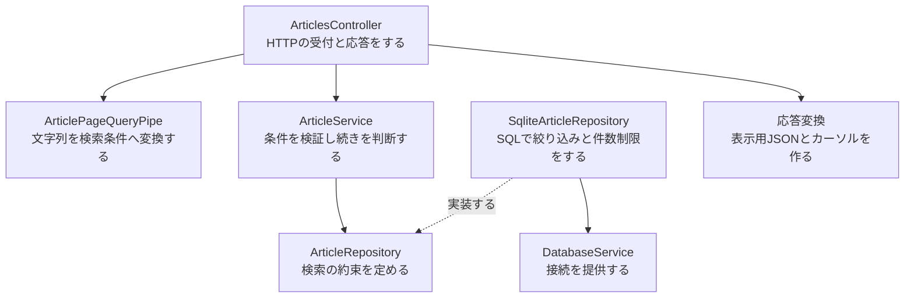
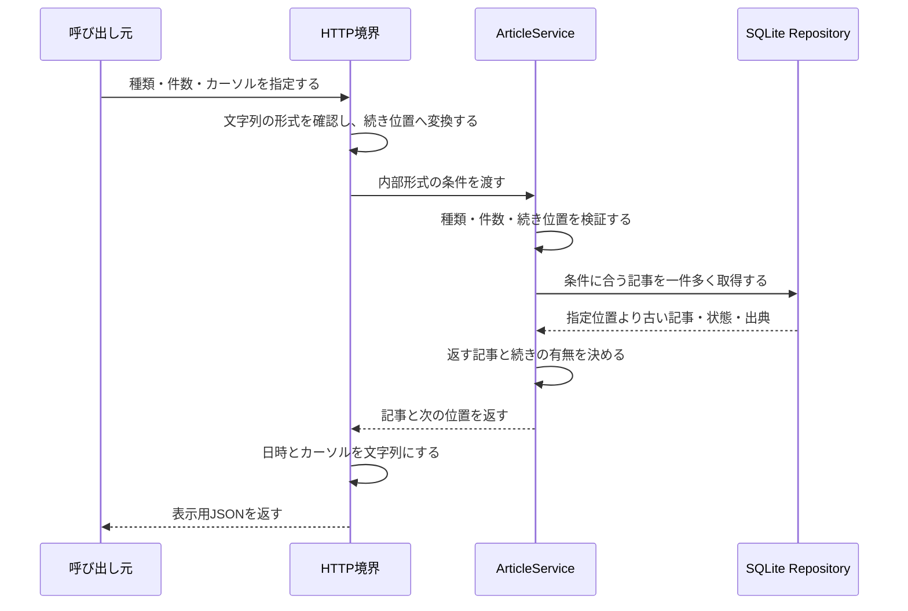

# Issue #7：全記事・気になる一覧API

[READMEに戻る](../README.md) · [データ方針](data-policy.md) · [保存基盤の構成](storage-architecture.md)

DBに保持中の記事を一ページずつ取得する。[一覧画面](article-list-ui.md)と[状態変更API](article-state-api.md)は別Issueで追加した。外部サイトの収集は後続Issueで扱う。

## 呼び出し方

```http
GET /api/articles
GET /api/articles?kind=interested
GET /api/articles?kind=all&limit=20&cursor=返されたnextCursor
```

| パラメータ | 省略時 | 受け付ける値 |
|---|---|---|
| kind | all | all：全記事、interested：気になる登録済み |
| limit | 20 | 1〜20の整数。通常の一覧は20件で取得する |
| cursor | 先頭 | 前の応答のnextCursorをそのまま渡す |

同じパラメータの複数指定、未知のパラメータ、空文字、不正な件数やカーソルは400になる。offsetやページ番号は使わない。

カーソルには一覧の種類・最後に返した取得日時・記事IDを含め、base64urlで表す。形式の上限は512文字。allのカーソルをinterestedで使うことはできない。画面は内容を組み立てず、返された文字列を再利用する。暗号化・署名ではなく、秘密情報や認証には使わない。

## 応答

以下は架空の記事一件を返す例。

```json
{
  "articles": [
    {
      "articleId": 1,
      "url": "https://example.com/article",
      "title": "記事のタイトル",
      "description": null,
      "author": null,
      "fetchedAt": "2026-10-01T00:00:00.000Z",
      "publishedAt": null,
      "sourceUpdatedAt": null,
      "source": {
        "sourceId": "zenn",
        "siteName": "Zenn",
        "iconUrl": null
      },
      "state": {
        "interested": false,
        "pinned": false,
        "lastOpenedAt": null
      }
    }
  ],
  "nextCursor": null,
  "hasMore": false
}
```

stateは対応する記事の中に入れ、記事IDとの対応を保つ。日時はISO文字列、欠損する任意項目はnullで返す。DBの照合列・外部記事ID・取得先endpoint・収集設定は返さない。

続きがあればhasMoreがtrue、nextCursorが文字列になる。終端や空一覧ではhasMoreがfalse、nextCursorがnullになる。空一覧も200で返す。利用者の状態を含むのでCache-Controlはno-storeにする。

## 並び順と途中変更

- 最初の取得日時の降順、同時刻は記事IDの降順にする。
- Serviceは指定件数より一件多く取得し、続きの有無を決める。カーソルは余分な一件ではなく、最後に返す記事を指す。
- 次のページは「取得日時が古い、または同時刻でIDが小さい」記事を検索する。
- カーソルが指す記事が削除されても、日時とIDの値で続きを取得できる。
- 先頭に増えた新着は、続きの取得に混ぜず、先頭からの再取得で表示する。
- 各ページは取得時点のDBを参照する。途中の削除や気になる変更を含む全件スナップショットは保持しない。
- 全記事には既読・未読・気になる・ピンの全状態を含む。取得先を無効にしても、保存済みの記事は表示対象になる。

## 依存関係

矢印はコードが参照する向き。点線は抽象の実装を示す。



HTTPの形式とJSONへの変換はcontrollers内に置く。ServiceはHTTP・カーソル文字列・SQLを知らず、Dateと数値の続き位置を扱う。SQLite実装は条件をSQLへ変換し、記事・状態・表示用の取得元を一つの検索で取得する。全件取得後の切り出しや記事ごとの追加検索は行わない。

機能内のフォルダ名を役割に揃えるため、ControllerとHTTPの補助処理はcontrollersにまとめる。記事のServiceはservices、Repositoryの抽象とSQLite実装はrepositoriesに置く。articles.controller.tsのファイル名にhttpは付けず、所属するフォルダで役割を表す。

## 実行する順番



入力の不正は400、DBなどの予期しない失敗は500になる。DBエラーの詳細を応答に含めない。一覧取得でDBへの書き込みや状態変更は行わない。

## 確認するファイル

- [内部の一覧データ](../apps/api/src/articles/models/article-page.ts)：種類・件数・続き位置を表す。
- [Service](../apps/api/src/articles/services/article.service.ts)：getPageで条件と続きの判断をする。
- [Repositoryの約束](../apps/api/src/articles/repositories/article.repository.ts)：findPageで種類・位置・件数を指定する。
- [SQLite実装](../apps/api/src/articles/repositories/sqlite-article.repository.ts)：WHERE・ORDER BY・LIMITを使う。
- [HTTP Controller](../apps/api/src/articles/controllers/articles.controller.ts)：受付と入力エラーのHTTP変換をする。
- [Query Pipe](../apps/api/src/articles/controllers/pipes/article-page-query.pipe.ts)：HTTPパラメータを変換する。
- [カーソル](../apps/api/src/articles/controllers/formatters/article-cursor.formatter.ts)：位置を文字列へ変換し、復元する。
- [応答変換](../apps/api/src/articles/controllers/formatters/article-page.formatter.ts)：表示に必要な値だけを返す。
- [API共有型](../packages/contracts/src/articles.ts)：ブラウザと共有するJSONの型を定める。

## 動作確認

開発用DBにサンプルを入れてNestを起動する。

```sh
npm run db:seed -w @it-discovery/api
npm run dev
```

http://127.0.0.1:3000/api/articles を開く。サンプルは全て気になる未登録なので、初期状態の http://127.0.0.1:3000/api/articles?kind=interested は空一覧になる。現在のVue画面は接続確認用のまま。

```sh
npm run typecheck
npm run test
npm run build
```

Serviceの判断、SQLiteの複数ページ・同時刻・途中削除・新着・取得先との対応、実際のNestに対するHTTP入力とJSON応答をテストする。
