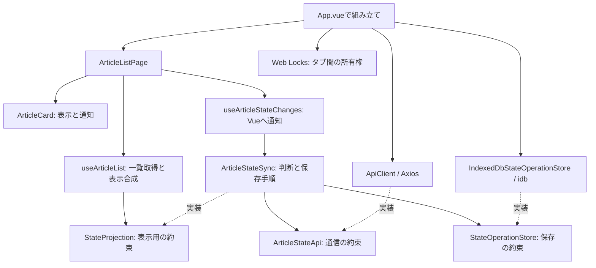
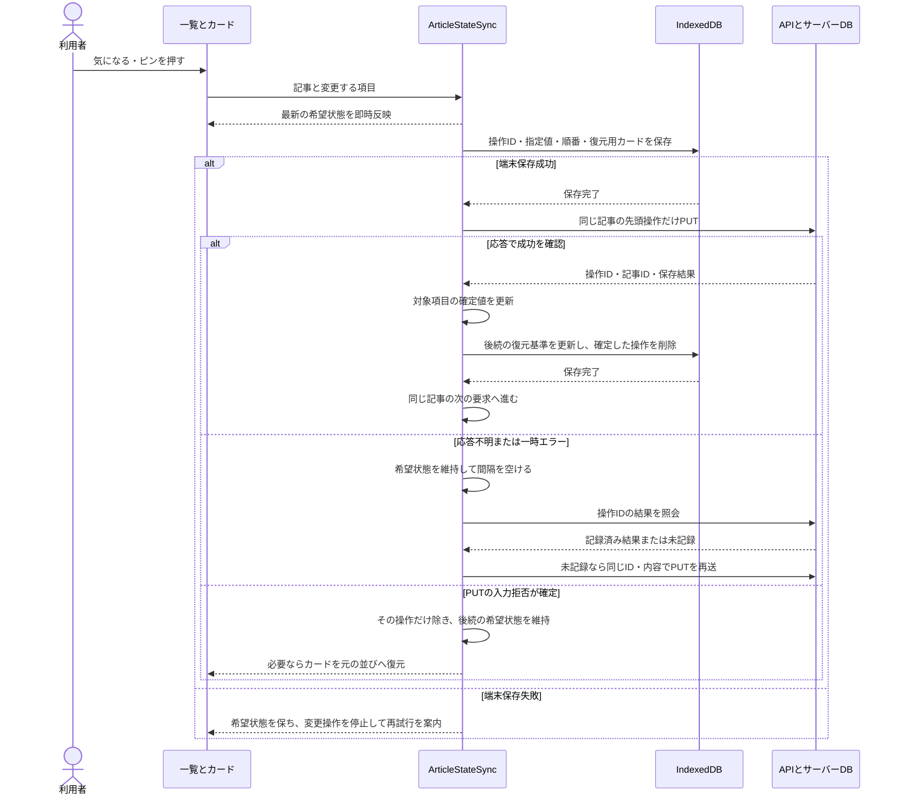

# 一覧の気になる・ピン操作（Issue #11）

[README](../README.md) · [一覧画面](article-list-ui.md) · [状態変更API](article-state-api.md) · [操作方針](operation-policy.md)

全記事・気になる一覧から登録・解除とピン操作を行う。画面は即時変更し、端末への保存が完了してからサーバーへ送る。同じ記事では気になる・ピンをまとめて順番を守り、別の記事は独立して進める。元記事を開く操作と既読の接続はIssue #12、仕分けは後続Issueとする。

## コードを読む順序

1. [ArticleCard.vue](../apps/web/src/components/ArticleCard.vue)：表示とイベント通知。カード内の値を直接変更しない。
2. [ArticleListPage.vue](../apps/web/src/features/list/components/ArticleListPage.vue)：イベント受付、起動待機、保存状況と再試行の表示。
3. [useArticleStateChanges.ts](../apps/web/src/features/article-state/controllers/useArticleStateChanges.ts)：送信管理の通知をVueのref・computedへつなぐ。NestのHTTP Controllerではない。
4. [ArticleStateSync](../apps/web/src/features/article-state/services/article-state-sync.ts)：即時反映、端末保存の順序、記事ごとの送信順、再送と確定値を管理する。
5. [useArticleList.ts](../apps/web/src/features/list/controllers/useArticleList.ts)：取得結果と希望状態を合成し、気になる一覧の表示対象と順番を求める。
6. [StateOperationStoreの実装](../apps/web/src/features/article-state/repositories/indexeddb-state-operation.store.ts)：idbでブラウザ内へ保存する。
7. [ApiClient](../apps/web/src/infrastructure/api/api-client.ts)：AxiosのPUT・結果照会、受信JSONの確認とエラー分類。
8. [App.vue](../apps/web/src/app/App.vue)：通信・端末保存・タブの所有権を組み合わせて画面へ渡す。

`models/state-sync.ts`は型と失敗の意味を定義する。Serviceは通信・保存の約束に依存し、AxiosやIndexedDBを直接操作しない。Vue固有の構文、Set・map、非同期の順序と再送する理由は使用箇所に日本語コメントを置いた。

## コードの依存関係

これは参照先の図。次の図は実際に動く順番を表す。

## 操作から保存まで

一覧更新では取得を始めた時点の番号を記録する。その後に変更された項目は、遅い一覧応答で戻さない。未確定の変更は必ず表示へ重ねる。気になる解除で消したカードは保持し、拒否時に取得日時・IDの降順で対象カードだけ復元する。表示中のカードを全て解除しても、続きがあれば追加取得のボタンを残す。

## 失敗と再起動

| 場面 | 動作 |
|---|---|
| オフライン・タイムアウト・500など | 希望状態と端末記録を維持。1・2・4・8・16・30秒、以降30秒間隔で照会・再送する |
| ブラウザがオフラインを通知 | 再送タイマーを止め、online通知で再開する |
| 結果照会の404 | 未記録として同じ要求を再送する。失敗確定とはしない |
| PUTの400 | 拒否された操作だけ戻す。後続の操作は維持する |
| 認証・権限・409など | 自動再送を止め、再試行または要確認の変更の明示的な破棄を案内する |
| 削除済み記事 | 通知し、端末記録を解消する。記事を再作成しない |
| 端末への追加・削除・後続情報の更新に失敗 | 操作を停止して再試行する。確定済み操作の端末削除が終わるまでは後続を送らない |
| アプリを閉じる | 通信を中止し、保存済みの未送信記録を維持する |
| 再起動 | 操作IDを照会してから再送し、残った一覧変更の解消後に一覧を取得する |

端末保存前に閉じた場合は、直前の未保存操作が失われる場合がある。保存失敗時にはその点を画面へ表示する。ブラウザの保存領域の削除・強制消去まで防ぐ保証ではない。

一つのタブがWeb Locksの所有権を持つ間、別タブはキューの読み書きと通常操作を待機する。別タブを閉じた後は「再試行」で取得できる。Web Locks未対応なら、二重送信し得る代替方式へ切り替えず、起動を止めて案内する。IndexedDBとロックの名前にはAPIの接続先を含める。

仕分け・既読も含めた共通の起動処理や日次判定はIssue #16で統合する。今回の起動待機は実装済みの一覧変更のキューが対象。Piniaはまだ追加せず、この機能の状態はServiceとComposableにまとめている。

## 確認結果

- 全体の型チェック・テスト・ビルドが成功。Markdown22ファイルのリンクとコードフェンスも確認した。
- web54件、API193件、計247件。入力・応答形式、実IndexedDB相当の保存・再接続、即時反映、同一記事の直列化、他記事の独立、再送、復元基準、終了後の遅い応答、失敗したカードの復元を確認する。
- 端末保存のテストにはfake-indexeddbを使う。実ブラウザのIndexedDBでも再読み込みと復旧を確認した。
- 390px幅のブラウザで、遅い通信での即時反映、ピンと気になるの保存、気になる一覧への反映、PUT拒否時の復元、503中の再読み込みと通常操作待機、復旧後の再開、別タブの待機を確認した。確認用の一時SQLiteと別ポートを使用した。
- 実機iPhoneの操作は未確認。元記事を開く・既読保存は今回追加しない。

## 使用したAPIの資料

- [idb公式README](https://github.com/jakearchibald/idb)：PromiseでのIndexedDB操作とトランザクション完了。
- [Web Locks API](https://developer.mozilla.org/en-US/docs/Web/API/Web_Locks_API)：同じオリジンのタブ間で処理を一つにする仕組み。
