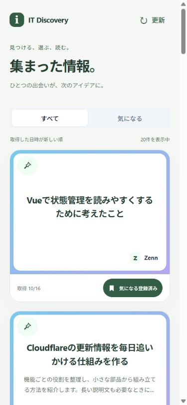

# 一覧の気になる・ピン操作（Issue #11）

[README](../README.md) · [一覧画面](article-list-ui.md) · [状態変更API](article-state-api.md) · [操作方針](operation-policy.md)

全記事・気になる一覧から登録・解除とピン操作を行う。画面は即時変更し、端末への保存が完了してからサーバーへ送る。同じ記事では気になる・ピンをまとめて順番を守り、別の記事は独立して進める。元記事を開く操作と既読の接続はIssue #12、仕分けは後続Issueとする。

## コードを読む順序

[MVVM＋Atomic Designの構成図と読む順序](frontend-architecture.md)で一覧・起動・ピン操作を別々に追える。

1. [Page](../apps/web/src/features/list/views/pages/ArticleListPage.vue)がイベントをVMへ渡す。
2. [VM](../apps/web/src/features/list/view-models/useArticleListViewModel.ts)はModelへ依頼し、表示値を公開する。API・Store・同期起動を扱わない。
3. [一覧Model](../apps/web/src/features/list/models/article-list.model.ts)が一覧取得・補完・絞り込み・並べ替えを担当する。
4. [記事データStore](../apps/web/src/features/articles/models/article-data.store.ts)が確定した記事と記事状態を持つ。
5. [同期Model](../apps/web/src/features/article-changes/models/article-change-sync.model.ts)が変更値を決定し、端末保存・送信・再送を進める。
6. [同期Store](../apps/web/src/features/article-changes/models/article-change.store.ts)が未完了操作と同期状況を持ち、確定記事へ希望値を重ねる。
7. [起動Model](../apps/web/src/features/startup/models/application-startup.model.ts)が端末の未完了変更を解消してから初回一覧を開始する。
8. [組み立て](../apps/web/src/app/create-application-models.ts)がAPI・Store・端末保存の実体をModelへ渡す。

未完了の操作は送信失敗だけでなく、送信前・送信中・結果不明・再試行待ち・成功後の端末削除待ちも含む。記事の既読・ピン・気になると、同期状況のstartupSyncComplete・onlineは別Storeに分ける。端末のDB名・データ形式は変更しない。

## 失敗と再起動

| 場面 | 動作 |
|---|---|
| オフライン・タイムアウト・500など | 希望状態と端末記録を維持。1・2・4・8・16・30秒、以降30秒間隔で照会・再送する |
| ブラウザがオフラインを通知 | 再送タイマーを止め、online通知で再開する |
| 結果照会の404 | 未記録として同じ要求を再送する。失敗確定とはしない |
| PUTの400 | 拒否された操作だけ戻す。後続の操作は維持する |
| 認証・権限・409など | 自動再送を止め、再試行または要確認の変更の明示的な破棄を案内する |
| 削除済み記事 | 通知し、端末記録を解消する。記事を再作成しない |
| 端末への追加・削除・後続情報の更新に失敗 | 操作を停止して再試行する。確定済み操作の端末削除が終わるまでは後続を送らない |
| アプリを閉じる | 通信を中止し、保存済みの未送信記録を維持する |
| 再起動 | 操作IDを照会してから再送し、残った一覧変更の解消後に一覧を取得する |

端末保存前に閉じた場合は、直前の未保存操作が失われる場合がある。保存失敗時にはその点を画面へ表示する。ブラウザの保存領域の削除・強制消去まで防ぐ保証ではない。

一つのタブがWeb Locksの所有権を持つ間、別タブはキューの読み書きと通常操作を待機する。別タブを閉じた後は「再試行」で取得できる。Web Locks未対応なら、二重送信し得る代替方式へ切り替えず、起動を止めて案内する。IndexedDBとロックの名前にはAPIの接続先を含める。

仕分け・既読も含めた共通の起動処理や日次判定はIssue #16で統合する。今回の起動待機は実装済みの一覧変更のキューが対象。Pinia 4.1.0を追加し、確定した記事は記事データStore、一覧固有の状態は一覧Model、未完了変更と同期状況は同期Storeに分けた。VMはModelの窓口を使い、共有同期Modelは一覧画面を閉じても停止しない。

## 確認結果

- 全体の型チェック・テスト・ビルドが成功。Markdownのローカルリンクとコードフェンスも確認した。
- 責務分離後のweb71件・API193件、計264件が成功。全体の型チェックとビルドも成功。入力・応答形式、実IndexedDB相当の保存・再接続、即時反映、同一記事の直列化、他記事の独立、再送、復元基準、終了後の遅い応答、失敗したカードの復元を確認する。
- 端末保存のテストにはfake-indexeddbを使う。実ブラウザのIndexedDBでも再読み込みと復旧を確認した。
- 390px幅のブラウザで、遅い通信での即時反映、ピンと気になるの保存、気になる一覧への反映、PUT拒否時の復元、503中の再読み込みと通常操作待機、復旧後の再開、別タブの待機を確認した。確認用の一時SQLiteと別ポートを使用した。
- 実機iPhoneの操作は未確認。元記事を開く・既読保存は今回追加しない。

## 使用したAPIの資料

- [idb公式README](https://github.com/jakearchibald/idb)：PromiseでのIndexedDB操作とトランザクション完了。
- [Web Locks API](https://developer.mozilla.org/en-US/docs/Web/API/Web_Locks_API)：同じオリジンのタブ間で処理を一つにする仕組み。
