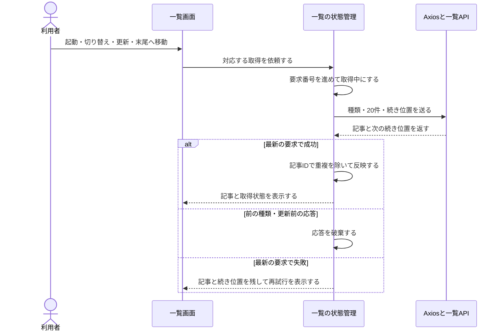

# 記事一覧画面の構成

[README](../README.md) · [一覧API](article-list-api.md) · [画面構成](ui-reference.md)

Issue #10で、全記事・気になる一覧をAPIに接続した。初回は20件を取得し、末尾に近づくと続きを追加する。更新はDBの最新一覧を先頭から取り直す。外部情報源の収集は開始しない。

## コードの依存関係

Issue #11で構成をMVVM＋Atomic Designへ整理した。現在のフォルダ・部品の依存関係・状態の持ち主は[フロントの構成図](frontend-architecture.md)を参照する。

- features/list/viewsは表示とイベント通知を行う。
- features/list/view-modelsは取得条件・続き位置・表示用データ・操作窓口を持つ。
- features/article-state/modelsは共有記事状態と保存・送信の手順を持つ。
- infrastructureはAxios・IndexedDBなどの具体的な外部接続を実装する。
- PrimeVueをAtomsとして使い、Molecules・Organisms・Templates・Pagesは必要なものだけ作る。

## 実行順序

切り替え時は前の通信を中止し、要求番号でも古い応答を排除する。追加取得は取得中・終端・失敗中には自動実行しない。再試行は失敗時の種類と続き位置を使う。更新成功時だけ先頭ページで置き換える。

## 表示と操作

- スマホは1列、幅800px以上は2列。
- 白いサムネイル領域内に中央揃えのタイトル・小さい概要・出典を置く。初期表示はタイトル4行・概要2行まで。省略があるカードだけ「続きを表示」で全文を表示する。内部の詳細画面は追加しない。
- 出典アイコンがない・読み込めない場合はサイト名の先頭文字を表示する。説明や公開日がなければ、その項目を表示しない。
- 取得日・公開日はサムネイルの下に置く。Issue #11で気になる・ピン操作を接続した。既読は表示だけする。
- 画面先頭で下に引いて離すと更新する。上部の更新ボタンでも同じ操作ができる。
- 末尾の自動取得に加え、「続きを読み込む」ボタンからも取得できる。

Issue #10の範囲は表示と取得。Issue #11で追加した[気になる・ピンの変更と端末保存](article-list-state.md)は別資料で説明する。元記事を開く操作と既読保存、仕分け、収集は後続Issueで接続する。

## 確認結果

一覧状態・通信形式・引く操作を含むフロント20テスト、API67テスト、型チェックとビルドを実施した。

一時DBの架空記事45件を使い、ブラウザで20→40→45件の追加、終端、気になるの空表示、API停止時の記事保持、再起動後の再試行、長文の展開を確認した。320・390・430px幅で横にはみ出さないことを確認した。下に引く操作は判定ロジックのテストを実施しており、実機iPhoneでの操作確認は未実施。

再現には[起動手順](development.md)と[サンプル投入](database.md)を使う。標準サンプルは5件なので、追加取得の確認には21件以上の確認用データが必要。スクリーンショット用の45件は自動投入しない。
