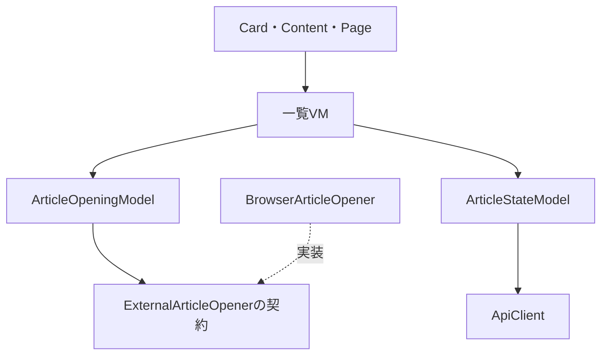
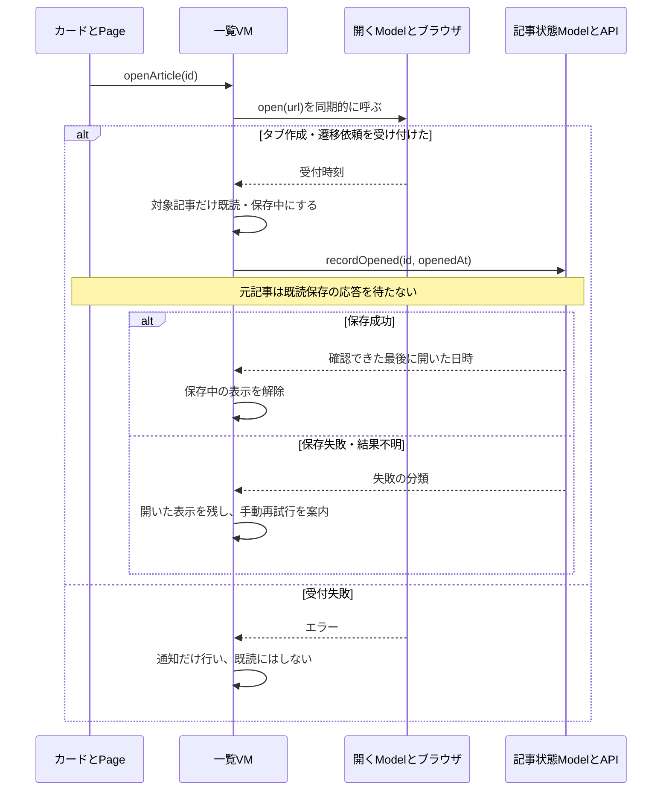

# 元記事を開く・既読の保存（Issue #12）

[README](../README.md) · [フロントの構成](frontend-architecture.md) · [状態API](article-state-api.md) · [操作方針](operation-policy.md)

一覧カードのタイトル・サムネ領域を押すと別タブで元記事を開く。タイトルリンクはキーボードのEnterでも操作できる。ピン・気になる・文章展開のボタンは記事を開く操作と分離する。

## 成功条件と検知限界

ArticleOpeningModelが絶対URLのhttp(s)だけを受け付け、BrowserArticleOpenerがクリックと同じ同期処理内で空タブを作る。openerをnullへ変更できたことを確認してからlocation.replaceへ元記事のURLを渡す。作成拒否・不正URL・参照切断失敗・遷移依頼の例外は受付失敗として通知し、既読にしない。途中で作った空タブは可能なら閉じる。

既読の基準はタブ作成と遷移依頼の受付で、外部サイトの正常表示や読了ではない。外部の404・通信エラー・認証画面は検知しない。ブラウザ標準メニューの「新しいタブで開く」など、アプリのクリック処理を通らない操作も既読の対象外。

## 依存関係

ブラウザ操作はinfrastructure/browserに閉じ込め、ModelはURLの検証と受付時刻を扱う。組み立てはapp/create-application-models.ts。Modelは表示状態を持たず、同じ開く処理と記事状態Modelを将来の仕分けVMからも使える。[仕分け画面](sorting-ui.md)でも同じModelを使用する。

## 実行順序

## 状態と失敗時の扱い

- VMのarticlesに画面上の既読を反映し、readStatusで保存中・保存失敗・結果不明を区別する。表示は「既読・保存中」「既読・保存未確認」、成功後は「既読」。ピン・気になるは変更しない。
- 保存失敗でも実際に開いた事実は取り消さない。カード下に理由と「既読を保存し直す」を表示する。404でも外部記事を開いた一覧位置を守るため、その場ではカードを除かない。
- 再試行は利用者が押した場合だけ、元の受付時刻で送る。保存中の再試行は無視する。自動再送・永続キュー・再起動時の再送は行わない。
- 再び記事を開いた場合は新しい受付時刻を送る。前の通信を中止し、遅い結果は表示へ反映しない。サーバーも古い日時で既読を巻き戻さない。
- locallyOpenedは画面内だけのIDと受付時刻のMap。古い一覧・ピン保存応答が画面上の既読を戻さないよう重ねる。既読の保存応答からピン・気になるを上書きしない。
- 同じ一覧のVue画面を残したまま別タブを開く。スクロール・フィルター・取得済み記事・カードの展開状態を初期化しない。戻った際の強制再取得・先頭移動は行わない。
- ページ終了では既読通信も中止する。HTTPの中止はDB更新の取り消しを保証しない。画面を破棄すると手元の既読・再試行情報は消え、次回はサーバー状態から取得する。

## コードを読む順序

1. [ArticleCard.vue](../apps/web/src/components/organisms/ArticleCard.vue)のリンク → Contentのopenイベント → Pageの@open。
2. [一覧VM](../apps/web/src/features/list/view-models/useArticleListViewModel.ts)のopenArticle。opening.openの前にはawaitを置かない。
3. [ArticleOpeningModel](../apps/web/src/features/articles/models/article-opening.model.ts) → [BrowserArticleOpener](../apps/web/src/infrastructure/browser/external-article-opener.ts)で受付判定。
4. VMが受付時刻を表示へ反映し、ArticleStateModel.recordOpenedを呼ぶ。finishReadSaveは結果を保存表示へ反映する。
5. retryReadSaveはタブを開き直さず、保存だけを再試行する。

## 確認範囲

Modelとブラウザ操作の代替によるテストで不正URL・作成拒否・参照切断・例外・時刻を確認。VMのテストで移動と保存の順序、登録値を変えないこと、失敗後の手動再試行、同時保存、遅い応答・終了を確認する。SSRでリンクと既読保存の表示を確認する。

仕分けでも同じカードを既読表示にし、保存を待たず外部へ移動する。カードの位置・判断履歴は変更せず、「次へ」で進める。

実ブラウザのポップアップ設定・外部復帰時のスクロール・iPhone/Safariの操作確認は未実施。代替ブラウザ操作によるテストは、この実機確認を代わりに保証するものではない。
