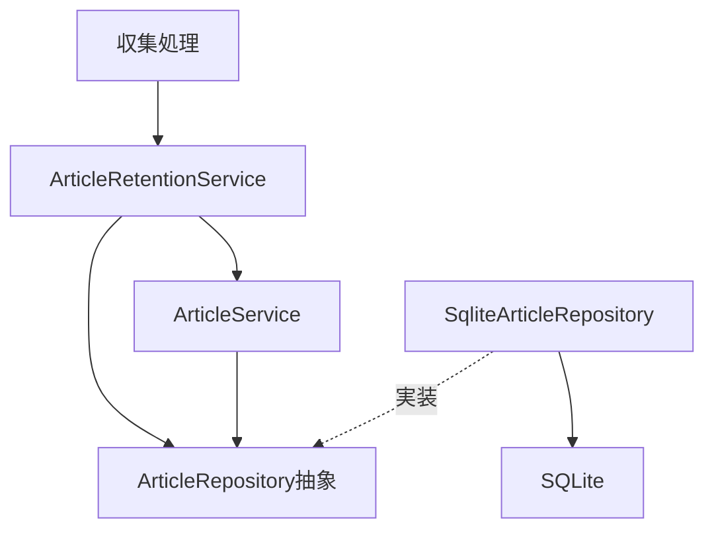
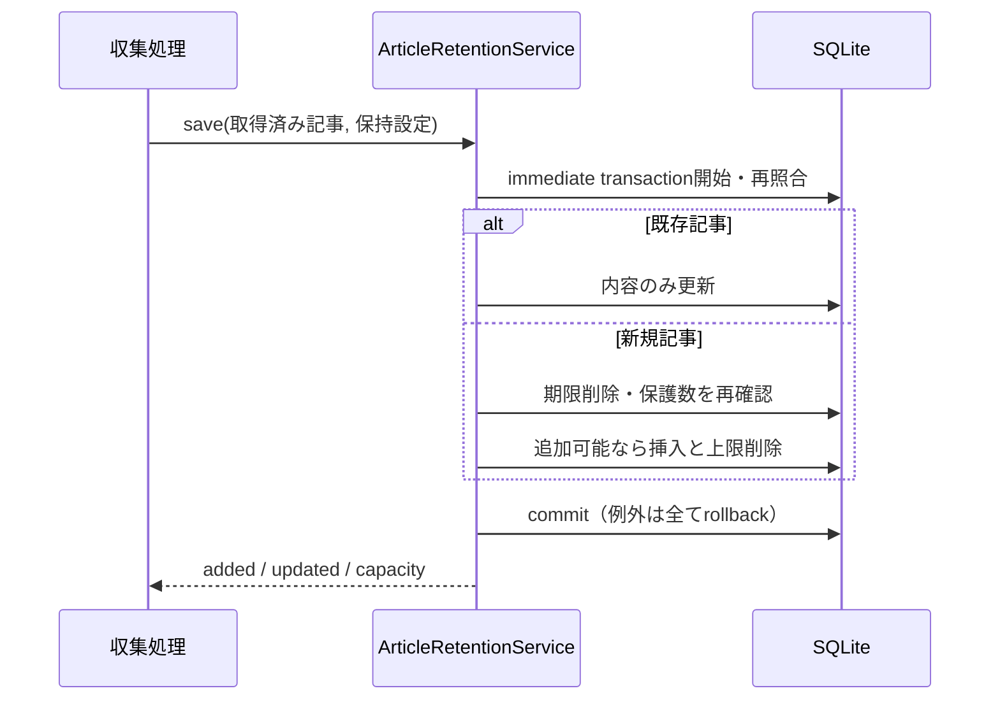

# 記事の保持と追加

ArticleRetentionServiceが期限・上限・追加可否を判断し、ArticleRepository抽象へ検索・削除を頼む。SQLはSQLite実装へ置く。既存の記事登録・状態APIは同じRepositoryとDBを使い、保護と削除が同時に書き込まれないようimmediate transactionで直列化する。

収集の冒頭でsweepを呼ぶ。期限は取得日時が現在時刻−保持日数より**前**の未読・未保護記事だけに適用し、境界時刻ちょうどは残す。既読は経過日数では削除しない。上限超過時は未保護の未読を取得日時・記事ID昇順、その後に既読を最終閲覧日時・記事ID昇順で削除する。気になる・ピンは両方の削除対象外。

新規一件の保存では、再照合・期限削除・保護数の再確認・挿入・上限削除を一つの同期transactionに含める。保護数が上限以上なら新規を追加しない。保護だけで上限を超過しても保護記事を消さない。判定を毎回やり直すので保護解除や空きができれば再開する。既存記事の内容更新は追加停止中も行う。新規追加の直前にAPI通信を行わず、通信済みのArticleInputを受け取る。

記事の削除でarticle_statesも外部キーのCASCADEにより削除する。削除SQLでも保護条件を再確認する。削除候補は500件ずつ処理し、SQLiteのbind変数制限を避ける。記事の一括登録結果は既存仕様どおり記事削除後も残す。端末の仕分け仮選択はサーバーの保護条件に含めない。

`article-retention.service.spec.ts`で期限境界、三種類の保護、未読優先と同順位、保護超過、停止と再開、状態の連動削除、挿入・上限削除失敗時のrollbackを確認する。
