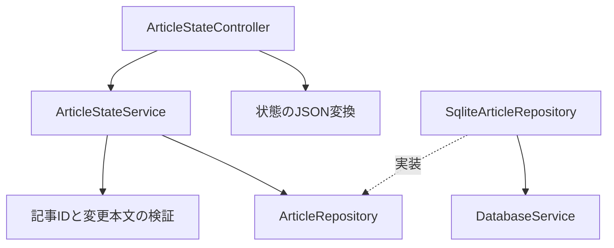
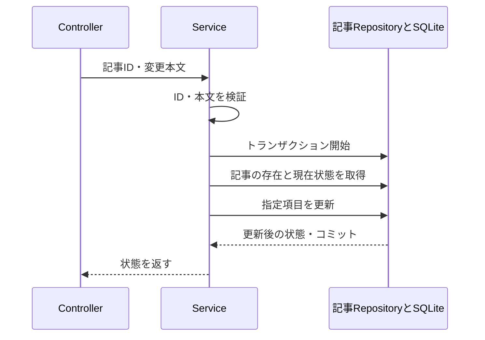

# 記事状態の直接保存API

[README](../README.md) · [操作方針](operation-policy.md) · [一覧API](article-list-api.md) · [仕分けAPI](sorting-api.md)

2026-10-20の方針変更：ピン・気になる・既読は永続キューによる再送を行わず、指定した状態を直接保存する。仕分けのbatchId・revision・結果記録は変更しない。

## APIと本文

| API | 内容 |
|---|---|
| GET /api/articles/:articleId/state | 記事の現在状態を取得 |
| PUT /api/articles/:articleId/state | 指定した一項目を保存して状態を返す |

PUTの本文は次のいずれか。operationId・余分なフィールドは受け付けない。

```json
{ "change": { "kind": "pinned", "value": true } }
```

```json
{ "change": { "kind": "interested", "value": false } }
```

```json
{ "change": { "kind": "opened", "openedAt": "2026-10-20T05:00:00.000Z" } }
```

booleanの文字列変換は行わない。openedAtはミリ秒3桁・Z付きの正規UTC日時に限定し、不正日付・null・未読へ戻す操作を拒否する。既読日時は現在より新しい場合だけ更新し、ピンや気になるは指定値を保存する。反転命令は用意しない。

GET・PUT成功時はHTTP 200とCache-Control: no-storeで同じ形式を返す。

```json
{
  "articleId": 42,
  "state": {
    "interested": false,
    "pinned": true,
    "lastOpenedAt": null
  }
}
```

| HTTP | 内容 |
|---|---|
| 400 / INVALID_STATE_INPUT | 本文、記事IDの形式が不正 |
| 404 / ARTICLE_NOT_FOUND | 記事が存在しない。再作成しない |
| 500 | DB等の予期しない障害。内部SQL・パスを公開しない |

壊れたJSONはNest標準の400。GET /api/article-state-operations/:operationIdは削除した。操作IDを返す応答、missingの成功応答、OPERATION_CONFLICTも廃止する。

## 責務と依存



## 保存の実行順序



記事がない場合は更新せずControllerが404を返す。既読日時が古い・同じ場合は現在状態を返す。DB更新失敗はロールバックし500とする。状態Serviceから操作記録Repositoryへの依存はなくした。

## 既存DBと移行範囲

旧article_state_operations表と過去のマイグレーションは保持する。新APIはその表を読み書きしない。既存の記事・状態・操作記録を削除する移行は行わない。仕分け用article_interest_batchesは継続利用する。

この変更はバックエンドのみ。旧フロントはoperationId付き要求・旧応答・照会APIを前提としており、新APIと実行時互換ではない。後続のフロント修正で端末キュー・復元・再送・照会を外し、通信中の操作制限と処理中表示へ変更する。それまではバック変更を分離ブランチに保ち、現行UIと組み合わせて配布しない。

共有型にはArticleStateUpdateRequestを追加し、応答は既存のArticleStateResponseを使う。旧フロントの型チェックを壊さないため旧MutationRequest・OperationResponse型だけdeprecatedとして残す。互換APIは追加しない。

タイムアウトは保存失敗の証明ではない。結果不明時は現在状態のGETで確認できるが、その取得も失敗する可能性がある。古い変更を後から自動再送しない。ピン・気になるの通信中は関連する変更の重複操作をフロントで制限する。

## 確認

Service・実SQLite・HTTPで、項目別更新、旧操作表への非依存、不正入力、記事なし、DB障害、既読日時の単調更新を確認する。仕分けの「登録→一覧で解除→古いbatchIdの再送」で解除が維持される既存テストも新本文で実行する。

検証結果：全workspaceの型チェック・ビルド成功。API189件・web71件、計260件のテストが成功。webのテスト成功は新APIとの実通信互換を意味しない。フロントのAPI接続変更は未実施。
