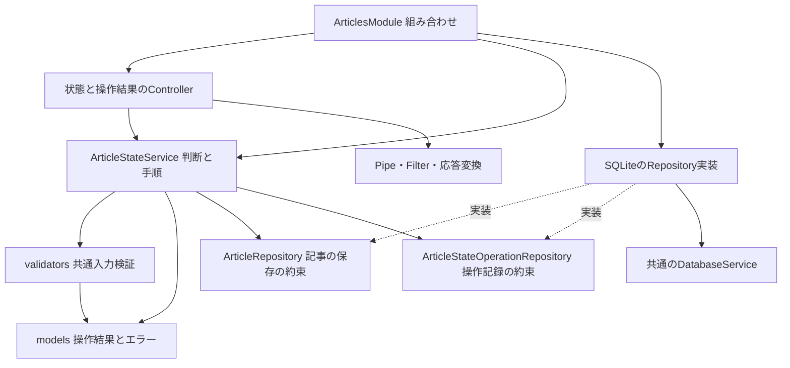
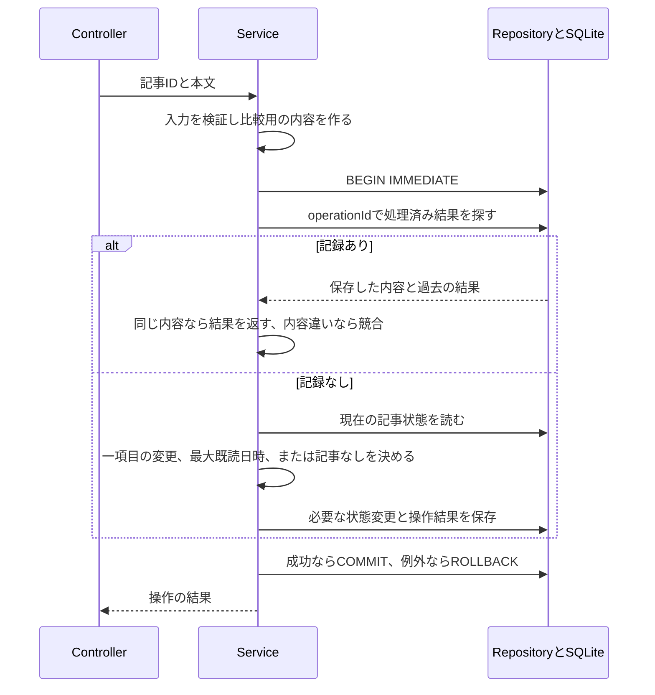

# Issue #8：記事状態の変更・確認API

[README](../README.md) · [操作方針](operation-policy.md) · [一覧API](article-list-api.md) · [DB手順](database.md)

気になる・ピンは明示した値に変更し、既読は開いた日時を記録する。同じ要求の再送で、後から行った別の操作を巻き戻さない。今回はAPIと保存処理の実装であり、一覧の操作ボタン・端末保存・外部サイトを開く処理は後続Issueで接続する。

## APIの呼び出し方

| メソッド・パス | 用途 |
|---|---|
| `GET /api/articles/:articleId/state` | 現在の確定状態 |
| `PUT /api/articles/:articleId/state` | 一項目を変更し、その操作の結果を保存 |
| `GET /api/article-state-operations/:operationId` | 応答不明になった操作の処理結果 |

すべての正常な応答は`Cache-Control: no-store`。記事IDは先頭ゼロなしの正の安全な整数。operationIdはUUID v4で、大文字・小文字は同じIDとして小文字に統一する。

PUTの本文は次のいずれか。operationIdは**操作ごとに新しく作り、同じ要求の再送では変えない**。

```json
{
  "operationId": "b087306a-9cf4-4cb4-81ee-882bad772985",
  "change": { "kind": "interested", "value": true }
}
```

`change`の種類：

| kind | 必要な値 | 意味 |
|---|---|---|
| interested | value：boolean | 気になる登録・解除 |
| pinned | value：boolean | ピン止め・解除 |
| opened | openedAt：UTCのISO文字列 | 開いた日時を記録 |

openedAtは`2026-10-16T12:00:00.000Z`のようにミリ秒3桁・Z付きとする。日付だけ・オフセット表記・不正日付・nullは拒否する。手動で未読へ戻す操作は設けない。文字列の`"true"`をbooleanへ自動変換せず、余分な項目や複数項目の同時変更も拒否する。

## 応答とエラー

変更成功と操作結果の照会は同じ形を返す。

```json
{
  "operationId": "b087306a-9cf4-4cb4-81ee-882bad772985",
  "articleId": 1,
  "status": "saved",
  "state": { "interested": true, "pinned": false, "lastOpenedAt": null }
}
```

記事が保持されていなければ、PUTはHTTP 200で`status: "missing", state: null`という**確定した処理結果**を返して記録する。再送しても同じ結果になり、記事を作り直さない。単一記事でも一括登録と同様に、処理結果を状態値で区別する方針。ここで未取得と削除済みの区別までは持たない。

現在状態のGETは`{ "articleId": 1, "state": { ... } }`を返す。操作結果は過去の保存時点の状態なので、現在状態のGETと値が異なる場合がある。照会や再送の古い結果で最新の表示を戻さない責任は、フロントの送信管理が持つ。

| HTTP | codeまたは結果 | 扱い |
|---|---|---|
| 200 | saved | 保存した状態、または同じ要求の過去の結果 |
| 200 | missing | 対象の記事なし。通知して未送信を解消できる |
| 400 | INVALID_STATE_INPUT | ID・本文・日時などが不正。自動再送で直らない |
| 409 | OPERATION_CONFLICT | 同じ操作IDで別の値・項目・記事を指定した。元の結果は変更しない |
| 404 | ARTICLE_NOT_FOUND | 現在状態のGETで記事なし |
| 404 | OPERATION_NOT_FOUND | 操作結果のGETで未記録。元の要求が失敗した証拠ではない |
| 500 | Nestの標準エラー | 予期しない保存失敗。内部SQLやDBパスは返さない |

壊れたJSONなど、Nestの本文解析で拒否された場合は標準の400となり、専用codeを持たない。

操作結果が未記録でも、先行要求が処理中の可能性がある。同じ操作ID・同じ内容を再送する。別の操作IDへ変えて再送しない。同じ記事の後続変更は、先行要求が確定してから送る（#11・#12・#16で実装）。サーバーは受信した保存処理をトランザクションで直列化するが、別IDの要求を利用者の操作時刻順へ並べ直す機能は持たない。

## コードの依存関係

矢印は参照する相手。実行順序は次の図で分けて示す。



- ControllerはHTTPの入口と応答変換を担当する。PipeはURLの記事IDを数値へ変換し、Filterはアプリの入力エラーだけを400・409へ変換する。
- Serviceはvalidatorsの共通検証を呼び、再送判定・変更項目・最大既読日時・保存手順を決める。HTTPやSQLiteのAPIは知らない。
- Repositoryは検索・保存・DB形式への変換を行う。抽象とSQLite実装を同じ`repositories`に置く。
- ModuleはServiceを公開し、Repositoryの具体実装を組み合わせる。二つのRepositoryに同じDatabaseServiceを渡すことが、保存単位の前提となる。

読む順序は[Service](../apps/api/src/articles/services/article-state.service.ts) → [ID検証](../apps/api/src/articles/validators/article-id.validator.ts)・[操作入力の検証](../apps/api/src/articles/validators/article-state-operation.validator.ts) → [型とエラー](../apps/api/src/articles/models/article-state-operation.ts) → [Controller](../apps/api/src/articles/controllers/article-state.controller.ts) → [操作記録のRepository](../apps/api/src/articles/repositories/sqlite-article-state-operation.repository.ts)。構文と処理の理由は各ファイルの日本語コメントにも記載した。

## 実行順序と保存単位



記事なしの場合も操作結果を記録する。操作記録は記事への外部キーを持たせず、記事削除後にも残す。初期仕様では自動期限削除を行わない。記事の保持上限10,000件の集計とは別の情報になる。

新しい`0001_article-state-operations.sql`は操作結果の表を追加する。既存記事・設定・状態を作り直さない。通常起動または`npm run db:migrate -w @it-discovery/api`で適用する。

## 確認結果

- Serviceの判断27件：項目別変更、再送、競合、最大既読日時、削除済み、不正入力。
- SQLite8件：遅れた登録の再送、状態維持、再接続、記事削除後の記録、保存前後の例外による全体ロールバック、旧DBからのマイグレーション。
- HTTP25件：3種類のAPI、同時の同一要求、結果照会、400・404・409・500、JSONの日時と内部情報を含めない応答。
- 既存分を含むAPI127件・web20件、合計147件が成功。全体の型チェック・ビルドも成功。ビルド済みNestと一時SQLiteでも、登録→解除→古い登録の再送、結果照会、現在状態と一覧の取得を確認した。

確認は一時DBを使用し、起動中の確認用アプリのDBへは変更を加えない。ブラウザの外部タブ受付の実装は#12の範囲。
