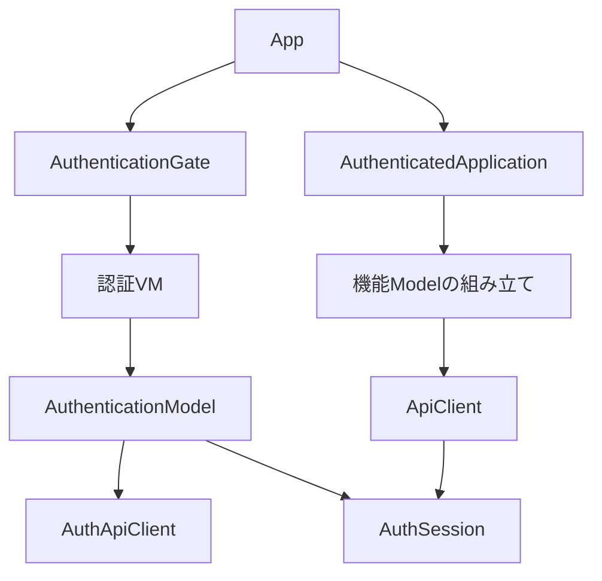
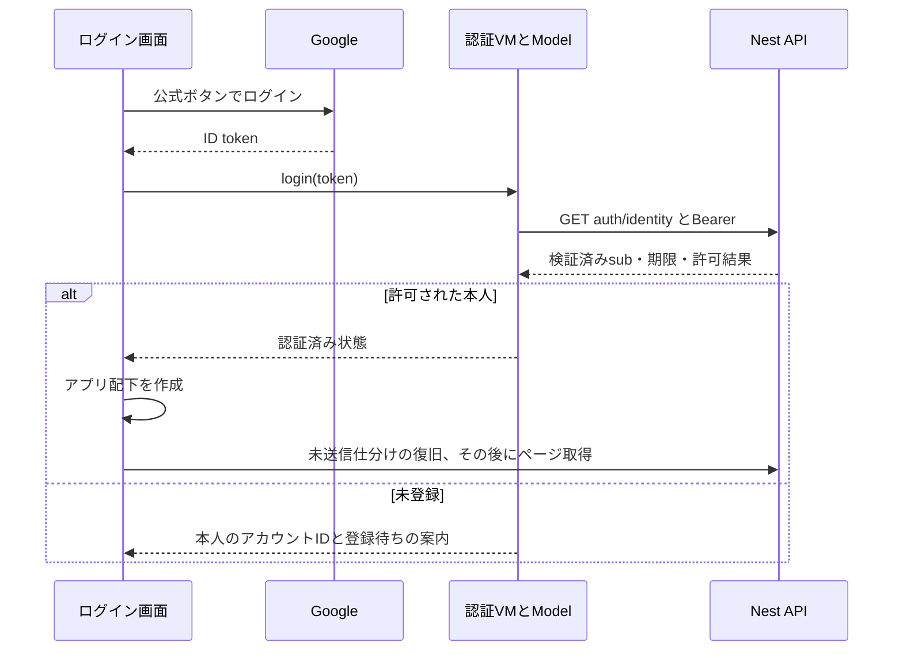

# Googleログインと登録済みユーザーの利用制限

画面はCloudflare Pages、APIはCompute Engine上の単一DBを使う。Google Identity Servicesのログインボタンと、Google公式のgoogle-auth-libraryを採用した。登録フォーム・初回利用者の自動登録・Googleのパスワード保存は実装しない。許可された利用者は同じ記事・気になる・ピン・既読を共有する。ユーザー別の記事DBは作らない。

## 責務とコードの依存関係

- AuthenticationGateはログイン画面とアプリの表示を切り替える。認証VMがsubject・確認中・エラー・期限タイマーを保持する。
- AuthenticationModelはAuthApiClientへ本人確認を依頼し、許可された結果だけAuthSessionへ受け入れる。ViewやVMからJWTをデコードして許可しない。
- AuthSessionはID tokenをメモリだけに保持する。URL・ログ・localStorage・IndexedDBへ書かない。Googleのrefresh tokenや独自のセッションCookieも使わない。画面再読込後は再ログインする。
- AuthenticatedApplicationは認証後に機能Modelを生成する。通常の一覧初回取得は引き続きArticleListPageが担当する。認証前に起動時仕分け送信や日次仕分けを開始しない。
- ApiClientはBearerヘッダーを付け、401/403なら現在のトークンだけ失効させる。失敗したPUTの自動再送はしない。
- GoogleAccessGuardはmain.tsで全Controllerに一度登録する。GoogleIdentityServiceが署名・aud・iss・期限とsubを確認する。許可は環境設定のsubとの完全一致で決める。



バックエンドではmain.tsがGuardを生成し、AuthModuleから公開されたGoogleIdentityServiceを渡す。各記事ServiceやRepositoryは認証・トークン・許可リストを知らない。DBのスキーマ変更はない。

## HTTP入口の適用範囲

| 経路 | 条件 | 応答 |
|---|---|---|
| GET /api/health | 未認証可 | 接続確認のみ |
| GET /api/auth/identity | 有効なGoogle ID tokenが必要。未登録でも本人確認可 | 本人のsubject、expiresAt（UNIXミリ秒）、allowedのみ |
| その他のControllerの全HTTPメソッド | 有効なtoken＋許可subが必要 | 未認証401、未登録403 |

存在しないルートはNestの404。identityは最初の管理者登録のための確認専用で、利用者や許可リストを追加しない。確認結果には本人のsubだけを返し、メールや他の利用者情報は返さない。全Controllerの応答にGuardでno-storeを設定する。CORSは別オリジンからのブラウザ通信の設定であり認証の代わりにはしない。

## ログインから取得までの実行順序



期限切れ・ログアウト・現在のAPIの401/403では配下を破棄し、通信中止・画面VM終了・タブ権解放を行う。認証VMの古い応答や、古いBearerで送った要求の失敗が次のログインを消すことはない。仕分けの端末保存はAPI接続先＋検証済みsubごとに分け、別アカウントへ送らない。以前の認証なしの保存領域は削除せず、所有者を推測した自動移行もしない。既存の仕分けだけの復旧機能は維持する。

## 設定

| 場所 | 変数 | 値 |
|---|---|---|
| PagesのProductionビルド | VITE_API_BASE_URL | https://micro-it-discovery.duckdns.org/api |
| PagesのProductionビルド | VITE_GOOGLE_CLIENT_ID | Google Cloudで作成したウェブクライアントID |
| VMのGit管理外.env | GOOGLE_CLIENT_ID | Pagesと同じクライアントID |
| VMのGit管理外.env | GOOGLE_ALLOWED_SUBS | 許可するGoogleのsub。複数はカンマ区切り |
| VMのGit管理外.env | CORS_ORIGINS | https://it-discovery.pages.dev |

composeはAUTH_MODE=googleを指定する。productionではAUTH_MODE=disabledを起動時に拒否する。GOOGLE_CLIENT_IDやGOOGLE_ALLOWED_SUBSが空でもhealthは動くが業務APIを許可しない。認証前提の本番フロントはVITE_GOOGLE_CLIENT_IDが空なら設定不足を表示し、ログインを省略しない。

ローカル開発では従来のlocalhost/Viteプロキシを維持する（APIはdevelopment/testでdisabled、フロントはViteのDEVのときだけ認証省略）。ローカルでGoogleを試す場合はAPIにAUTH_MODE=google、ViteにVITE_AUTH_MODE=googleを指定し、Google Cloudでlocalhostの生成元も登録する。

## 本番への段階的な反映

1. Google CloudのJavaScript生成元にhttps://it-discovery.pages.devを登録する。popupのJavaScript callback方式なのでredirect URIやclient secretは使わない。
2. PagesにVITE_GOOGLE_CLIENT_IDを設定し、認証付きフロントを再ビルドする。APIはActionsで作成した完全なSHAのイメージをVMへpullする。VMでビルドしない。
3. VMの.envへGOOGLE_CLIENT_ID、CORS_ORIGINSを設定し、GOOGLE_ALLOWED_SUBSは一旦空にする。compose.ymlも最新へ更新し、コンテナを再作成する。
4. 匿名の記事APIが401になることをVM内で確認してからCaddyの/api/auth/identityを開く（下の設定）。Pagesで本人がログインすると未登録画面に検証済みアカウントIDが表示される。
5. そのIDが利用したいGoogleアカウントのものか確認し、VMのGOOGLE_ALLOWED_SUBSへ設定してコンテナを再作成する。最初のアクセスを自動で所有者にしない。
6. Caddyを全API転送へ変更し、Pagesで再ログインする。本人の取得・保存と、未認証拒否を実機で確認する。

登録準備中のCaddyfile（設定変更ごとにcaddy validate後systemctl reload caddy）：

```caddyfile
micro-it-discovery.duckdns.org {
    @setup path /api/health /api/auth/identity
    handle @setup {
        reverse_proxy 127.0.0.1:3000
    }
    handle {
        respond "Not found" 404
    }
}
```

認証拒否を確認して登録を終えた後のCaddyfile：

```caddyfile
micro-it-discovery.duckdns.org {
    handle /api/* {
        reverse_proxy 127.0.0.1:3000
    }
    handle {
        respond "Not found" 404
    }
}
```

変更前のイメージは認証を持たない。全API転送を開始した後、古い版へ戻す場合は必ず先にCaddyをhealthのみへ戻す。トークン・シークレットの貼り付けや無認証APIの一時公開は不要。

## 検証と残る実機確認

架空のRSA鍵で作成したJWTをGoogle公式の検証処理とNest HTTP入口へ通し、署名改ざん・aud・iss・期限・sub・未登録を拒否することを確認する。Googleの証明書取得だけをテスト用鍵へ差し替え、実アカウントや本番DBを使わない。フロントはBearer付与・401/403・期限・遅延応答を検証する。Docker永続化の検査は匿名401を確認した上で、同じコンテナDBの保存内容を直接確認する。

実Googleアカウントでのログイン、Google側の同意画面やブラウザのpopup設定、Pagesの環境変数、VMの許可sub、実機での期限切れ・再ログインは配置後に確認する。コードのテスト成功だけで本番認証の完了とはしない。

公式資料：[Googleログインの設定](https://developers.google.com/identity/gsi/web/guides/get-google-api-clientid)、[JavaScript API](https://developers.google.com/identity/gsi/web/reference/js-reference)、[サーバー検証](https://developers.google.com/identity/gsi/web/guides/verify-google-id-token)。
