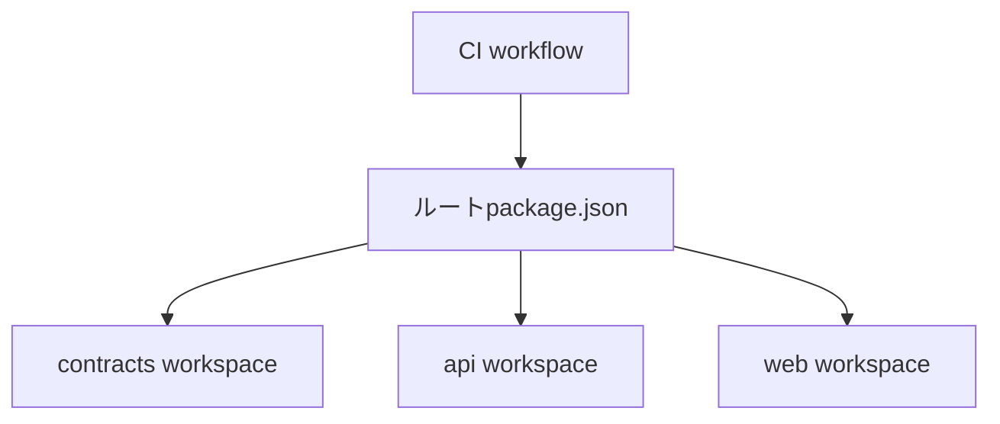
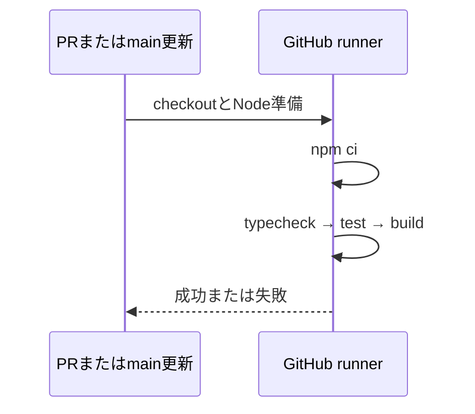
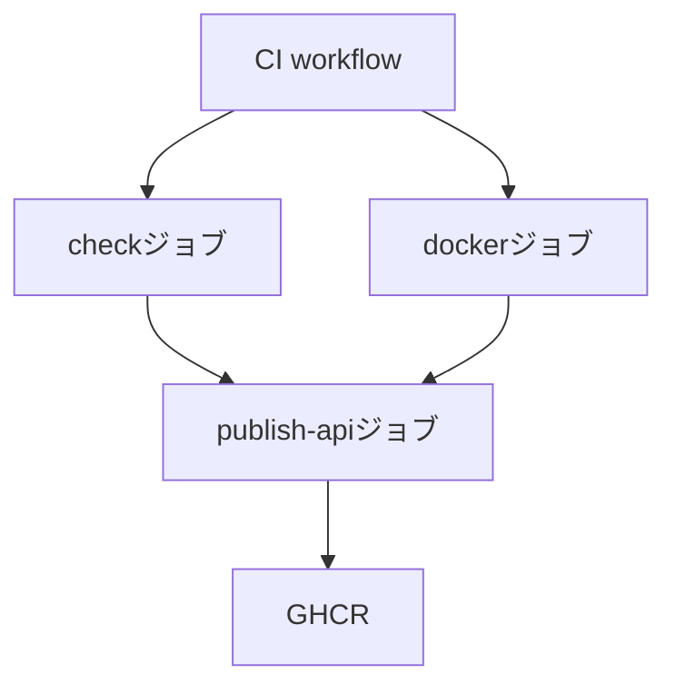
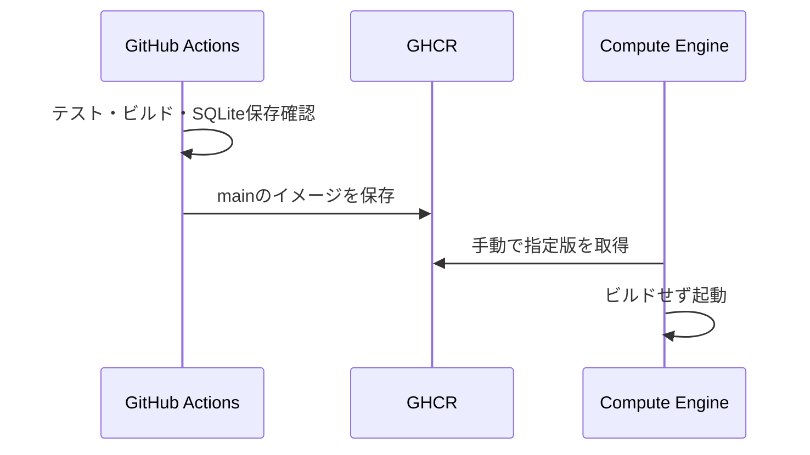

# 自動確認

`.github/workflows/ci.yml` はPRの作成・更新とmainへのpushで、Node.js 24.19.0のUbuntu環境に依存を新規導入し、型チェック・テスト・ビルドを順番に実行する。失敗したステップでジョブも失敗する。新しい実装のテストは各workspaceのtestに追加すれば同じ確認に含まれる。

APIのテストは一時SQLite、フロントの端末保存はfake-indexeddb、通信はテスト内の代替実装を使う。外部の情報源・本番DB・APIキー・本人用ログインには接続しない。npm依存とActionsのダウンロードにはネットワークが必要。npmのキャッシュは依存のダウンロードを省くためで、node_modulesやDBは引き継がない。

ローカルで同じ確認を行う場合は、ルートで `npm ci`、`npm run typecheck`、`npm run test`、`npm run build` を実行する。ワークフローはブランチ保護やVMへのデプロイを変更しない。

## VM向けイメージの配布

mainへのpushとmainを指定した手動実行では、check・dockerジョブの成功後にpublish-apiジョブがイメージをビルドしてGHCRへ保存する。PRやmain以外の手動実行では保存しない。既存の確認ジョブは読み取り権限のまま、配布ジョブだけにpackages: writeを付け、GitHubが発行するGITHUB_TOKENで認証する。独自のSecretやVMのSSH鍵は不要。

イメージ名は `ghcr.io/beppukanato/it-discovery/api:<完全なコミットSHA>`。latestタグは使わず、Actionsの実行概要に表示する版をVM側で指定する。配布ジョブは独立したrunnerで再ビルドするが、同じコミットのDockerfileとlockfileを使う。VMはビルドせず取得・実行だけを担当する。GHCRのパッケージは初回は非公開になるため、匿名取得する運用では所有者がパッケージ設定からPublicに変更する。非公開のまま使う場合はVM側にread:packages権限の認証が別途必要。

VMでの保存先と起動手順は[Dockerの手順](docker.md#compute-engineでビルドせず起動する)を参照。
