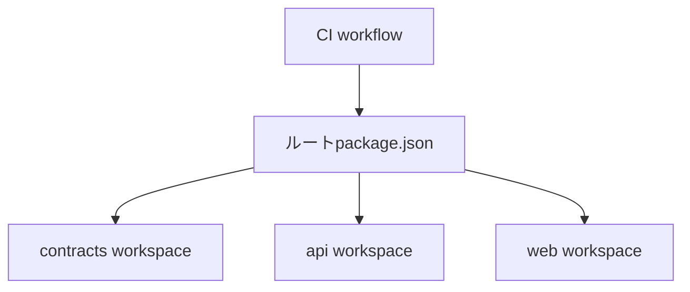
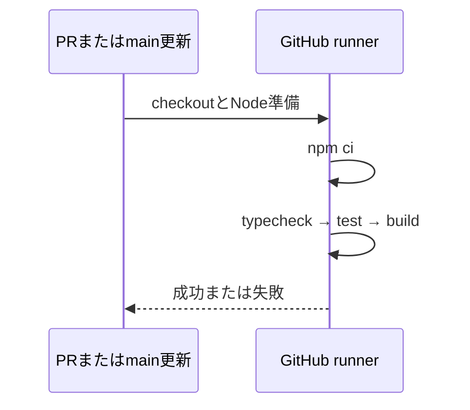

# 自動確認

`.github/workflows/ci.yml` はPRの作成・更新とmainへのpushで、Node.js 24.19.0のUbuntu環境に依存を新規導入し、型チェック・テスト・ビルドを順番に実行する。失敗したステップでジョブも失敗する。新しい実装のテストは各workspaceのtestに追加すれば同じ確認に含まれる。

APIのテストは一時SQLite、フロントの端末保存はfake-indexeddb、通信はテスト内の代替実装を使う。外部の情報源・本番DB・APIキー・本人用ログインには接続しない。npm依存とActionsのダウンロードにはネットワークが必要。npmのキャッシュは依存のダウンロードを省くためで、node_modulesやDBは引き継がない。

ローカルで同じ確認を行う場合は、ルートで `npm ci`、`npm run typecheck`、`npm run test`、`npm run build` を実行する。ワークフローはブランチ保護やデプロイを変更しない。
