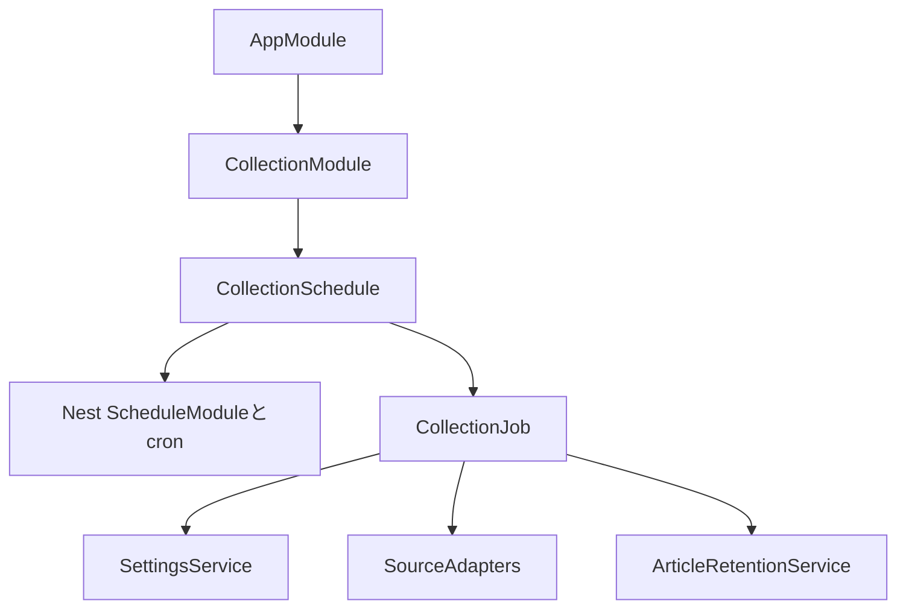
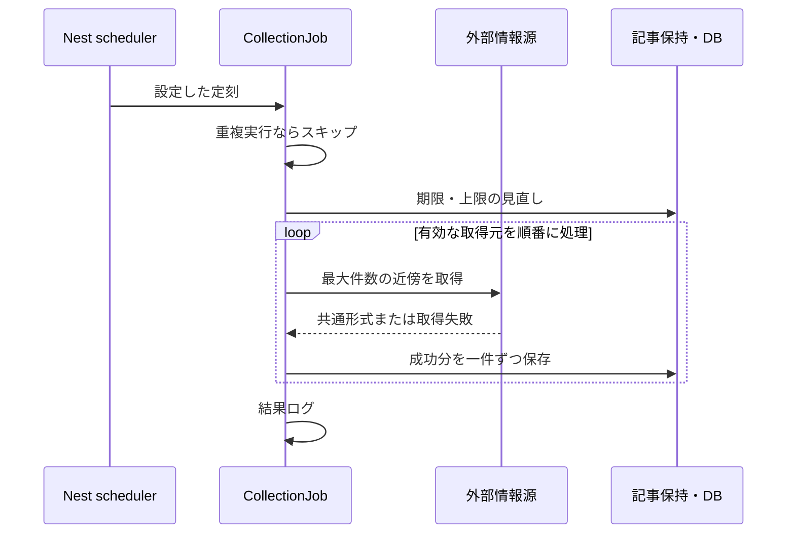

# 定期収集

CollectionModuleでNestのScheduleModuleを一度だけ初期化する。SettingsModuleの初期化後にCollectionScheduleがDBの時刻・タイムゾーンから日次cronを登録する。初期値は毎日05:00、Asia/Tokyo。設定時刻を変更した場合はAPIを再起動する。各実行の保持条件・取得先・件数はその都度DBから読む。

画面や一覧APIを開く必要はなく、APIプロセスの稼働中に実行する。一覧の更新操作はDBを読むだけ。起動直後の収集や停止中の時刻の追い掛け、失敗直後の自動再試行は行わない。次の定刻に再実行する。手動収集用のHTTP APIは設けない。

単一VM・単一APIプロセスを前提に、実行中の二回目はキューに積まずスキップする。複数プロセスで同じSQLiteへ定期収集を起動しない。情報源のタイムアウト・HTTP・解析失敗はその取得元だけを失敗として次へ進む。DBや内部処理の失敗はその実行を終了し、すでに確定した記事は残す。外部通信はDBのtransactionの外で行う。保存は一件単位で保持条件の再確認と挿入・削除を確定し、追加停止中も既存更新を続ける。

ログはevent名と件数で確認する。`collection_scheduled`、`source_completed`、`source_failed`、`collection_completed`、`collection_failed`、`collection_skipped`を出力する。取得元のURL、外部の生レスポンス、トークン、SQLの生エラーを出力しない。UIには収集失敗を出さない。

終了時は新規実行を拒否し、外部通信を中断して進行中のジョブが終わるまで待つ。その後にSQLiteを閉じる。Nestのshutdown hooksを使い、タイマーはSchedulerRegistryを通して解除される。

`collection-job.service.spec.ts`で取得元失敗の継続、既存状態の保持、DB失敗時の終了と先行保存、重複スキップ、容量による停止・再開、日本時間の定刻とジョブ呼び出し、停止後の拒否を確認する。取得Adapter・保持処理の詳細は[source-adapters.md](source-adapters.md)と[article-retention.md](article-retention.md)を参照。
