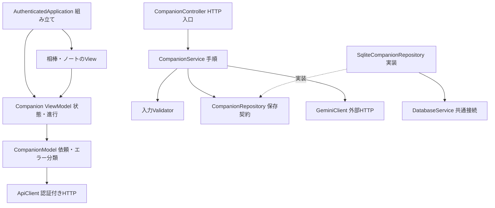
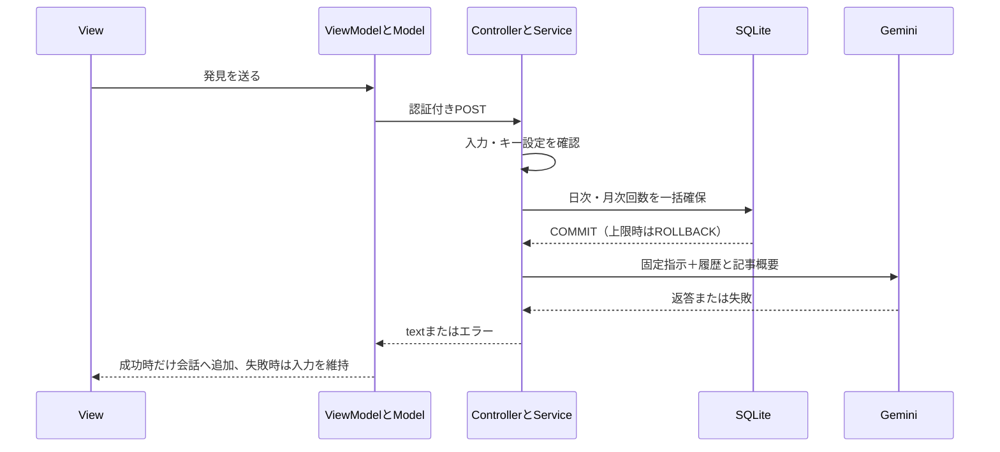

# 相棒・会話・発見ノート

[親Issue #52](https://github.com/BeppuKanato/it-discovery/issues/52) / [フロント構成](frontend-architecture.md)

## 体験

青・白を基調にした探索、左右スワイプの仕分け、発見ノート、設定を下部ナビで切り替える。全画面共通の右下に全身キャラを置き、専用の下部領域とナビの上に足元まで収める。隠す・再表示が可能。入力中に画面を狭めないよう、低い画面では会話内の立ち絵を省く。キャラ画像に新規アニメーションは付けず、通常・考え中の画像を切り替える。素材と生成指示は[characters/README](../apps/web/public/characters/README.md)に記載。

普段は静かで、タップすると任意に会話できる。通常の返答は短い1文。発見の具体的な一点に関心を示し、一般的な称賛・採点・質問の連続で引き延ばさない。質問や解説を求められた場合は必要な長さを許す。誤った理解は肯定しない。全文のプロンプトは[companion-prompt.ts](../apps/api/src/companion/models/companion-prompt.ts)。一文という方針はモデルへの指示であり、文章を機械的に切断しない。

一覧・仕分けから記事を開く操作で記事情報を会話へ渡す。これは選択中の記事という文脈であり、外部記事の読了検知ではない。戻ったときの自動発話や復帰監視は今回導入しない。会話中や下書きがある場合は文脈を上書きしない。

会話を開くだけではAIを呼ばない。ユーザーが送るときだけ生成する。入力800文字、直近4発言を各500文字まで、記事タイトル240文字・概要800文字までを送る。会話全文はサーバーへ自動保存しない。画面を閉じても同じログイン中は会話が残り、ページ再読み込み・ログアウトで消える。履歴の表示は直近20発言。記事本文・自動要約・検索・推薦・音声は扱わない。

「発見ノートに残す」は、入力中の文章か最後の本人の発言を保存する。AIの返答を本人の発見として保存しない。SQLiteへ本文・任意の記事ID・記録時の記事タイトル・日時を保存し、記事が削除されても残す。新しい順に最大100件を表示し、削除できる。これはピン・気になるとは別の記録。保存結果不明時に成功表示・自動再送はせず、一覧で確認するよう案内する。

## API・費用制限

全エンドポイントはmain.tsのGoogleAccessGuardの対象。未ログイン・未登録アカウントは拒否し、Cache-Control: no-storeを付ける。

| API | 入力・応答 |
|---|---|
| POST /api/companion/chat | message、history、任意articleId → text |
| GET /api/companion/notes | 新しい順に最大100件 |
| POST /api/companion/notes | text、任意articleId → 保存したノート |
| DELETE /api/companion/notes/:id | 正の整数ID → deleted: true |

Gemini Developer APIの`gemini-3.1-flash-lite`をgenerateContentで呼ぶ。思考レベルMINIMAL、思考込み出力最大384トークン、20秒でタイムアウト。別モデルや有料ツールへの自動切り替え・自動再送はしない。Googleの設定で上限が小さく、不完全な返答となった場合も成功扱いしない。キー・上流エラー本文・会話をログへ出さない。生のキーはx-goog-api-keyヘッダーだけに載せ、フロントへ渡さない。

アプリ全体で日本時間の1日30回・月500回、3秒以上の送信間隔、プロセス内で同時1通信。通信前にSQLiteの同期トランザクションで回数を確保する。通信失敗・結果不明も回数に含め、再起動・複数タブでも日次・月次上限を引き継ぐ。外部通信をDBトランザクション内で行わない。上限は429、未設定・上流失敗は503、入力不正は400。記事一覧・仕分け・ノートはキー未設定でも動く。

Google AI Studioでは月300円のプロジェクト上限を利用者が設定済み。これは表示の遅延等で超過する可能性がある。アプリの回数上限は費用の円換算を保証するものではなく、追加の制限。課金の実績はGoogle側で確認する。

## 依存関係



記事配列・仕分けの仮選択は既存ページのVMに残す。共通Appが一覧の初回取得を行う設計には戻さない。ノートViewの表示開始で一覧を取得し、会話の送信は利用者の操作からだけ始める。

## 実行順序



## VMへの反映

VMのリポジトリのcompose.ymlへ以下のenvironment設定が必要。既存のデータ用volume・ポート・認証設定は維持する。

```yaml
GEMINI_API_KEY: ${GEMINI_API_KEY:-}
GEMINI_MODEL: ${GEMINI_MODEL:-gemini-3.1-flash-lite}
```

VMの.envへ利用者が保存したキーとモデルを読み込む。新しいイメージでコンテナを再作成すると0004_companion.sqlが適用される。新しい表は既存SQLiteファイル内なので、既存のSQLiteバックアップに含まれる。DBの再作成やボリューム削除は不要。

## 検証と残る確認

- 固定応答で上限・入力制限・同時要求・上流失敗・ノート保存/削除・Google認証をテスト。本物のキー・課金呼び出しはテストで使わない。
- 実ブラウザでスワイプ、フィルター、キャラ表示/非表示、会話、ノート保存、設定への移動と横はみ出しを確認する。CIで画面をartifacts/companionへ保存する。
- 実Geminiの返答・口調・待ち時間と、iPhone PWAのソフトキーボード/安全領域はVM反映後に実機で確認する。

公式: [GenerateContent](https://ai.google.dev/gemini-api/docs/generate-content/text-generation) / [思考レベル](https://ai.google.dev/gemini-api/docs/generate-content/thinking)
