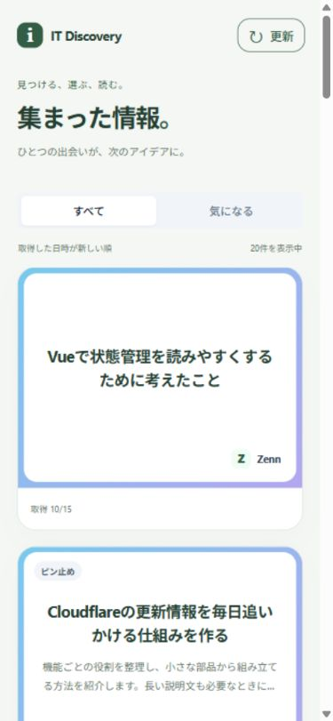

# 開発基盤の起動と確認

[README](../README.md) · [技術構成](architecture.md)

現在はSQLiteと一覧API、全記事・気になる一覧画面、気になる・ピン・既読の状態変更・確認API、仕分け対象取得・一括登録APIまで実装している。[一覧画面の構成・確認結果](article-list-ui.md)を参照する。一覧の気になる・ピンは保存中表示と成功後の確定を行う。永続再送は廃止した。[一覧操作の構成図](article-list-state.md)を参照する。仕分け・収集・認証・本番公開は後続Issueで追加する。

## 必要な環境

- Node.js 24.15以降の24 LTS。Nest CLIの間接依存と、JestからNest 12のES Modulesを読む互換性を含めた要件に合わせる。Node.js 22はこの基盤の対象にしない。
- npm 10以上。npm workspacesを使い、依存はルートのpackage-lock.jsonで固定する。
- Git。

TypeScriptは5.9系を使う。今回のVue型チェックとNestのコンパイルで互換性を確認し、TypeScript 7への移行は含めない。Issue #6でDrizzle ORM 0.45.4・better-sqlite3 13.0.3・Drizzle Kit 0.31.11・tsx 4.23.15を追加した。[SQLiteの手順](database.md)を参照する。一覧整理でidb・fake-indexeddb・Piniaを撤去した。画面状態はVMのVue ref・reactiveで管理する。Vue Router・定期実行は必要な機能のIssueで追加する。

.npmrcでNode.jsの要件を満たさないインストールを拒否する。Nest 12のES ModulesをJestが読み込むため、APIのテストコマンドだけでNodeのexperimental-vm-modulesを指定する。通常のアプリ起動には指定しない。

## 初回の起動

リポジトリのルートで実行する。別々のターミナルを使う必要はない。

```sh
npm ci
npm run dev
```

Nestの「Nest application successfully started」が出たら、http://127.0.0.1:5173/ を開く。全記事一覧が表示される。DBが空なら「まだ記事がありません」と表示する。更新ボタン・下に引く操作で先頭から読み直す。API起動前や接続失敗時は再試行ボタンを表示する。API復旧後の再試行で記事を取得できる。



APIだけを確認する場合は http://127.0.0.1:3000/api/health を開く。

```json
{"status":"ok","message":"サーバーに接続できました。"}
```

これはプロセスの疎通確認であり、DBや外部情報源の正常性を保証するAPIではない。

記事一覧APIは http://127.0.0.1:3000/api/articles で確認する。記事を入れるには[サンプル投入](database.md)を使う。条件・カーソル・応答形式と実装した構成は[一覧APIの説明](article-list-api.md)を参照する。

`npm run dev`は共有型を先にビルドし、共有型・Nest・Viteを監視する。どれかが終了したら他も終了する。終了はCtrl+C。既定のポートが使われていれば勝手に別ポートへ切り替えず、設定を直して起動し直す。

APIの状態変更・現在状態取得の確認は[状態変更APIの手順](article-state-api.md)を参照する。一覧の気になる・ピン操作は[一覧操作の手順](article-list-state.md)を参照する。[元記事を開く・既読保存](article-opening.md)も接続済み。カードのタイトルまたはサムネ領域から別タブで開き、保存が失敗したらカード下から再試行する。

仕分け対象と最終結果の一括登録は[仕分けAPI](sorting-api.md)を参照する。[仕分けのカードUI](sorting-ui.md)は一覧の「仕分けを始める」から操作する。右/左のスワイプまたはボタンで判断し、「ひとつ戻す」で繰り返して戻れる。元記事を開いたら同じカードの「次へ」で進む。端末保存・終了時登録は未接続のため、仮選択がある間は終了できない。戻す操作で仮選択を0件にした場合や、見送りだけの場合は終了して一覧へ戻れる。

## 設定

既定値で起動する場合は.envを作らなくてもよい。変更する場合は、次の各ファイルを同じフォルダ内の.envへコピーする。

- [apps/api/.env.example](../apps/api/.env.example) → apps/api/.env
- [apps/web/.env.example](../apps/web/.env.example) → apps/web/.env

PowerShellでは次のようにコピーできる。

```powershell
Copy-Item apps/api/.env.example apps/api/.env
Copy-Item apps/web/.env.example apps/web/.env
```

| 変数 | 既定値 | 読む場所と役割 |
|---|---|---|
| HOST | 127.0.0.1 | Nestの待受アドレス |
| PORT | 3000 | Nestの待受ポート |
| CORS_ORIGINS | 空 | Nestが許可するフロントのオリジン。カンマ区切り、パス・末尾の/・*は禁止 |
| WEB_PORT | 5173 | Viteの開発用ポート |
| DEV_API_TARGET | http://127.0.0.1:3000 | ViteからNestへの転送先。/apiは付けない |
| VITE_API_BASE_URL | /api | ブラウザのAxiosが呼ぶベースURL。/apiまで含める |

例えばAPIを4100番にする場合、apiのPORTを4100、webのDEV_API_TARGETをhttp://127.0.0.1:4100にする。VITE_API_BASE_URLは/apiのままでよい。webの/api/health要求はNestの/api/healthへ、そのまま転送される。

設定変更後は開発プロセスを終了して起動し直す。シェルの環境変数は.envより優先される。npmのworkspaceコマンドは各アプリのフォルダで実行されるので、Nestはapps/api/.env、Viteはapps/web/.envを読む。

別オリジンからAPIへ直接接続する場合は、VITE_API_BASE_URLをAPIの絶対URL（例：https://api.example.com/api）にし、NestのCORS_ORIGINSにフロントのオリジンを設定する。開発のプロキシ経由ならCORS設定は不要。CORSは認証ではない。本人用アクセス制限とHTTPSは#23・#24で用意する。

VITE_変数はビルド時に配布ファイルへ含まれる。秘密情報を入れない。本番の接続先変更はwebの再ビルドが必要。Viteの開発プロキシは配布したdistでは動かない。

## ビルド・型チェック・テスト

```sh
npm run typecheck
npm run test
npm run build
```

| コマンド | 確認すること |
|---|---|
| typecheck | 共有型・Nest・Vueの型の整合性 |
| test | Jestでサーバー設定の誤り、Vitestで通信中の連打と失敗後の再試行 |
| build | 共有型の宣言ファイル、Nestの実行コード、Vueの配布ファイルを順に生成する |

生成先はpackages/contracts/dist、apps/api/dist、apps/web/dist。Gitへ含めない。

ビルドしたAPIの起動：

```sh
npm run start -w @it-discovery/api
```

ビルドしたwebだけの表示確認：

```sh
npm run preview -w @it-discovery/web
```

previewはローカルの表示確認用で、本番公開用サーバーではない。APIも起動しておく。直接APIへ接続する構成の確認では、ビルド前のweb設定とAPIのCORS設定を揃える。

## コードを読む順序

[フロントの構成図と読む順序](frontend-architecture.md)を参照する。まずPage→VM→Model→ApiClientを読む。

- app/main.ts・create-application-models.ts：PrimeVueとModel・ApiClientを組み立てる。
- features/list/views/pages/ArticleListPage.vue：表示開始・終了と表示部品のイベントをVMへ渡す。
- features/list/view-models/useArticleListViewModel.ts：記事・フィルター・取得状態・保存状態を持ち、操作を進める。
- features/list/models/article-list.model.ts：20件の取得条件を組み立てる。
- features/articles/models/article-state.model.ts：直接保存・現在状態取得と失敗分類。
- infrastructure/api：Axiosの設定と応答検証。

設定はapps/web/vite.config.ts、apps/api/src/config/server.config.ts、API起動はapps/api/src/main.tsで確認できる。

## UI部品とスタイル

PrimeVue 4.5.5と@primeuix/themes 2.0.3を使う。どちらもMITライセンスの版を固定した。テーマ付きのCard・Button・Messageを接続確認画面で使い、Buttonのloadingとdisabledで通信中の操作を示す。

共通の緑色や部品の角丸などはapps/web/src/app/ui-theme.tsで定義し、main.tsでPrimeVueを初期化する。現在はライト表示に揃える。Templateや各表示部品には画面固有の配置をstyle scopedとして置き、style.cssにはフォント・背景などの基本設定を残す。PrimeVue内部のCSSへ直接上書きする方式は基本にしない。

## コミット単位でのレビュー

今後の変更は機能・変更目的ごとにコミットし、PR本文の「コミットと確認箇所」から読む場所を辿れるようにする。依存とlockfileは一緒に扱う。例えばPrimeVue導入ならpackage.json・main.ts・ui-theme.ts、画面への適用ならApp.vueを確認する。[作業指示](../AGENTS.md)と[PRテンプレート](../.github/pull_request_template.md)にも同じ方針を残す。

## Gitに入れるもの

package-lock.json、ソース、設定例は管理する。.env、node_modules、dist、DB本体とその付随ファイル、調査スクリプトの生成データは.gitignoreで除外する。実際の秘密情報は設定例にも記載しない。

## Issue #5の検証記録

Windows、Node.js 24.21.0、npm 10.9.9でnpm ci、typecheck、test、buildを確認した。Jestは12件、Vitestは2件が成功。ブラウザで接続失敗後の再試行と390px幅の表示を確認した。既定のViteプロキシ、APIの4100番への変更、CORSで指定したオリジンだけに許可ヘッダーが付くことも確認した。

PrimeVue導入後にwebの型チェック・Vitest 2件・ビルドを再確認した。ブラウザでCard・Button・Messageの描画、失敗後の再試行、390px幅の表示とMessageのpoliteな状態通知を確認し、画面参照を更新した。

2026-10-09のnpm audit --omit=devは指摘0件。開発用依存を含む監査には、Jest系の間接依存sprintf-jsのDoSに起因するmoderateの指摘が20件残る。Issue #6でDrizzle Kitの開発用の間接依存esbuildに関する4件が加わり、合計24件となった。指摘対象はesbuildの開発サーバー機能で、DB生成コマンドはそのサーバーを起動しない。実行用依存の監査は引き続き0件。固定した版では修正版が提供されておらず、古いJestへの強制変更は行っていない。実行用依存には含まれない。後続のCI・依存更新で継続確認する。
