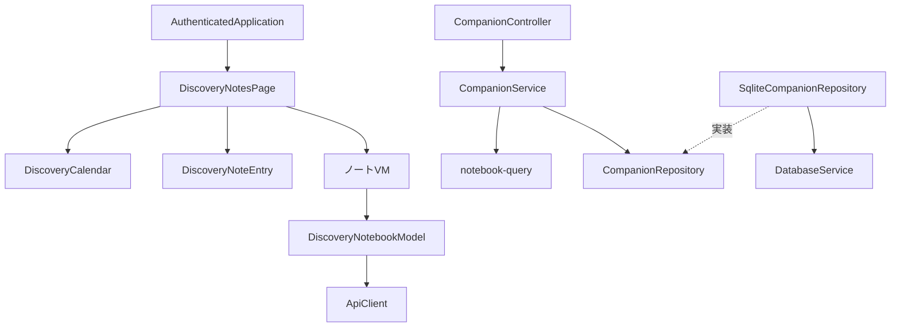
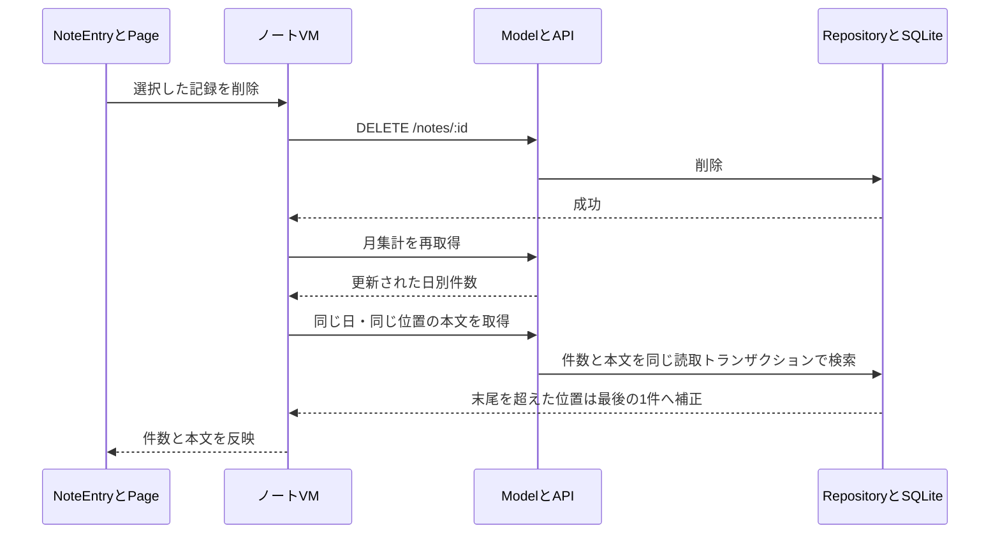

# 発見ノート：カレンダーと1件ずつの振り返り

[UX親Issue #59](https://github.com/BeppuKanato/it-discovery/issues/59) · [キャラと会話 #52](https://github.com/BeppuKanato/it-discovery/issues/52) · [フロント構成](frontend-architecture.md)

## 承認された体験

月間カレンダーに日別件数を表示し、日付を選ぶとその日の発見を1件ずつ前後にめくる。月30件以上でも本文カードを縦に並べない。件数は記録の蓄積を表し、連続日数・達成度・知識の評価として扱わない。本人が保存した文章をそのまま表示し、AIによる見出し生成や自動分類は追加していない。

表示開始は現在の月。その月に今日の記録があれば今日、それ以外は記録のある最新日を選ぶ。空の月は1日を表示し、過去に記録があれば「最近の発見へ」から最新の記録月へ移動できる。前の月は最初の記録月まで、次の月は現在月または最後の記録月まで移動する。空の日も選べる。日付の基準は既存の日次運用と同じ日本時間で統一する。

本文は新しい日時・同日時なら大きいIDの順。元記事のタイトルは保存時のものを保持し、元記事がDBに残っている場合だけ現在のURLへのリンクを表示する。元記事が消えても記録は削除しない。ノートから開いたことを自動的な読了・仕分け判断とは扱わない。

## APIと互換性

| API | 応答 |
|---|---|
| `GET /api/companion/notes/calendar?month=2026-10` | month、指定月全体のdays（日付・件数）、全期間のtotalCount・firstMonth・lastMonth |
| `GET /api/companion/notes/day?date=2026-10-27&offset=0` | date、補正済みoffset、当日のtotalCount、1件のnoteまたはnull |

両方とも既存GoogleAccessGuardの認証対象で、`Cache-Control: no-store`。month・dateは実在する4桁年の日付、offsetは0以上の安全な整数に限定する。日本時間の月・日をUTCの開始以上／終了未満に変換してSQLiteで検索し、最新100件に絞ってから集計しない。月の本文をまとめて返さず、日別集計と選択した1件だけを返す。

`GET /api/companion/notes`の最新100件取得は旧クライアント用に維持する。新カレンダーはこの上限を使わない。保存・削除のURLとDBスキーマは変更せず、既存データの再作成や移行は不要。新しいフロントはcalendar/day APIを使うため、公開時は先にAPIを更新する。

## 状態と責任

| 部品 | 責務 |
|---|---|
| DiscoveryNotesPage | VMの生成・開始・終了、子イベントの接続、会話からの保存通知を監視 |
| useDiscoveryNotebookViewModel | 月・選択日・1件の本文・取得中・エラー・削除状態、古い応答の破棄 |
| DiscoveryNotebookModel | 読取・削除をAPI契約へ依頼。本文配列のStoreは持たない |
| DiscoveryCalendar | 月・日・件数の描画と選択イベント |
| DiscoveryNoteEntry | 本人の文章・元記事・削除操作の描画 |
| CompanionService / SqliteCompanionRepository | 入力検証・読み取り依頼／SQL集計・1件取得 |

依存関係（矢印は参照先）：

実行順序（削除成功後の再集計）：

削除が失敗・結果不明なら本文を残して手動更新を案内し、自動再送はしない。読み取り失敗を「記録なし」と表示しない。月・日を変えると古い通信を中断し、要求番号が一致する結果だけを反映する。Page終了で通信を中断する。会話で保存した場合は既存会話VMのnotesVersionを合図に、表示している月・日を再取得する。

## キャラクターと表示

全身立ち絵は右下で記事・ノートに重ね、専用の下部パネルとその分の余白を撤去。既存の表示切替・任意会話を維持し、UI上は「相棒」から「キャラクター」「発見を話す」へ表記を変更する。正式名や口調の新仕様を決める変更ではない。ノートの前後操作は立ち絵より手前に置き、入力できるようにする。下部ナビはそのさらに手前に置く。

記事カードのサムネ風タイトル枠は既存実装を維持する。AI焦点の生成・保存・費用運用、推薦、永続仕分け履歴は#59の後続タスク。

## 検証

- API：100件を超える日、最新100件より古い月、日本時間の月末／日付境界、うるう日、安定順序、削除末尾の補正、記事消失、認証・不正クエリ。
- VM：月・日の古い応答、読込失敗、削除失敗、終了時中断、100件以降のページング、危険なURLの非表示。
- 実Chrome：`scripts/check-swipe.mjs`。固定日付の30件の月・110件の過去月、日付選択、前後・キーボード、削除・空の日・元記事リンク、320px／390px、既存スワイプ・会話・保存・表示設定を確認。画面はCIのcompanion-ui成果物へ出す。
- iPhone PWAの安全領域・ソフトキーボード・実Geminiの口調は既存#52の実機確認として残す。
