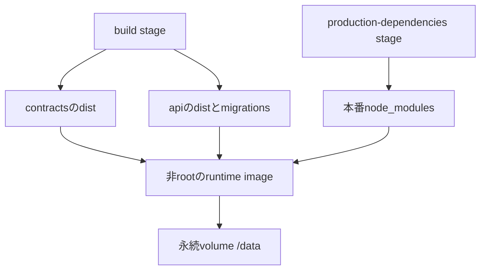
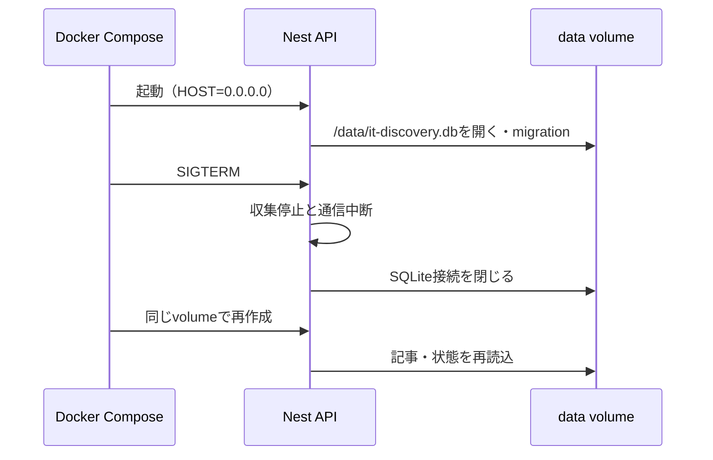

# DockerでAPIとSQLiteを動かす

リポジトリのルートでDocker EngineとCompose v2を使う。これはローカル起動用であり、公開URLや本人用認証はまだ構成しない。APIは127.0.0.1:3000へだけ公開する。

```sh
docker compose up -d --build
curl --fail http://127.0.0.1:3000/api/health
docker compose logs --tail 100 api
```

`.env`の作成は必須ではない。別のポートなら `API_PORT=3001 docker compose up -d` とする。直接フロントと別オリジンで使う場合はCORS_ORIGINSを指定する。GITHUB_TOKENは任意で、環境変数またはGit管理しないルートの.envから渡す。いずれもイメージへ埋め込まない。SPAはこのComposeで配信せず、開発時はnpm run devで起動する。





Node 24.19.0のDebian slimをビルドと実行で揃え、SQLiteのネイティブ依存のABIを一致させる。コンパイラ・開発依存・ソースコードは最終イメージへコピーしない。.dockerignoreでDB・.env・node_modules・distをビルド入力から除外する。runtimeはnodeユーザーで動き、/dataに書き込む。named volumeは初回にディレクトリの所有者を引き継ぐ。bind mountへ変更する場合はUID 1000が書けるディレクトリを事前に用意する。

## 停止・更新・復旧

`docker compose stop`で停止、`docker compose start`で再開する。`docker compose down`はコンテナとネットワークを削除するが、data volumeは残す。**`docker compose down -v`やdocker volume rmはDBも削除するため、通常の更新では使わない。** volumeはホストのDocker保存領域にあり、VMではその領域を永続ディスクに置く。VMやディスク自体の消失への対策は外部バックアップ（#27）で別途用意する。

更新は旧イメージのタグを残してから行う。

```sh
docker image tag it-discovery-api:local it-discovery-api:before-update
docker compose up -d --build api
docker compose ps
docker compose logs --tail 100 api
```

コードだけを戻す場合は `API_IMAGE=it-discovery-api:before-update docker compose up -d --no-build api`。DB migrationは自動で適用され、旧版への互換性は保証されない。DB変更を含む更新前は整合した外部バックアップを取得し、旧版が読めるかを別環境で確認する。DBも戻す必要がある場合はサービスを停止し、#27で決める復元手順を使う。稼働中の.dbだけを単純コピーしたり、復旧確認のため本番DBへ上書きしたりしない。

停止猶予は60秒。Nest shutdown hooksで収集の通信を中断して処理終了を待ち、その後DBを閉じる。ログはstdout/stderrに出し、Composeで1ファイル10MiB・3世代に制限する。

## 再作成の検証

GitHub Actionsのdockerジョブで本番イメージを構築し、`scripts/check-docker-persistence.sh`を実行する。CI専用の一時volumeに記事・気になる・ピン・既読を保存し、正常停止（exit 0）→コンテナ削除→同じvolumeで起動→HTTP一覧の値を確認する。終了時にその一時volumeだけを削除する。既存のComposeや本番volumeへは接続しない。
