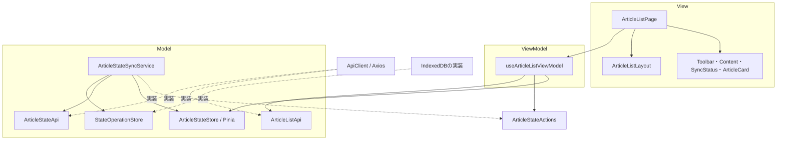
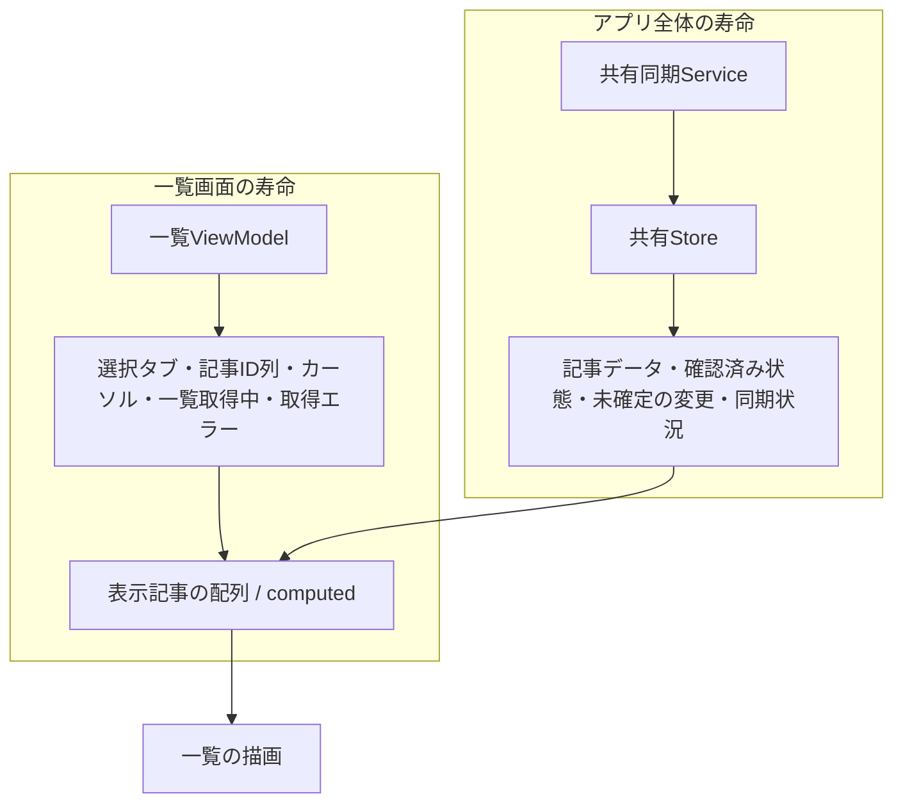
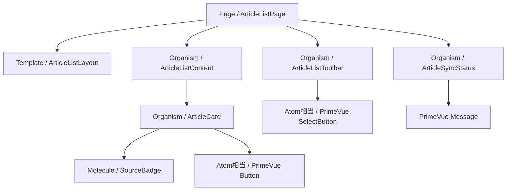
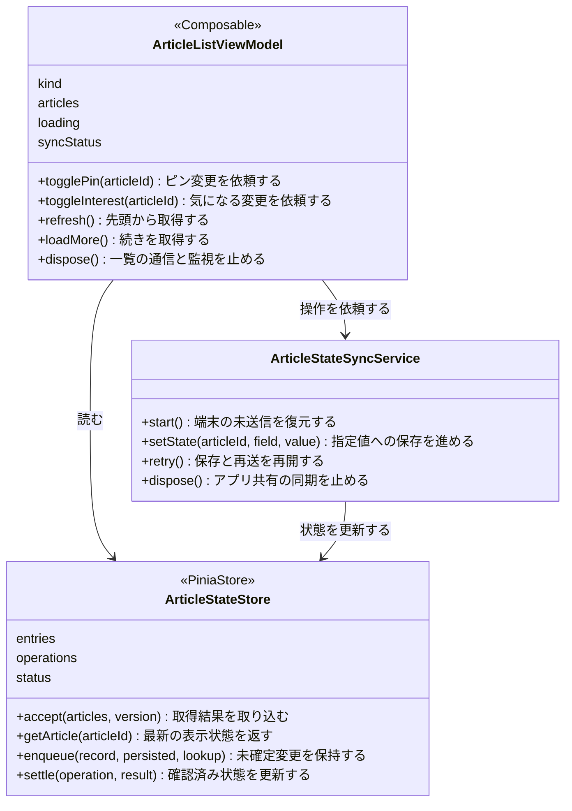
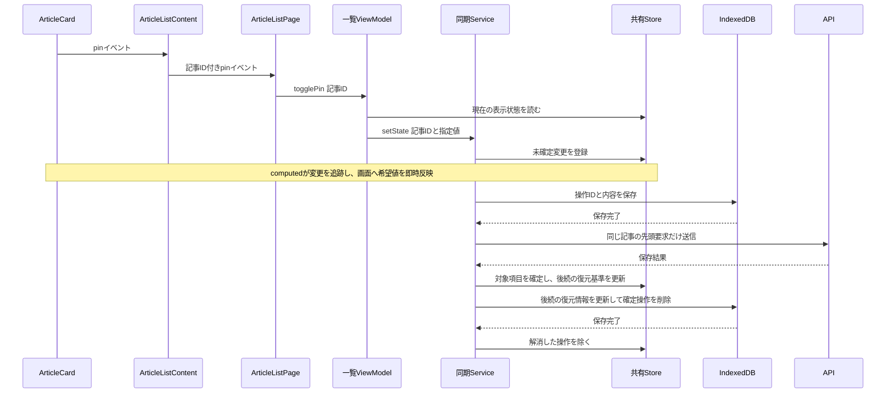

# フロントの構成：MVVM＋Atomic Design

[README](../README.md) · [一覧の操作と再送](article-list-state.md) · [全体の技術構成](architecture.md)

この資料はPR #37で実装した構成を説明する。機能を最上位に分け、その内側をView・ViewModel・Modelの役割で分ける。View内部の組み立てにはAtomic Designを使う。オニオンへの全面的な移行は今回行わない。

## 1. MVVMの依存関係

矢印は「先の機能を参照して使う」というコード上の依存。値の変更通知や処理の戻り値とは区別する。



Modelは型定義だけを意味しない。記事状態と、それを更新・保存する処理を含む。ViewModelは表示用の値と操作を提供する。ViewModel・ModelからViewのコンポーネントやDOMを参照しない。

同期ServiceはStoreの状態を読み、更新はStoreの操作を呼ぶ。Storeは同期Serviceを参照せず、自分で通信や再送を開始しない。AxiosとIndexedDBの実装はinfrastructureに置く。

## 2. 状態の持ち主



- 一覧VMは記事ID列を持つ。APIで届いた記事内容・状態はStoreへ取り込み、VMに編集可能な別コピーを持たせない。
- 記事の状態は「確認済み値＋未確定の希望値」から求める。取得中に変更された項目を古い一覧応答で戻さない。
- 表示記事はcomputedで求め、別の状態配列に詰め直さない。絞り込み・復元・並び順はこの計算で扱う。
- カードの説明文の展開、指の座標、DOMの監視は、そのViewに閉じた状態なのでView側に置く。
- Serviceの実行中要求・再送タイマー・端末書き込みジョブはServiceが保持する。表示データの別コピーではない。
- Piniaはメモリ上の共有状態。IndexedDBは終了後にも残す端末保存先であり、役割が違う。

Storeの`entries`は`Map<number, ArticleEntry>`。キーは記事IDで、値は記事情報・確認済み状態・変更の管理番号・削除済み判定を持つ。項目別の管理番号は`Map<StateField, number>`とし、未変更のキーは存在しない。`version`は新旧比較用であり、描画を促す通知番号ではない。

`operations`は未確定操作の順番を持つ。`persisted`は端末保存完了、`lookup`は次に結果照会するか、`settled`は応答で確定したか、`blocked`は要確認で停止中かを示す。同じ情報をService側で別キューとして保持しない。

## 3. Atomic Designの部品構成

次は部品を組み立てる関係。全ての矢印がMVVMの別レイヤーへの依存を意味するわけではない。



| 分類 | 判断基準と今回の責任 |
|---|---|
| Atom | 基本要素。Button・Tag・SelectButtonなどはPrimeVueを直接利用し、包むだけの部品を量産しない |
| Molecule | 小さい一機能。SourceBadgeは画像・サイト名・読み込み失敗時の代替表示をまとめる |
| Organism | 独立した画面領域。カード・一覧操作・カード群・保存状況をそれぞれ担当する |
| Template | 領域の配置。Layoutはheader・intro・toolbar・status・通常内容・footerのslotを提供する |
| Page | VMとの接続。propsを配り、emitをVMの操作へ接続する。画面固有の文面も置く |

Page以外の表示部品は、ViewModelやStoreの実体を受け取らず、必要な値をpropsで受け取る。子の操作はemitで返す。再利用回数や行数だけで分割せず、一機能・独立領域・配置・接続のいずれを担当するかで判断する。全階層を機械的に通す必要はない。

更新ボタンは一覧ツールバーへまとめた。取得・保存・並び順などの動作ルールは維持している。

## 4. ファイル配置

```text
src/
  app/
    main.ts                         Pinia・PrimeVueの初期化
    create-services.ts              通信・端末保存・Store・同期の組み立て
    App.vue                         画面へ渡し、アプリ終了時に同期を終了
  components/
    molecules/SourceBadge.vue
    organisms/ArticleCard.vue
  features/
    list/
      views/
        pages/ArticleListPage.vue
        templates/ArticleListLayout.vue
        organisms/
          ArticleListToolbar.vue
          ArticleListContent.vue
          ArticleSyncStatus.vue
        composables/usePullToRefresh.ts
      view-models/useArticleListViewModel.ts
      models/article-list-api.ts
    article-state/
      models/
        article-state.store.ts
        article-state-sync.service.ts
        state-sync.ts
  infrastructure/
    api/api-client.ts
    storage/indexeddb-state-operation.store.ts
    state-sync-owner.ts
```

共通の表示部品だけをcomponentsへ置く。特定の機能でしか使わない部品はfeatures内に置く。フロントにNestのControllerはなく、従来のcontrollersフォルダはview-modelsまたはViewのcomposablesへ整理した。初期の疎通確認用connectionは後方の確認用として残している。

## 5. オブジェクトと主な操作

図の箱は関数が返すオブジェクトも含む。ViewModelとPinia StoreをTypeScriptのclassとして実装しているわけではない。



## 6. ピン操作の実行順



ViewModelは`togglePin`で現在の表示値を反転するが、Serviceへ渡すのはtrue/falseの指定値。再送でトグルを再実行しない。拒否が確定した場合はその操作だけを除き、後続の希望を保つ。通信不明は失敗確定とせず、同じ操作IDの照会・再送で解消する。

## 7. 寿命と読む順序

`main.ts`がPiniaを一つ作り、create-servicesが同じStoreを同期Serviceへ渡す。Pageは画面ごとのVMを作る。Page終了ではVMの一覧通信とDOM監視だけ止め、同期は継続する。App終了時に共有同期とonline/offline監視を止める。起動時に残った未送信変更の解消を待つ手順はVMのinitializeが担当する。

ピン操作のレビューは次の順で追える。

1. [ArticleCard](../apps/web/src/components/organisms/ArticleCard.vue)のemit。
2. [ArticleListContent](../apps/web/src/features/list/views/organisms/ArticleListContent.vue)で記事IDを付ける。
3. [Page](../apps/web/src/features/list/views/pages/ArticleListPage.vue)の`@pin="togglePin"`。
4. [VM](../apps/web/src/features/list/view-models/useArticleListViewModel.ts)のtogglePinとtoggleState。
5. [同期Service](../apps/web/src/features/article-state/models/article-state-sync.service.ts)のsetState。
6. [Store](../apps/web/src/features/article-state/models/article-state.store.ts)のenqueue・project・settle。
7. [通信](../apps/web/src/infrastructure/api/api-client.ts)と[端末保存](../apps/web/src/infrastructure/storage/indexeddb-state-operation.store.ts)。

## 確認

web61件・API193件、計254件。既存の再送・応答不明・削除済み・ロールバック・解除復元を維持し、Storeの共有、Proxyの端末保存、独自通知番号なしの追跡、画面ごとのタブの独立、画面を閉じた後の同期、起動時の一覧待機を確認する。

全体の型チェック・テスト・ビルドが成功。ブラウザ390px幅で、ピン・気になる・タブ切り替え・再読み込み、保存拒否の復元、503中の起動待機と復旧を確認した。実機iPhoneは未確認。外部記事の既読や仕分けは後続Issueで接続する。
