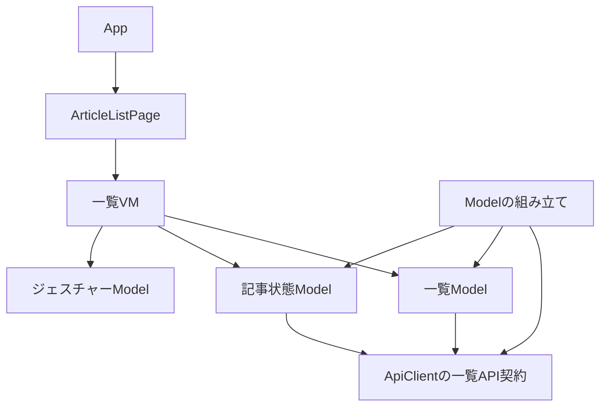
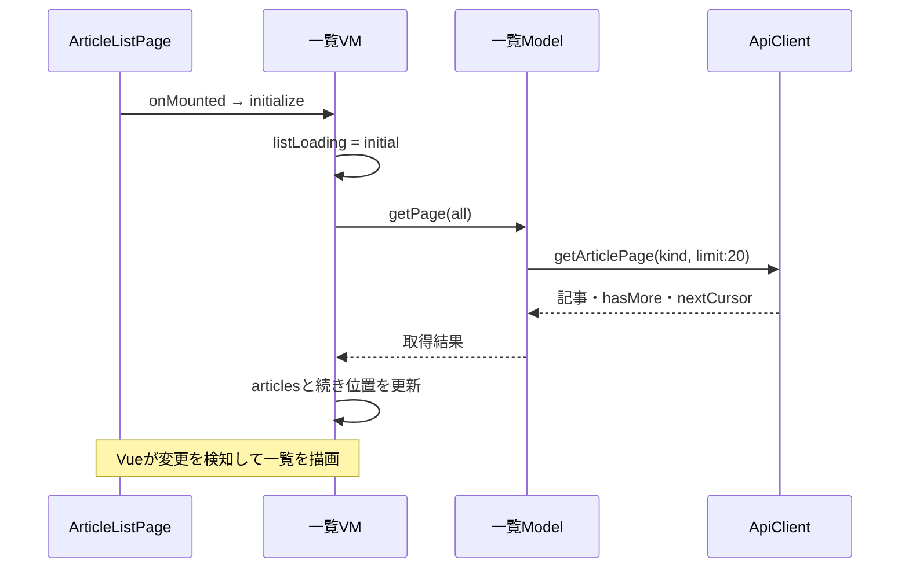
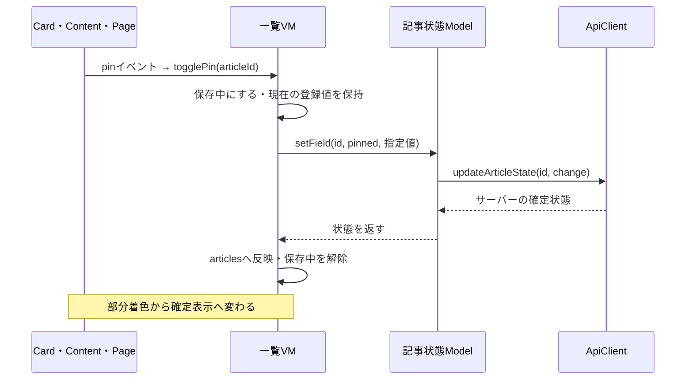
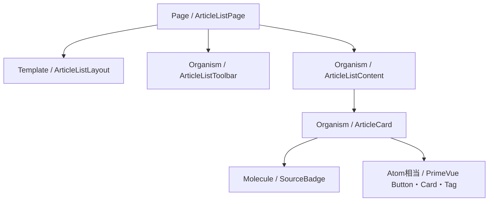

# フロントの構成：MVVM＋Atomic Design

[README](../README.md) · [一覧操作](article-list-state.md) · [技術構成](architecture.md)

2026-10-20の一覧整理後の実装を説明する。ページの表示開始から取得し、保存は直接APIへ送る。一覧の理解に永続キューや起動時同期の知識は必要ない。仕分け画面とその端末保存は未実装で、今回の対象外。

## 役割とファイル

| 役割 | 担当 | ファイル（apps/web/src以下） |
|---|---|---|
| View | 表示、DOM監視、イベント通知、ページ開始・終了 | features/list/views/pages/ArticleListPage.vue と表示部品 |
| VM | 記事・フィルター・取得状態・保存状態を保持。操作をModelへ依頼し、結果を画面へ反映 | features/list/view-models/useArticleListViewModel.ts |
| 一覧Model | 一覧の取得条件（20件）を組み立てて取得 | features/list/models/article-list.model.ts |
| 記事状態Model | ピン・気になる・既読の保存、現在状態の取得、エラーの分類 | features/articles/models/article-state.model.ts |
| ジェスチャーModel | 引く方向・距離・成立判定。DOMやVueへ依存しない | features/list/models/pull-to-refresh-gesture.ts |
| 通信 | Axiosの設定、HTTP入出力、応答検証 | infrastructure/api/api-client.ts |
| 組み立て | ApiClientを生成し、二つのModelへ渡す | app/create-application-models.ts |

Modelは取得した記事配列を保持せず、結果を返す。画面状態の持ち主はVM一つ。Pinia・IndexedDB・起動Model・同期Storeは今回の一覧では使わない。

## コードの依存関係

矢印は「コードが参照する相手」。実行順序とは別に読む。

API契約はTypeScriptのinterfaceで、実体はApiClient。組み立て関数がconstructorへ実体を渡す。PageへはAppからpropsでModelを渡す。provide/injectのキーやVMの共有は導入していない。PageでVMを生成するので、将来ページを切り替えても画面状態はそのPageの寿命に従う。

## 状態の持ち主

| 値 | 持ち主 | 理由 |
|---|---|---|
| articles | VMのshallowRef | 表示する記事配列。記事状態の変更も配列・記事を置き換えて反映 |
| selectedKind | VMのref | 全記事・気になるの選択表示 |
| listLoading・listError | VMのref | 初回のスケルトン、末尾の取得表示、再試行案内 |
| hasMore | VMのref | 末尾の取得手段・終端の表示 |
| savingByArticle | VMのreactive Map | 記事ごとの部分着色・操作制限。別の記事は操作可能 |
| saveErrors・notice | VMのreactive Map・ref | 記事ごとの失敗・現在状態の確認、削除済み通知 |
| canLoadMore | VMのcomputed | 既存の取得状態から導く。独立した保存値ではない |
| nextCursor | VMの通常変数 | 次の要求に渡すだけで、値自体は画面に表示しない |
| generation・AbortController | VMの通常変数 | フィルター変更・終了後の応答を無視し、不要な通信を中止 |
| savingStates・confirmedStates・removedArticles | VMの画面内の通常Map・Set | 保存前の状態を維持し、古い一覧応答による保存結果の巻き戻り・削除記事の復活を防ぐ |
| expanded・canExpand | ArticleCard内のref | カード内の文章展開・省略。業務状態は持たない |

confirmedStatesは保存・確認で得た状態と変更番号だけを持つ。記事全体の別Storeや未完了要求のキューではない。一覧要求の開始後に確認された状態を優先し、次に開始する新規取得ではサーバーを読む。保存待ちの記事は現在の確定表示を保つ。

## 初回取得の実行順序

AppはModelをPageへ渡すだけ。端末通信の解消を初回取得の条件にしない。フィルター変更ではVMが配列・カーソルをリセットし、その条件で新規取得する。追加取得も現在の条件とカーソルを使う。画面を閉じるとPageがVM.disposeを呼び、通信・ジェスチャーを終了する。

## ピン操作の実行順序

具体的にはArticleCard.vueがemit('pin')、ArticleListContent.vueが記事IDを付けてemit('pin', id)、ArticleListPage.vueの@pinがVM.togglePinへ接続する。VMは現在値を反転した指定値をArticleStateModel.setFieldへ渡す。ModelはApiClient.updateArticleStateを呼び、PUT /api/articles/:id/stateへ送る。返ったstateをVMがarticlesへ反映する。気になるも同じ流れ。

通信中は同じ記事のピン・気になるを無効化する。保存対象のアイコンを固定の部分着色にし、進捗率としては扱わない。他方のボタンは既存の登録表示を保つ。解除中も成功するまでaria-pressedは既存状態を示す。失敗・結果不明の流れは[一覧操作](article-list-state.md)を参照。

## Atomic Designの部品構成

PageはVMとの接続、Templateはslotの配置、Organismは画面領域、Moleculeは出典表示という小さなまとまりを担当する。PrimeVueの基本部品をAtomsとして直接使い、名前を合わせるだけのラッパーや空フォルダは作らない。

タッチ座標・スクロール位置・preventDefault・IntersectionObserverはViewの責任。引く操作の判定はVMを経由してジェスチャーModelへ渡し、成立したらVMが更新する。末尾のObserverはmoreイベントだけを通知し、取得条件はVMが判断する。

## 読む順序

1. [ArticleListPage.vue](../apps/web/src/features/list/views/pages/ArticleListPage.vue)：onMountedと@pin・@interestの接続。
2. [useArticleListViewModel.ts](../apps/web/src/features/list/view-models/useArticleListViewModel.ts)：状態宣言、initialize→loadPage、toggleField。
3. [ArticleListModel](../apps/web/src/features/list/models/article-list.model.ts)と[ArticleStateModel](../apps/web/src/features/articles/models/article-state.model.ts)：依頼がどのAPI呼び出しになるか。
4. [ApiClient](../apps/web/src/infrastructure/api/api-client.ts)：実際のHTTPと応答の検証。
5. [組み立て](../apps/web/src/app/create-application-models.ts)：Modelへ何を渡すか。
