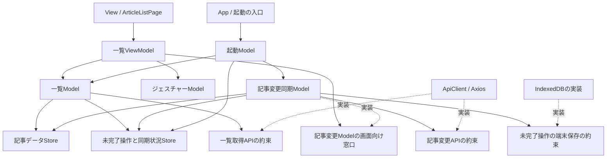
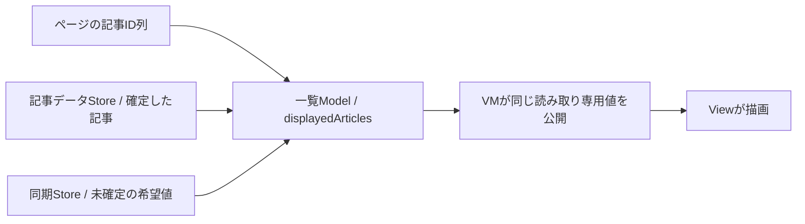
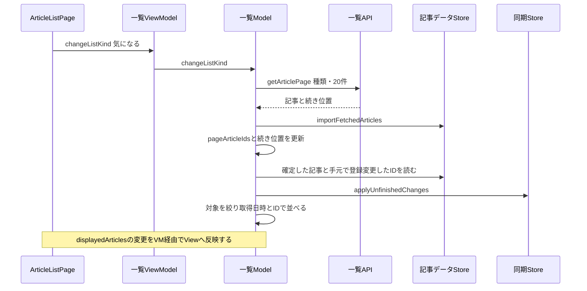
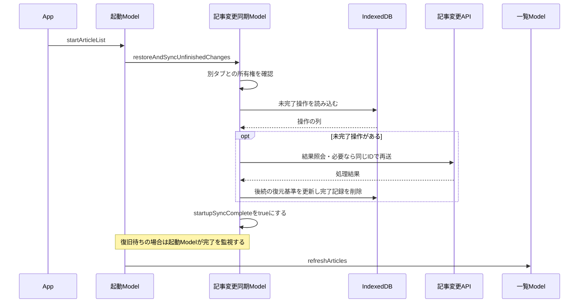
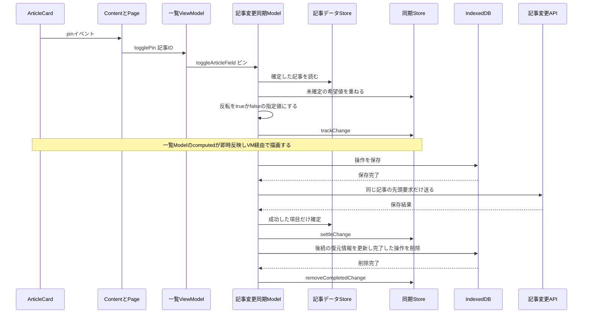
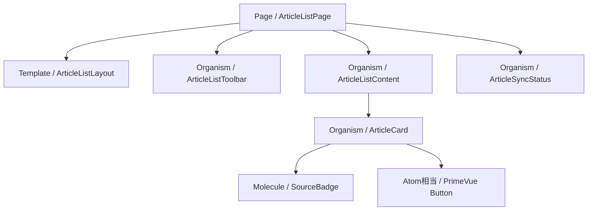

# フロントの構成：MVVM＋Atomic Design

[README](../README.md) · [一覧操作と同期](article-list-state.md) · [技術構成](architecture.md)

PR #37の現在のコードを説明する。機能別のフォルダの中をView・ViewModel・Modelで分け、Viewの部品をAtomic Designで組み立てる。

## 役割と読む入口

| 役割 | 現在の責任 | 主なファイル |
|---|---|---|
| View | 描画、propsの受け渡し、emit、座標の取り出し、DOM制御 | ArticleListPage.vueと表示部品 |
| ViewModel | 画面の操作をModelへ接続し、表示値を公開する | useArticleListViewModel.ts |
| 一覧Model | 一覧取得、ページ管理、古い応答の破棄、補完・絞り込み・並べ替え | article-list.model.ts |
| 記事データModel | 記事情報と確定した既読・ピン・気になるを保持する | article-data.store.ts |
| 記事変更Model | 未完了操作、即時反映、保存・送信・照会・再送を行う | article-change-sync.model.tsとarticle-change.store.ts |
| 起動Model | 端末の変更を解消してから初回一覧を取得する | application-startup.model.ts |
| 操作判定Model | タッチの方向・距離・成立条件を扱う | pull-to-refresh-gesture.ts |
| 外部接続の実装 | AxiosとIndexedDBを使う | infrastructure/api・storage |

Modelは外部接続だけではない。データ・判断・取得と同期の手順を含む。VMからAPIやStoreを直接参照せず、一覧取得の理解に再送ループの内部を要求しない。

## 1. コードの依存関係

矢印は「参照して使う相手」。処理の戻り値やVueの更新通知とは区別する。



組み立てはapp/create-application-models.tsだけで行う。ここで作るApiClientなどの実体をModelへ渡す。TypeScriptのinterfaceは実体を生成しない。具体実装をどこで渡したか知りたい場合だけ、この組み立てファイルを読む。

## 2. どの状態を誰が持つか

| 管理元 | 値 | 意味 |
|---|---|---|
| 一覧Model | selectedKind | 全記事・気になるの選択 |
| 一覧Model | pageArticleIds | 現在のページ群から取得したID列 |
| 一覧Model | nextCursor・hasMore | 続き位置と、続きがあるか |
| 一覧Model | listLoading・listError | 一覧取得中の種類と取得エラー |
| 一覧Model | displayedArticles / computed | 記事データと希望状態から求める表示用配列 |
| 記事データStore | articlesById | ID別の記事情報、確定状態、項目別の変更番号、削除済み判定 |
| 記事データStore | changeVersion | 遅い取得応答で変更を戻さないための新旧比較番号 |
| 同期Store | unfinishedChanges | 端末削除まで完了していない変更操作の列 |
| 同期Store | syncStatus | 端末復元済み・起動同期完了・接続状況・同期エラー |
| 同期Model | storageJobs等 | 書き込み順、実行中の要求、再送タイマー |
| 操作判定Model | 開始座標・distance | 下に引く操作の途中状態 |



記事配列や記事状態をVMに二重保存しない。Modelでもref・computed・Piniaを使う。Vueの変更追跡を使うことと、画面操作の接続を担当するVMであることは別である。

記事の状態はinterested・pinned・lastOpenedAt。同期状況のstartupSyncCompleteやonlineとは別の概念。旧ArticleStateStoreのentries・statusへまとめていた情報を分離した。

## 3. 未完了の変更操作とは

「未送信」は送信失敗だけに聞こえるため、コードではUnfinishedArticleChangeと呼ぶ。送信前・送信中・結果不明・再試行待ち・成功後の端末削除待ちを含む。

保存するのは操作ID・記事IDを含む復元用の記事・変更する項目と指定値・順番。例えば「記事42のピンをtrueにする」。再送で反転を再実行しない。

| 追跡項目 | 意味 |
|---|---|
| persisted | 端末へ保存できたか。保存前は送信しない |
| lookup | 次の要求の前に結果照会するか |
| settled | 成功または拒否を確認できたか。端末削除前はキューに残る |
| blocked | 利用者の確認を待っているか |
| attempts | 再試行回数 |
| storageRestored | 端末記録を読み終えたか |
| startupSyncComplete | 起動時に復元した変更を解消し、通常操作を開始できるか |

startupSyncCompleteは通常操作中の送信待ちではfalseに戻さない。未完了件数はunfinishedCountで別に表す。IndexedDBのDB名・ストア名・データ形式は既存版と同じであり、この整理による移行は不要。

## 4. 一覧を切り替えたときの実行順



補完IDはgetLocallyChangedInterestIdsで取得する。登録直後の記事を気になる一覧へ追加し、解除が拒否された記事を元の位置へ戻すために使う。未完了操作だけに限定せず、起動中に登録変更した記事を保持する。補完の意味をVMに持ち込まない。

記事データが入る入口は二つ。通常は一覧ModelのimportFetchedArticles→rememberArticle、再起動時は同期ModelのtrackArticleChange→rememberArticleで復元用の記事を取り込む。後者は一覧取得ではない。

## 5. 起動と終了の実行順



一覧Modelは画面ごと、記事データ・変更同期はアプリ全体で共有する。Pageの終了はVMと一覧取得だけを止める。App終了では起動の監視・共有同期・接続監視も解放する。アプリを閉じた後の送信継続は保証せず、端末に残った操作を次回復元する。

## 6. ピン操作の実行順



拒否ならその操作だけを表示から除き、後続の希望を保つ。通信不明は失敗確定と扱わず、照会・再送で解消する。詳細は[一覧操作と同期](article-list-state.md)。

## 7. Atomic Designとタッチ入力



PrimeVueを基本部品として直接使い、包むだけのAtomを増やさない。Moleculeは小さな一機能、Organismは画面領域、Templateはslotで配置、PageはVMとの接続を担当する。

タッチ入力はPage→VM→PullToRefreshGestureへ座標などの値で渡す。判定ModelはVue・DOMに依存しない。成立時にVMが一覧ModelのrefreshArticlesへつなぐ。引っ張り量はVMのcomputedから描画する。preventDefaultとDOM監視はViewに残す。カードの説明展開はカードだけの表示状態としてViewに残している。

## 8. 配置

```text
src/
  app/
    main.ts
    create-application-models.ts
    App.vue
  features/
    list/
      views/pages・templates・organisms/
      view-models/useArticleListViewModel.ts
      models/
        article-list.model.ts
        article-list-api.ts
        pull-to-refresh-gesture.ts
    articles/models/article-data.store.ts
    article-changes/models/
      article-change-sync.model.ts
      article-change.store.ts
      article-change-contracts.ts
    startup/models/application-startup.model.ts
  components/
    organisms/ArticleCard.vue
    molecules/SourceBadge.vue
  infrastructure/
    api/api-client.ts
    storage/indexeddb-article-change.storage.ts
    article-change-ownership.ts
```

## 9. コードを読む順序

一度に全処理を辿らず、最初は「気になる一覧を選ぶ」一本に絞る。

1. [Page](../apps/web/src/features/list/views/pages/ArticleListPage.vue)のselectKindと@select：ユーザー入力の入口。
2. [VM](../apps/web/src/features/list/view-models/useArticleListViewModel.ts)のchangeListKind：一覧Modelへ依頼するだけの接続。
3. [一覧Model](../apps/web/src/features/list/models/article-list.model.ts)のchangeListKind→loadPage：取得、古い応答の破棄、記事の取り込み、IDと続き位置を更新する。
4. [記事データStore](../apps/web/src/features/articles/models/article-data.store.ts)のimportFetchedArticles→rememberArticle：articlesByIdへ記事が入る場所。
5. 一覧ModelのdisplayedArticles：ページIDと補完IDを集め、[同期Store](../apps/web/src/features/article-changes/models/article-change.store.ts)のapplyUnfinishedChangesで希望値を重ね、対象を絞って並べる。VMは同じ値を公開し、PageがContentへ渡す。

一覧を理解したあとに、次の順で範囲を広げる。

- ピン：Cardのemit→Content→Page→VM.togglePin→[同期Model](../apps/web/src/features/article-changes/models/article-change-sync.model.ts)のtoggleArticleField→setArticleState→trackArticleChange。
- 起動：[App](../apps/web/src/app/App.vue)のonMounted→[起動Model](../apps/web/src/features/startup/models/application-startup.model.ts)のstartArticleList→同期ModelのrestoreAndSyncUnfinishedChanges→初回一覧取得。
- 再送：同期ModelのsendNextChangeForArticle→結果照会・保存要求→complete→端末記録削除。通常一覧の取得とは独立した処理。
- 実体の組み立て：[create-application-models.ts](../apps/web/src/app/create-application-models.ts)。API・Store・端末保存をどこで渡したか確認する。

## 確認結果

全体の型チェック・ビルドが成功。API193件・web71件、計264件が成功した。一覧Modelの取得と競合、VMの操作接続とジェスチャー、起動順、記事データと同期Storeの分離、既存の即時反映・再送・復元を確認した。

390px幅の実ブラウザで、初回一覧、ピンと気になる、一覧切り替え、更新、登録解除の拒否時の復元、503中の再読み込みと起動待機、通信復旧後の再送と初回一覧への復帰を確認した。一時DBと既存の実IndexedDBを使い、保存形式の継続利用を確認した。実機iPhoneのジェスチャーは未確認。
