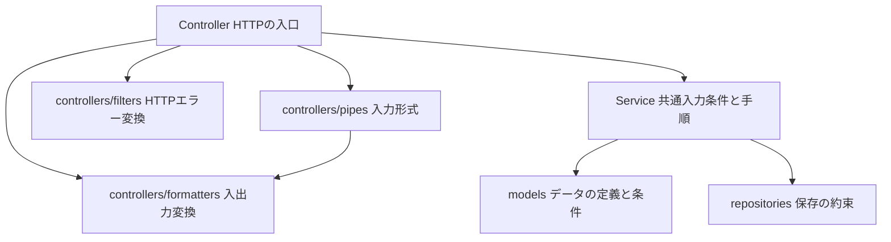

# HTTP処理の配置と適用範囲

[README](../README.md) · [技術構成](architecture.md) · [一覧API](article-list-api.md) · [状態変更API](article-state-api.md)

Controller直下を見ればHTTPの入口が分かり、Controllerのコードを見れば固有の入力変換・エラー変換が分かる配置にする。フロントのComposableを対象とする規約ではない。

## 配置

```text
apps/api/src/
├─ main.ts                            全体共通のHTTP設定を登録する
├─ articles/
│  └─ controllers/
│     ├─ articles.controller.ts        一覧APIの入口
│     ├─ article-state.controller.ts   状態取得・更新の入口
│     ├─ article-state-operation.controller.ts
│     ├─ formatters/                  HTTP入出力の形を変換する
│     │  ├─ article-page.formatter.ts
│     │  ├─ article-state.formatter.ts
│     │  └─ article-cursor.formatter.ts
│     ├─ pipes/                       引数の形式を検査・変換する
│     │  ├─ article-page-query.pipe.ts
│     │  └─ article-id.pipe.ts
│     ├─ filters/                     アプリのエラーをHTTPへ変換する
│     │  └─ article-state-exception.filter.ts
│     └─ tests/                       HTTP APIのテスト
└─ health/controllers/
   └─ health.controller.ts            疎通確認の入口
```

`*.controller.ts`が入口・出口。FormatterはControllerが直接呼ぶ普通の関数。Pipeは`@Query`・`@Param`に指定し、NestがControllerメソッド実行前に呼ぶ。Filterは`@UseFilters`で対象を明示し、対象となる未処理の例外が発生した場合にNestが呼ぶ。

カーソルは入力時のデコードと出力時のエンコードで同じ形式を扱うため、`formatters/article-cursor.formatter.ts`へまとめる。Pipeからも参照するが、ServiceやRepositoryはこのHTTP形式を知らない。

## どこを見れば適用内容が分かるか

1. 共通設定は[main.ts](../apps/api/src/main.ts)を見る。
2. 対象Controllerの`@UseFilters`、各メソッド・引数のPipe指定を見る。
3. 応答を変換する関数の呼び出しを見る。
4. アプリ共通の入力条件や判断は、呼び出し先Serviceで確認する。Serviceが呼ぶモデルの検証関数は、Nestが自動適用するグローバル検証ではない。

現在、独自のグローバルPipe・Filter・Interceptor・Middlewareは登録していない。共通HTTP設定はAPIプレフィックスと、設定に応じた全体のCORS許可。Nest標準のJSON本文解析や標準例外処理は使っている。特定Controllerだけに隠れて適用する共通部品はない。

| APIの入口 | 明示したPipe | HTTPエラー処理 | 明示したFormatter |
|---|---|---|---|
| GET /api/health | なし | Nest標準 | なし（応答を直接返す） |
| GET /api/articles | ArticlePageQueryPipe | Controllerで一覧の入力エラーを400へ変換、その他はNest標準 | toArticlePageResponse、カーソル変換 |
| GET /api/articles/:articleId/state | ArticleIdPipe | ArticleStateExceptionFilter、記事なしはControllerが404 | toStateValue |
| PUT /api/articles/:articleId/state | ArticleIdPipe | ArticleStateExceptionFilter | toStateOperationResponse |
| GET /api/article-state-operations/:operationId | なし（ID条件はServiceで確認） | ArticleStateExceptionFilter、未記録はControllerが404 | toStateOperationResponse |

状態更新の本文の共通条件もServiceが検証を呼ぶ。Pipeがないことは「入力検証がない」という意味ではない。HTTPの文字列から数値への変換と、アプリが受け付ける操作の条件を分けている。

## 依存関係と実行順序

コードの参照関係。矢印は参照先を表す。



実行時はNestがデコレーターの指定を読み、次のタイミングで呼ぶ。上の参照関係の矢印が、そのまま実行順序を表すわけではない。

```text
リクエスト → Nestが引数のPipeを実行 → Controller → Service
                                                ↓
レスポンス ← ControllerがFormatterを呼ぶ ← 処理結果

対象の未処理例外 → NestがFilterを実行 → エラーレスポンス
```

## 全体共通の部品を追加するとき

実際に全Controllerへ同じ設定が必要になった場合だけ、`infrastructure/http/`配下に役割別の部品を作り、`main.ts`の一か所で全体へ登録する。未使用の共通フォルダや部品を先に作らない。

- 適用先が一部だけなら、機能側に置き、対象Controller・メソッド・引数で明示する。
- 共通部品の内部でController名などによる隠れた除外や切り替えを行わない。
- 共通だからMiddlewareへ統一するのではなく、処理内容に合うPipe・Filter・Interceptorなどを選ぶ。
- 「全体に登録」と「毎回実行」は異なる。Filterは対象の例外があるときだけ実行する。条件・適用範囲は登録箇所とこの表で分かるようにする。

既存の一覧APIも含めた全バックエンドを確認し、Controller補助処理とHTTPテストをこの配置へそろえた。APIのURL・検証条件・保存処理・応答形式は変更しない。

## 確認結果

再配置後に全体の型チェック、API127件・web20件の計147件のテスト、ビルドを確認した。ファイルの移動とimport先の変更、登録方針の説明が中心で、APIの振る舞いを追加・変更するテストは必要ないため新設していない。
