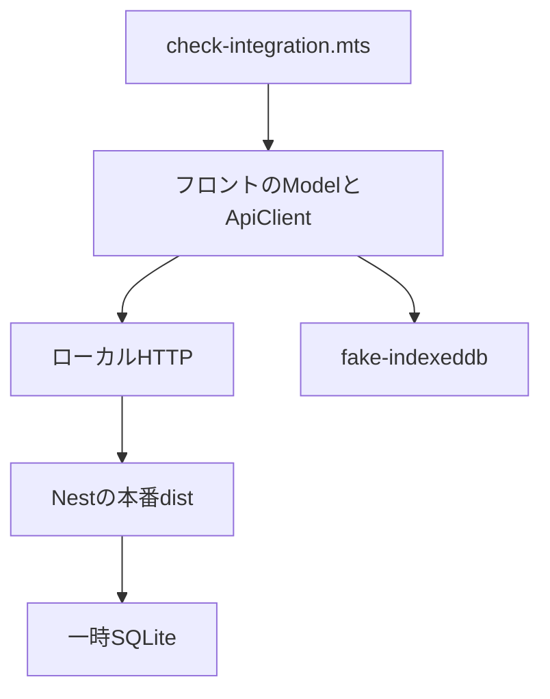

# 結合確認と残る確認

2026-10-20時点の実装と確認範囲を記録する。公開環境の認証・スマホの実ブラウザ・外部バックアップは未確認で、#23〜#28を完了扱いにしない。

ルートで `npm ci` → `npm run build` → `npm run test:integration` を実行する。GitHub Actionsもビルドの後に同じ結合確認を行う。`scripts/check-integration.mts`は一時ディレクトリに新規SQLiteを作り、fake-indexeddbで端末保存を代替する。外部情報源は架空のRSSへ置き換える。Nestは本番distから起動し、フロントの実際のModel・ApiClientからHTTPで呼ぶ。本番のURLやDBは指定できない構成とし、終了時に一時DBを削除する。

| 経路 | 確認内容 |
|---|---|
| 収集・再収集 | 25件の新規登録、同じ25件の更新 |
| ページング | 20件＋5件、重複なし、続き終了 |
| 仕分け | 最大10件、気になる→気になる→戻す→見送りの最終集合 |
| 端末復旧 | IndexedDB接続を閉じて復元、最終集合のみ送信・解消 |
| 日次判定 | 同じ日本時間の日に二回目の自動仕分けを開始しない |
| 応答喪失 | サーバー保存後に返事だけ失敗、DB再起動後の結果GETで確認しPUTを繰り返さない |
| 一覧操作 | 気になる解除・ピン・外部遷移の受付・既読日時の保存 |
| DB再起動 | ピン・解除・既読日時を保持 |
| 保持上限 | 未保護記事を削除し気になる・ピンを保持 |

実行結果は成功。別のGitHub Actions dockerジョブでも本番イメージを構築し、正常停止→コンテナ削除→再作成後のHTTP一覧で記事・気になる・ピン・既読の保持を確認済み。

この結合確認はDOMや指のスワイプを操作しない。Vueの画面状態・失敗の分岐・端末保存の版や条件削除は個別テストで確認する。元記事を開く処理は外部タブ操作を代替し、実ブラウザのポップアップ・Safari・タッチ表示・複数タブのWeb Locksは別途スマホ相当環境で確認する。公開URLのHTTPS・本人以外の拒否・認証切れ・本番バックアップからの別DB復元は公開構成の決定後に実施する。

## 残るIssue

| Issue | 必要な判断・依存 |
|---|---|
| #23 | 配信先、Googleログイン等の本人制限、GCP地域/サイズ/予算、ドメインを利用者と決定 |
| #24 | #23で選んだ方式だけを実装し、未認証・認証切れを確認 |
| #25 | 対象GCPプロジェクト・課金条件と権限の確認後にVMへ配置 |
| #26 | 配信先アカウント、正式URLと認証済みAPIへ接続 |
| #27 | 外部保存先・頻度・世代・許容損失を利用者と決定し、実保存と別DB復元 |
| #28 | 上記をつないだ公開環境とスマホ相当ブラウザの確認 |

[公開構成の具体案](hosting-policy.md)は未承認の提案。新しい認証や課金リソースはこの時点では作っていない。
