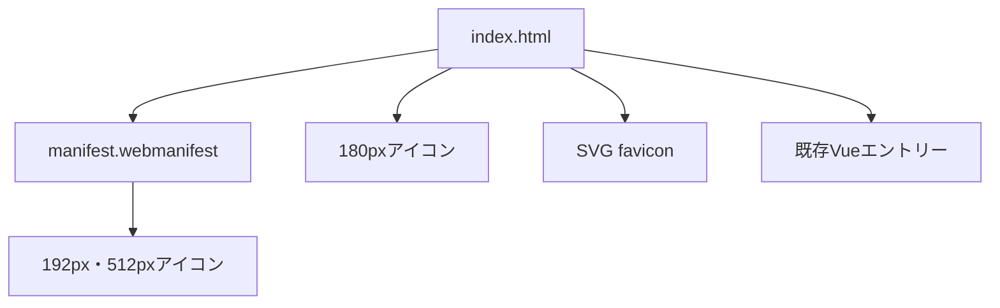
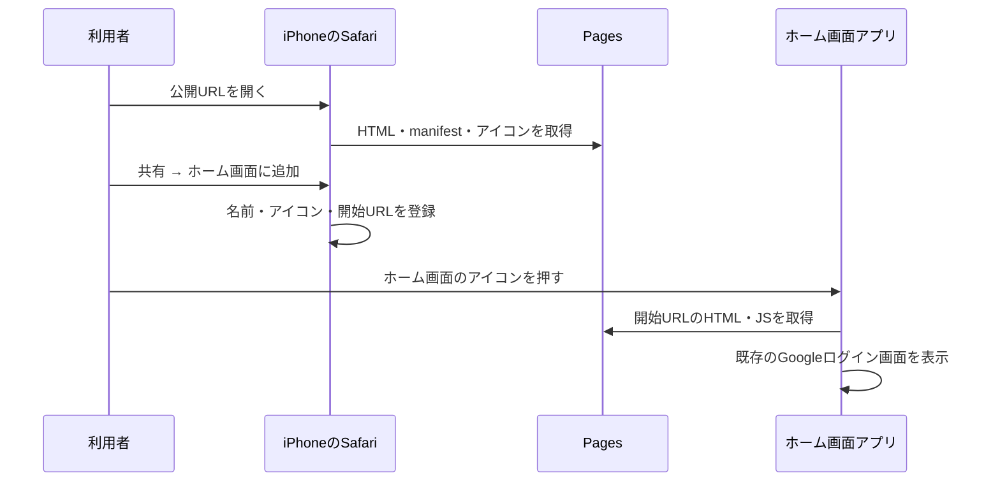

# ホーム画面から使うIT Discovery

[README](../README.md) · [フロントの構成](frontend-architecture.md) · [Googleログイン](authentication.md)

## 今回の範囲

HTTPSの公開画面を、名前・アイコン付きでホーム画面へ追加し、ブラウザのアドレスバーがない専用ウィンドウで起動する。App Storeへの公開は不要。オンライン利用を前提にし、オフライン起動・記事キャッシュ・通知・Service Workerは追加しない。更新は通常のWeb配信に従い、アプリを閉じて開き直すと新しいHTMLを読み込む。

GoogleログインとAPIの許可判定は既存の構成を使う。トークンは引き続きメモリだけに保持する。Safariでログイン済みでもホーム画面側でログインを求められる場合がある。再ログインは登録済みの同じGoogleアカウントを使う。PWA化のためにCookie・トークン永続保存・APIの公開範囲を変えない。

## 配信ファイルと責任

| ファイル | 役割 |
|---|---|
| `apps/web/index.html` | manifest・favicon・iPhone用180pxアイコン・iOS向けメタ情報への入口 |
| `apps/web/public/manifest.webmanifest` | アプリ名、固定ID `/`、開始URL `/`、対象範囲 `/`、standalone、色、192/512pxアイコン |
| `apps/web/public/icons/app-icon.svg` | コンパスの原画とfavicon。PNGも同じ原画から生成 |
| `apps/web/public/icons/*.png` | iPhone用180px、manifest用192/512px。不透明な背景でOSの切り抜きに対応 |
| `apps/web/src/app/style.css` | ノッチ・ホームインジケーター・横向きの安全領域をbodyの余白に反映 |
| `ArticleListLayout.vue` | スクロール時のstickyツールバーも安全領域を避ける |

512pxアイコンはmaskableにも使う。コンパス全体を中央の直径80%の安全領域内に収め、角の丸みは画像に描かずOSに任せる。PNGの変更時はSVGも更新する。原画からの再生成例（開発用にInkscapeがある環境）：

```sh
inkscape apps/web/public/icons/app-icon.svg --export-type=png --export-filename=apps/web/public/icons/apple-touch-icon.png --export-width=180 --export-height=180
inkscape apps/web/public/icons/app-icon.svg --export-type=png --export-filename=apps/web/public/icons/icon-192.png --export-width=192 --export-height=192
inkscape apps/web/public/icons/app-icon.svg --export-type=png --export-filename=apps/web/public/icons/icon-512.png --export-width=512 --export-height=512
```

Viteはpublicのファイルをそのままdistへコピーする。ランタイムやビルドの追加依存はない。記事VM・Modelにインストール処理を持たせない。

### 配信ファイルの参照関係



### 追加と起動の順序



## iPhoneで追加する

1. PagesのProductionデプロイが成功してから、Safariで <https://it-discovery.pages.dev/> を開く。
2. 共有メニューの「ホーム画面に追加」を選ぶ。見つからなければ共有メニューを下へスクロールする。
3. コンパスのアイコンと「IT Discovery」を確認する。「Webアプリとして開く」が表示されるiOSではオンにして追加する。
4. ホーム画面のアイコンから起動し、登録済みGoogleアカウントでログインする。
5. 一覧・気になる切り替え・ピン・仕分け・元記事を開く操作を確認する。

既に追加した古いアイコンは名前や画像が更新されない場合がある。仕分けを終了してサーバー保存を確認してから、古いホーム画面アイコンを削除し、Safariから追加し直す。未送信の仕分けがある間は削除しない。キャッシュやサイトデータを一律に削除する手順は使わない。

## 確認項目

ビルド確認：

```sh
npm run build -w @it-discovery/contracts
npm run test -w @it-discovery/web
npm run build -w @it-discovery/web
```

公開後は `/manifest.webmanifest` がHTMLではなくJSONで、`/icons/apple-touch-icon.png`・`/icons/icon-192.png`・`/icons/icon-512.png` が指定サイズのPNGとして取得できることを確認する。Pagesのビルドコマンド、出力先 `apps/web/dist`、既存の環境変数は変更不要。バックエンドの更新も不要。

実機での最終確認は次を別々に行う。デスクトップの画面幅変更ではiOSの追加・Googleログイン・安全領域まで保証できない。

- ホーム画面から専用ウィンドウで起動できる。
- Googleログイン後に一覧・仕分け・保存ができる。閉じて開き直しても同じアカウントで保存結果を読める。
- 縦向き・横向きでノッチとホームバーに操作が重ならず、スクロール中もツールバーを押せる。
- 元記事を開いてアプリへ戻れる。

## 参照

- [WebKit：Home Screenのstandaloneとアイコン](https://webkit.org/blog/13878/)
- [WebKit：Safari 26のWebアプリ](https://webkit.org/blog/17333/webkit-features-in-safari-26-0/)
- [Web App Manifest](https://www.w3.org/TR/appmanifest/)
- [web.dev：manifestとアイコン](https://web.dev/articles/add-manifest)
