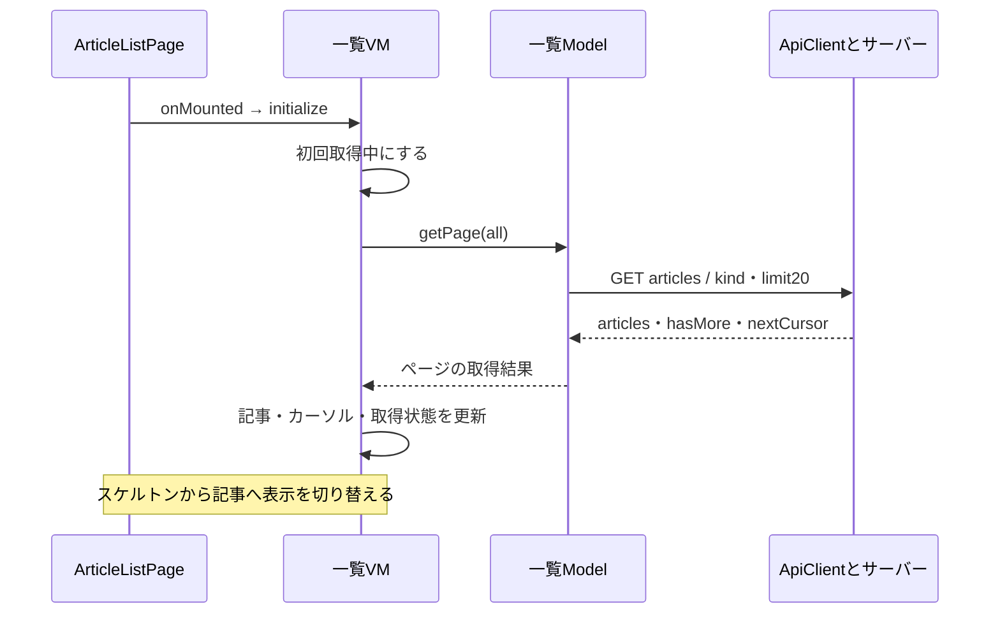
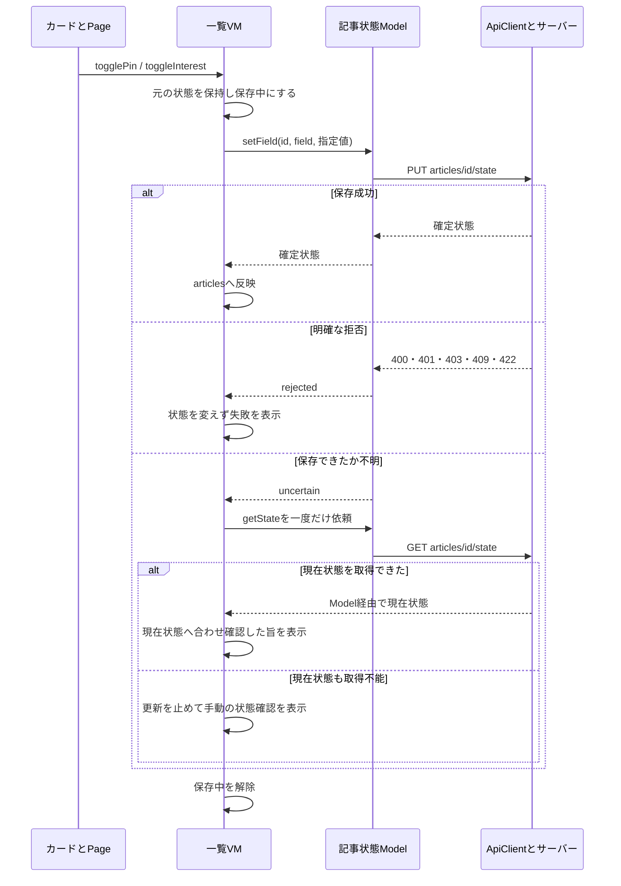

# シーケンス図：一覧の取得と状態変更

更新日：2026-10-20

[README](../README.md) · [フロントの構成](frontend-architecture.md) · [一覧操作](article-list-state.md) · [状態変更API](article-state-api.md)

一覧はページ表示開始で取得する。ピン・気になるは保存中の部分着色と操作制限を使い、成功後に登録状態を確定する。操作ID・永続保存・自動再送・起動同期の旧方式は撤去した。仕分けの端末保存・起動統合は後続Issue。

## 一覧取得

フィルター変更時は旧通信の中止と要求番号の更新を行い、新しい条件で先頭から取得する。末尾の240px手前でmoreイベントを受け、VMが現在のフィルターとカーソルで追加取得する。取得中の重複要求は出さない。成功時だけカーソルを進め、記事IDの重複を除く。

初回・更新・追加が失敗したら再試行ボタン。更新・追加の失敗は既存記事を保持する。取得日時・記事IDの降順で並べる。一覧更新はDBを読み直す処理で、外部情報源の収集を開始しない。

## ピン・気になるの保存と失敗

同じ記事の二つのボタンは保存中に無効化する。別の記事は独立して操作できる。気になる一覧での解除は成功してから記事を外す。404は削除済み通知を出して一覧から除く。

更新要求を自動再送しない。GETで取得する現在状態は元のPUTの成功・失敗の証明ではない。ページを閉じる際に通信の中止を依頼するが、サーバー保存の取り消しは保証しない。次回起動では通常の一覧取得でサーバーを読む。

## 元記事を開く・既読

画面から元記事を開く処理は未接続。受付判定の仕様は[操作方針](operation-policy.md#合意済み外部記事と既読)を参照する。ArticleStateModel.recordOpenedは日時指定の直接保存を用意しているが、端末保存・起動時再送は行わない。外部への移動を既読保存の完了まで待たせない。サーバーは古い日時で最後に開いた日時を巻き戻さない。
