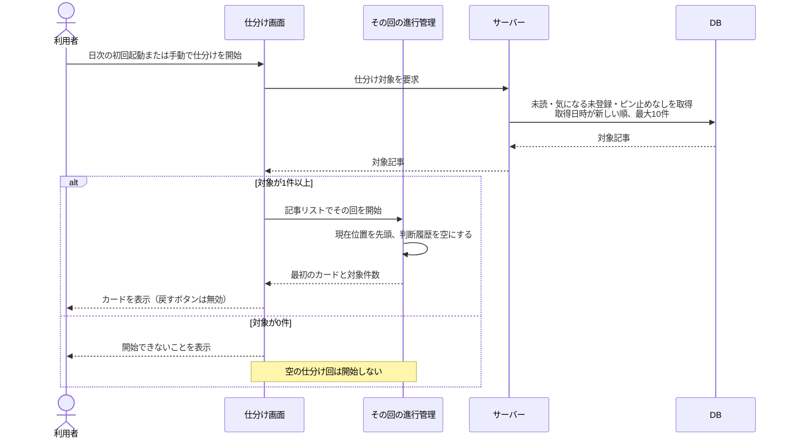
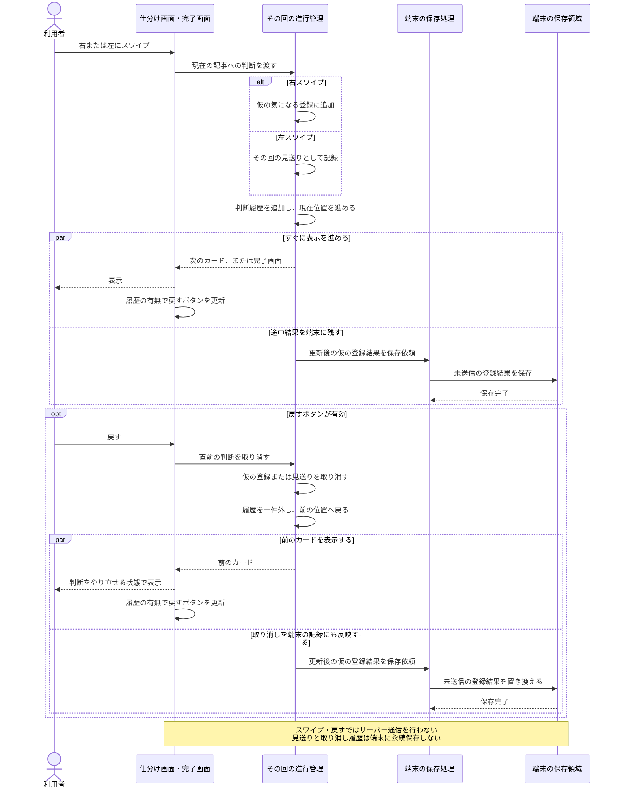
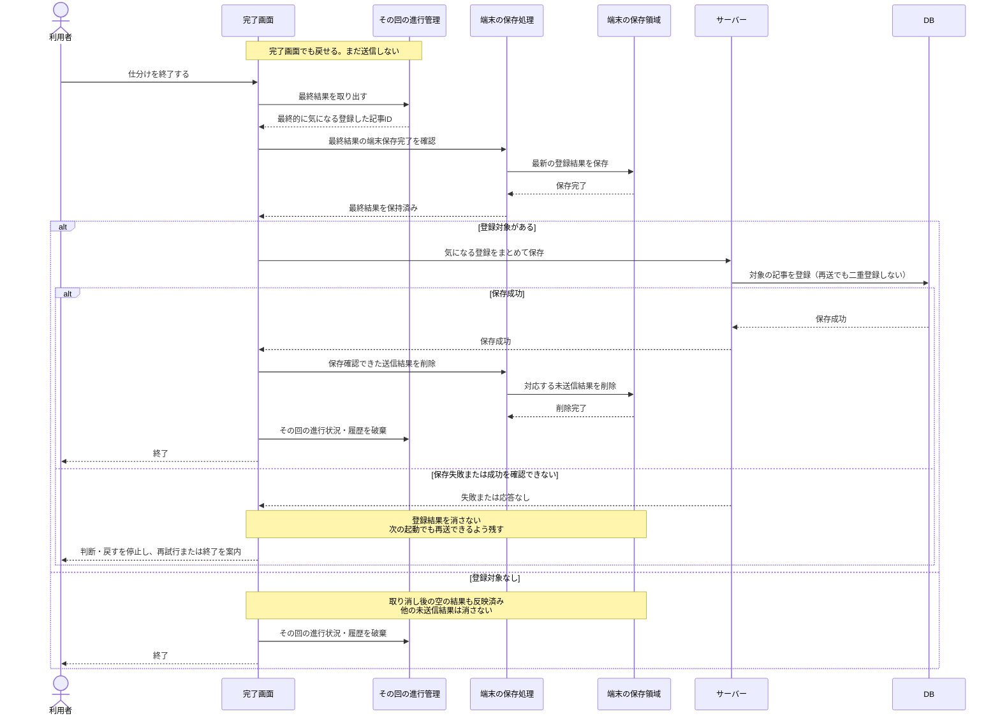
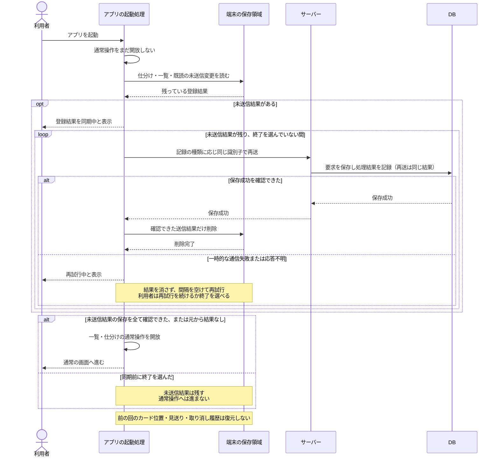
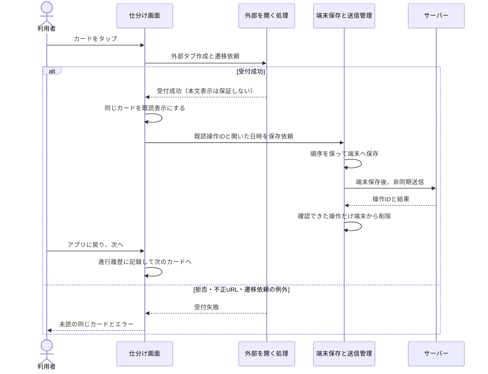
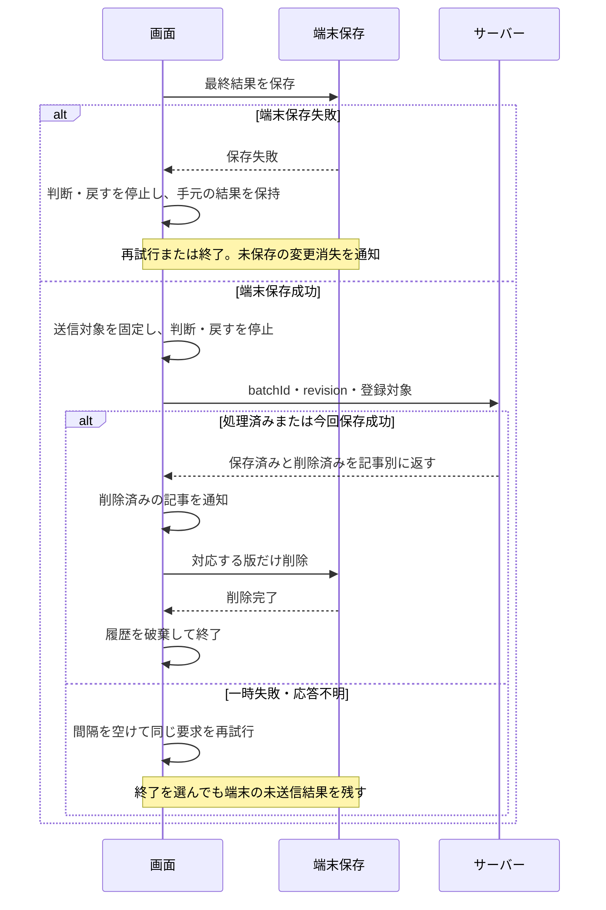

# シーケンス図：仕分けと結果の保存

更新日：2026-10-15

[READMEに戻る](../README.md) · [ルール](rules.md) · [状態遷移図](state-transitions.md) · [ユースケース](use-cases.md) · [一覧のシーケンス](sequences-list.md)

仕分けの操作はサーバー通信の完了を待たずに進める。「気になる」の途中結果を端末に保存し、終了時にまとめて送信する。途中でアプリを閉じても、次の起動時に残っている登録を送信する。仕分けの続き自体は再開しない。

図は上から下へ時間が進む。`alt` は条件分岐、`opt` は条件を満たす場合だけの処理、`par` は並行して進める処理を表す。通常の処理を中心に描いた設計図であり、実装済みの挙動ではない。

## 登場人物と保存する情報

| 登場人物 | 役割 |
|---|---|
| 利用者 | 開始、スワイプ、戻す、記事を開く、終了の操作をする |
| 画面 | カード・完了画面を表示し、履歴の有無で戻すボタンを有効・無効にする |
| その回の進行管理 | アプリのメモリで対象記事・現在位置・判断履歴・仮の気になる登録を管理する |
| 端末の保存処理 | サーバー未保存の気になる登録を非同期で端末へ保存する |
| 端末の保存領域 | 起動し直しても残る未送信の登録結果を保持する |
| バックグラウンド送信 | 画面操作を待たせずに既読の保存を依頼する |
| サーバー・DB | 記事と永続的な気になる・既読・ピン止めを管理する |
| 外部を開く処理 | 外部タブ作成と遷移依頼の受付を確認する。本文表示は判定しない |

これらは責任を表す役割であり、具体的なクラス名・API名の指定ではない。[技術構成](architecture.md)ではVue・Nest・SQLiteを選び、端末の未送信保存はIndexedDB＋idbで実装する。

端末に残すのは、途中で選んだ「気になる」のうち、まだサーバーに保存できていない結果。見送り・現在位置・取り消し履歴を次の起動のために保存する必要はない。

## 1. 仕分けを開始する

毎日の初回起動時に対象があれば自動開始し、その後も自由に開始できる（SORT-19）。起動時の未送信同期があれば、その完了後に判定する。日次判定は端末ごとに日付を保存し、0件でもその日は再度自動開始しない。外部情報源の収集は呼ばず、DBに保持している記事から選ぶ。開始時のカード情報と順序をその回で固定する。

ルール：SORT-01〜04・19。1〜9件でも開始できる。起動時に未送信の登録が残っている場合の処理は図4を参照。起動時の同期を完了してから開始する（SORT-18）。

## 2. 登録・見送り・取り消しを手元で処理する

右スワイプによる登録は、終了確定まで仮の判断として扱う。取り消しも手元だけで行い、サーバーへの登録・解除要求は出さない。

ルール：SORT-05〜11、13〜15。履歴がなければ戻すボタンを無効にする。履歴のある範囲で繰り返し戻せる。既読・ピン止めは取り消さない。

端末保存は非同期で、画面表示の前提にしない。ただし保存時間がゼロという意味ではなく、保存完了前の強制終了では最後の変更が残らない可能性がある。

保存処理が前後して古い結果で上書きされないよう、依頼を順序どおり処理するなどの仕組みが必要。図の「更新後の結果」は右スワイプの追加だけでなく、取り消した記事を送信対象から外すことも含む。

## 3. 終了時に最終結果をまとめて保存する

途中でも「仕分けを終了する」で判断済みの結果を確定できる。完了画面を出しただけでは送信しない。「仕分けを終了する」で最終的な登録を送る。見送りや途中の判断履歴は送らない。

ルール：SORT-11〜17。「登録対象なし」の場合は気になる保存の通信が不要。

最終結果を端末に確保してから送信する。送信対象の版を固定し、送信中の判断・戻すを止める。保存成功を確認して消すのは、その送信で確定した結果だけとする。別の未送信結果や、送信後に新しく発生した変更まで消さない。

端末保存失敗では判断・戻すを停止し、手元の最新結果の再保存または終了を案内する。サーバーに保存できたのに応答を受け取れなかった場合でも、同じ登録を安全に再送できるようにする。

## 4. 起動時に残っている登録を同期してから操作を開始する

終了直前の通知や送信の成功には依存しない。端末に仕分け・一覧・既読の未送信変更があれば、同期を解消するまで一覧・仕分けの通常操作を待機させる。再送前に一覧で解除する操作を受け付けないため、その競合の優先順位は不要。

ルール：SORT-08、14〜18。途中終了していた場合は、端末に残っている最後の登録結果を送る。取り消しが保存済みなら、その記事は送信対象に含めない。

通常の一覧取得と日次判定は同期完了後に行う。端末の保存領域が消去された場合は未送信結果を復元できない。削除済みは記事ごとに知らせてその項目を解消する。不正要求は自動再試行を止め、修正または明示的な破棄を案内する。

## 5. 元記事を開き、既読を非同期で保存する

外部から戻ったら同じカードを表示し、「次へ」で進む。左右の判断は行わず、その記事も最大10件のうち1件と数える。次への進行を戻しても既読は取り消さない。

外部への移動や画面表示は端末保存・既読送信の完了を待たない。端末保存前の強制終了では最後の変更を失い得る。端末保存済みの既読は、応答不明でも残して再送する。気になる状態は変更しない。[既読の判定方法](operation-policy.md#合意済み外部記事と既読)を参照。

## 6. 保存失敗・削除済みと同期完了

サーバーは有効な登録と処理結果を一つのトランザクションで保存する。削除済みの記事を再作成しない。成功後に端末の削除だけ失敗しても、同じ要求の再送は同じ処理結果を返す。[再送と恒久エラー](operation-policy.md)に従う。

## 関連するシーケンスとクラス図

[クラス図](classes.md)にデータ・アプリ・サーバーの責任を整理した。

[一覧の取得・追加読み込み・登録とピンの表示変更・元記事を開く処理](sequences-list.md)、[サーバーの定期収集・更新・保持と削除](sequences-server.md)は別のシーケンスにまとめた。今回の一括送信は仕分けの登録を対象とし、一覧の変更まで一括送信にする仕様ではない。

クラス図では、進行管理、端末への未送信結果の保存、送信・再送、サーバー側の登録をそれぞれの責任として検討する。
