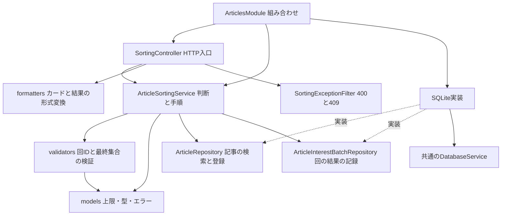
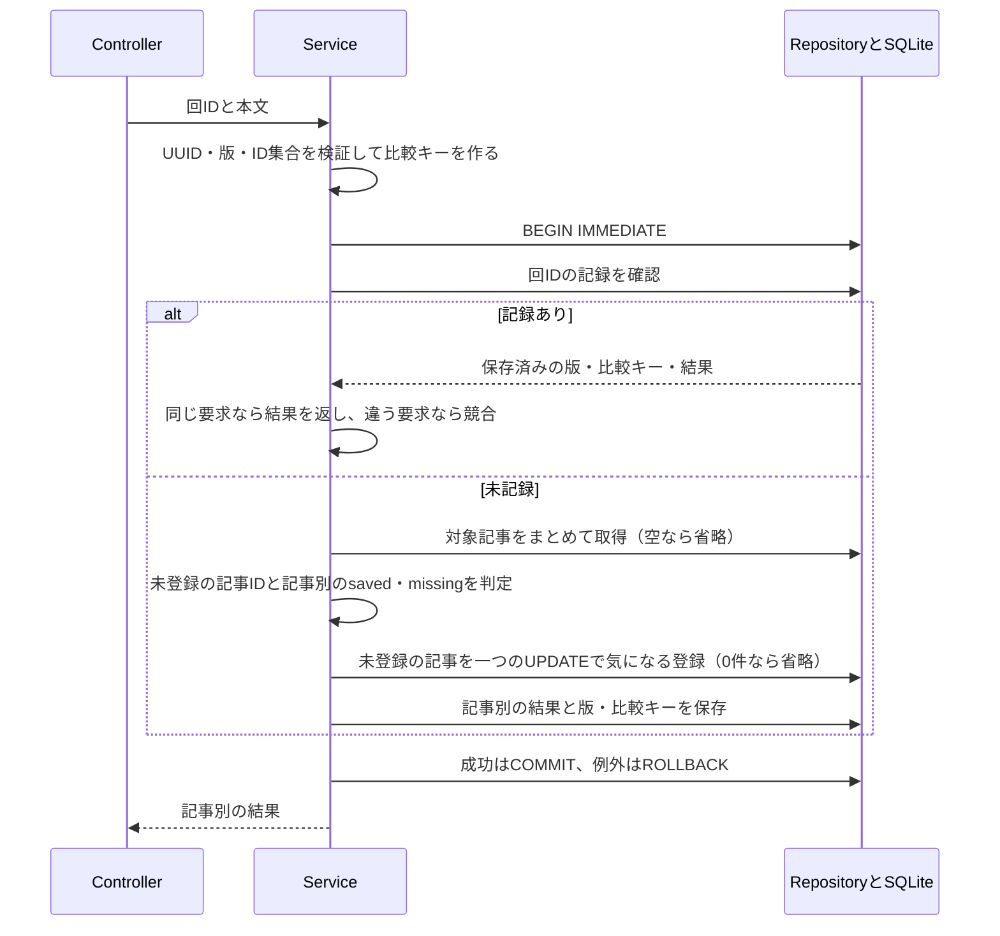

# Issue #9：仕分け対象取得と気になるの一括登録API

[README](../README.md) · [操作方針](operation-policy.md) · [状態変更API](article-state-api.md) · [HTTP配置](http-structure.md)

仕分け開始時の最大10件を取得し、終了時の最終ID集合をまとめて登録する。カードの判断・戻す・端末保存・日次自動開始はフロントの後続Issueで実装する。サーバーには見送り・カード位置・判断履歴を保存しない。

## 1. 開始時の対象を取得する

```http
GET /api/sorting/candidates
```

- 未読（lastOpenedAtがnull）・気になる未登録・ピンなしの記事を、取得日時の降順、同時刻は記事IDの降順で最大10件返す。
- 応答は`{ "articles": [...] }`。各記事の形式は[一覧API](article-list-api.md)と同じ。日時はISO文字列、欠損した概要・公開日・アイコンなどはnull。
- 0件でもHTTP 200で空配列を返す。1〜9件ならその件数で開始できる。ページングや件数変更用の引数は設けず、クエリを付けても検索条件や上限を変更しない。
- GET自体は既読・登録・見送りを変えず、記事を予約しない。繰り返し取得すると同じ対象が返り得る。
- その回のカード情報・順番はフロントがこの応答を保持する。途中の新着や更新を自動で差し込まない。次の回を開始するときは改めて取得する。
- 外部のRSS/APIへの収集は行わない。

## 2. 終了時に登録する

```http
PUT /api/sorting/interest-batches/389ad904-c687-472e-a187-20441c731425
Content-Type: application/json
```

```json
{
  "revision": 3,
  "articleIds": [12, 8]
}
```

| 値 | 条件・意味 |
|---|---|
| URLのbatchId | 端末が仕分け回ごとに作るUUID v4。大文字・小文字は同じIDとして扱う |
| revision | 端末の仮結果の版。1以上の安全な整数。送信開始時に固定する |
| articleIds | 最終的に選んだID集合。正の安全な整数を0〜10件、重複なし |

余分なフィールド、見送り・判断履歴、文字列の数値、重複ID、11件以上は400で拒否する。ID集合の列挙順は意味を持たないため、コピーを昇順へそろえて比較し、結果もID昇順で返す。カードの表示順を変更する指示ではない。

- 対象の記事があれば、気になるをtrueにする。既読・ピンを変更しない。すでに気になるなら書き込み不要で保存済みとする。
- 開始後に既読・ピンが変わっていても、最終登録の対象にはできる。未読・未登録・ピンなしは「開始時の抽出条件」。終了時にもう一度その条件を満たすことは要求しない。
- 送られなかったIDを解除しない。保持されていないIDは記事を作り直さずmissingとする。
- 通常、登録対象0件なら通信は不要。明示的に空集合を送った場合も、空の結果を確定・記録できる。

応答例：

```json
{
  "batchId": "389ad904-c687-472e-a187-20441c731425",
  "revision": 3,
  "results": [
    { "articleId": 8, "status": "saved" },
    { "articleId": 12, "status": "missing" }
  ]
}
```

missingは「現在DBに保持されていない」確定結果。削除済みか未取得かまでは区別しない。保存済みとmissingが混在してもHTTP 200で結果を返し、フロントは登録できなかった記事を知らせて未送信を解消できる。全てmissingでも同様。

## 3. 再送と結果確認

```http
GET /api/sorting/interest-batches/389ad904-c687-472e-a187-20441c731425
```

PUTで確定したものと同じ回ID・版・記事別結果を返す。成功後に記事が削除されても結果を保持する。これは現在の状態ではなく、処理を受理した時点の結果。

- 同じbatchId・revision・ID集合の再送は、記事を再更新せず以前の結果を返す。一覧で後から解除していても、古い一括登録で巻き戻さない。
- 一つの回でサーバーが受理する最終結果は一つ。同じbatchIdで別のrevisionやID集合を送ると409。新しい仕分け回には新しいbatchIdを使う。
- revisionは送信前の端末上の変更を識別する版であり、受理済みの回をサーバー上で更新するための番号ではない。
- 応答不明は同じ識別子・版・内容で照会・再送する。409を避けるため自動的にIDや版を変更して再送しない。
- 照会で404でも、先の要求が処理中の可能性がある。失敗とは断定しない。
- フロントは回IDと版が一致した結果だけを端末から削除する。別版の照会結果で、手元の新しい記録を消さない。

| HTTP | code・状態 | 扱い |
|---|---|---|
| 200 | results内のsaved / missing | 最終結果が確定。混在しても通信失敗ではない |
| 400 | INVALID_SORTING_INPUT | 回ID・版・ID集合が不正。入力を修正する |
| 409 | BATCH_CONFLICT | その回が別版・別内容で確定済み。自動再送を止める |
| 404 | BATCH_NOT_FOUND | 結果未記録。元の要求の失敗を意味しない |
| 500 | Nest標準エラー | 予期しないDB障害。内部SQL・パスなどは返さない |

壊れたJSONはNest標準の400。3 APIの正常応答は`Cache-Control: no-store`で返す。

## コードの依存関係



入力検証は[Validator](../apps/api/src/articles/validators/article-sorting.validator.ts)、手順は[Service](../apps/api/src/articles/services/article-sorting.service.ts)を読む。Controllerのコメントにも、Serviceで実行する検証を記載した。候補の抽出SQLは[記事Repository](../apps/api/src/articles/repositories/sqlite-article.repository.ts)、回の保存形式は[結果Repository](../apps/api/src/articles/repositories/sqlite-article-interest-batch.repository.ts)で確認できる。DBからの形式変換と共通の入力検証を混ぜない。

## 一括登録の実行順序



記事の取得は`findByIds`のSELECT一回、変更は`registerInterests`のUPDATE一回にまとめる。記事ごとのループではDBへアクセスしない。登録済みの記事は更新対象から除き、結果の順序はRepositoryの返却順に依存させない。

missingは例外ではない。有効な登録と結果記録は一つのトランザクションで確定し、DB障害では途中の変更も全て取り消す。二つのRepositoryは同じDatabaseServiceの接続を使う。同期トランザクション内に通信やawaitは入れない。

`0002_sorting-interest-batches.sql`で結果保存用の表を一つ追加する。記事への外部キーは持たせず、記事削除後も結果を保持する。初期仕様では自動期限削除を行わない。通常起動または`npm run db:migrate -w @it-discovery/api`で適用し、既存の記事・状態・状態操作記録は維持する。

## 確認

- Service26件、SQLite13件、HTTP27件を追加。既存分を含むAPI193件・web20件、計213件が成功。
- 全体の型チェック・ビルド成功。ビルド済みNestでも、一時DBで対象10件、savedとmissingの混在、結果照会、解除後の再送、版違いの競合を確認した。


Serviceの判断・入力検証、実SQLiteの候補抽出・再接続・一括登録・ロールバック、HTTPの0件〜10件・同時再送・結果照会・エラー応答を確認する。既存一覧と状態変更のテストも合わせて実行する。確認用の一時DBだけを使い、起動中アプリのDBへは変更しない。
