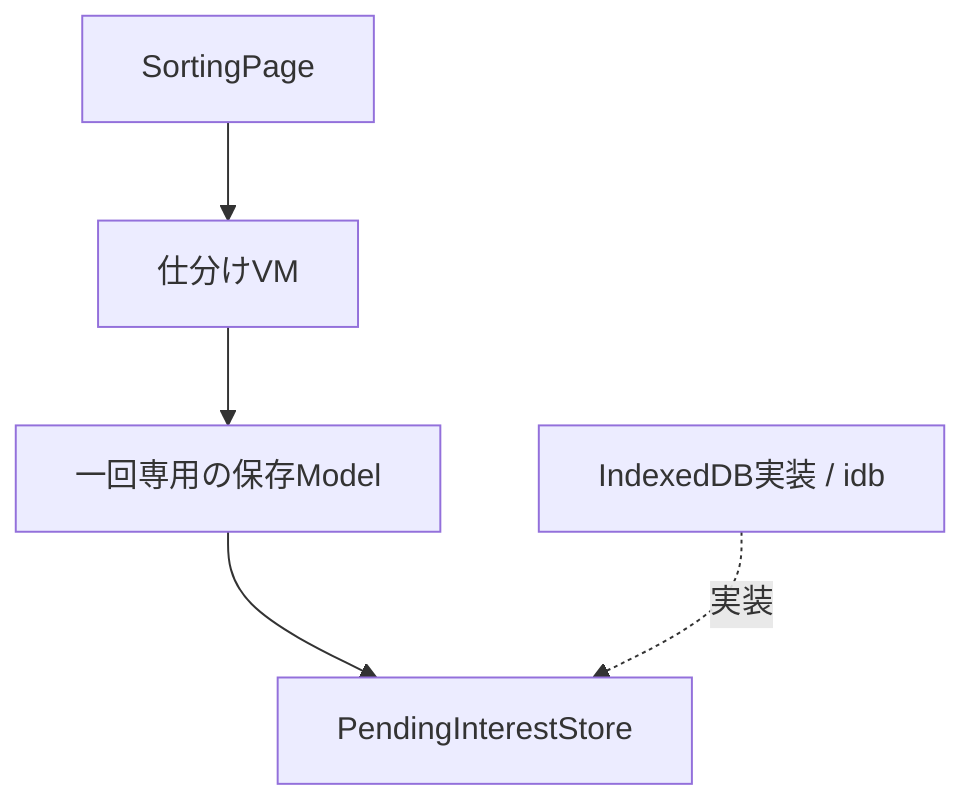
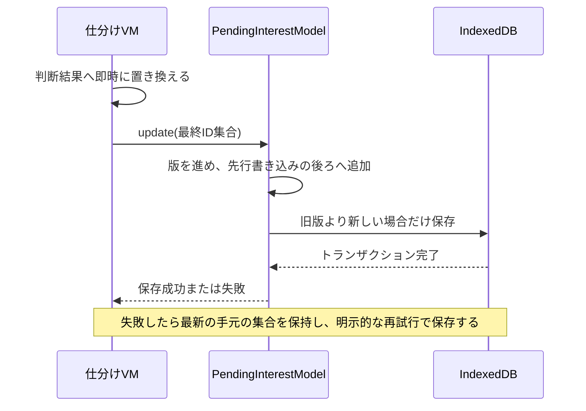
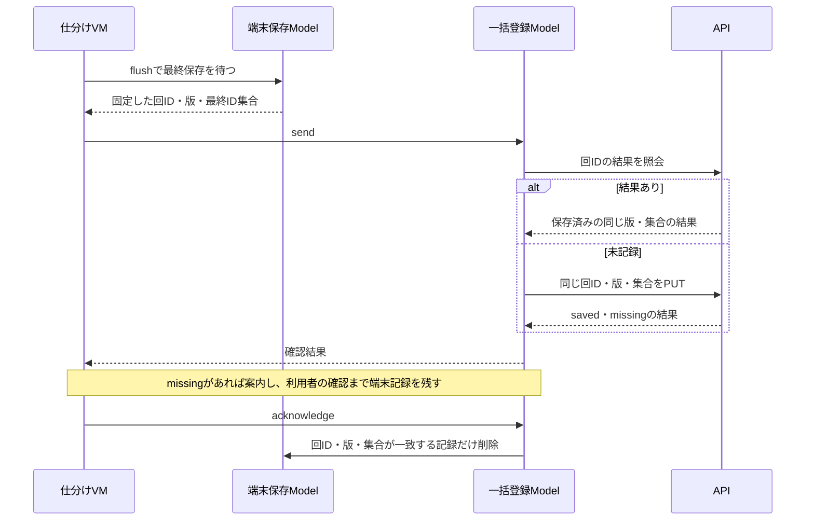

# 仕分けの端末保存

[仕分け画面](sorting-ui.md) · [フロント構成](frontend-architecture.md) · [一括登録API](sorting-api.md)

## #14：順序を保つ端末保存

保存は仕分けだけが対象。ピン・一覧の気になる・既読に永続キューを戻さない。

PendingInterestBatchはbatchId（回のUUID v4）・revision（変更ごとの版）・articleIds（取り消しを反映した最終ID集合）だけを持つ。記事本文・カード順・見送り・位置・判断履歴は復元しない。空集合も最新版として書き、古い登録が復活しないようにする。

| 層 | 実装 | 役割 |
|---|---|---|
| VM | useSortingViewModel | 表示を先に進め、保存中・失敗を表示する。失敗後は判断と戻すを止める |
| Model | PendingInterestModel | 一回専用のID・版・最新集合。Promiseを順に実行し、失敗後は手動再試行まで後続保存を止める |
| 保存の契約 | PendingInterestStore | 読み出し・版付き保存・同じ内容の条件付き削除 |
| 外部接続 | IndexedDBPendingInterestStore | idbを使う。版の比較と更新・条件付き削除を各一つのトランザクションで行う |

古い版の遅延書き込みはDB側でも無視する。同じ版の異なる内容はエラー。成功確認時の削除は回ID・版・集合が全て一致した時だけ行い、新しい結果を消さない。

DB名はAPIの絶対URLごとに分ける。旧一覧操作の保存先は読み取り・送信・削除しない。idb 8.0.4を使用し、保存の確認にはfake-indexeddbを使う。実行時は書き込み要求の成功だけでなくtransaction.doneまで待つ。

## 限界と確認

端末保存完了前の強制終了、ブラウザの保存領域削除・容量不足までは保証しない。失敗時は未保存の可能性を表示する。終了処理は最新保存を待つ。前回の回は再開せず、保存した最終集合だけが次回の送信対象となる。

テストで、直列化、保存失敗後の停止と最新版の再試行、取り消し後の復元、旧版の後着、同版矛盾、条件付き削除、壊れた記録の検出、VMの停止と再開を確認する。

参照：[idb](https://github.com/jakearchibald/idb)（transaction.done）、[IndexedDB](https://developer.mozilla.org/en-US/docs/Web/API/IndexedDB_API) 。

## #15：終了時の固定・送信・完了解消

終了ボタンを押したら判断と戻すを止め、PendingInterestModel.flushで最後の端末保存を待つ。その版とID集合を固定してInterestBatchSyncModelへ渡す。完了画面の表示だけでは送らない。空集合なら結果照会もPUTもせず、対応する端末記録だけを条件付きで解消する。

一時エラーは1・2・4・8・16・30秒、以降30秒間隔で再試行する。オフライン通知中はタイマーを止め、復帰時に再開する。400・401・403・404（PUT）・409・422や不一致応答は自動再送を止め、記録を残して手動の復旧を待つ。結果照会の404は未記録の意味で、元の要求の失敗確定ではない。

サーバー成功後の端末削除失敗でも記録を残す。次の再試行は結果照会から行い、保存済みならPUTせず削除を再試行する。別版が端末に存在する場合は古い成功で削除しない。アプリ終了時は通信を中止し、端末の未送信結果は消さない。
