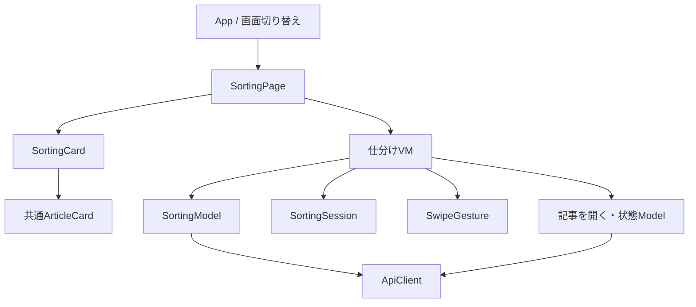
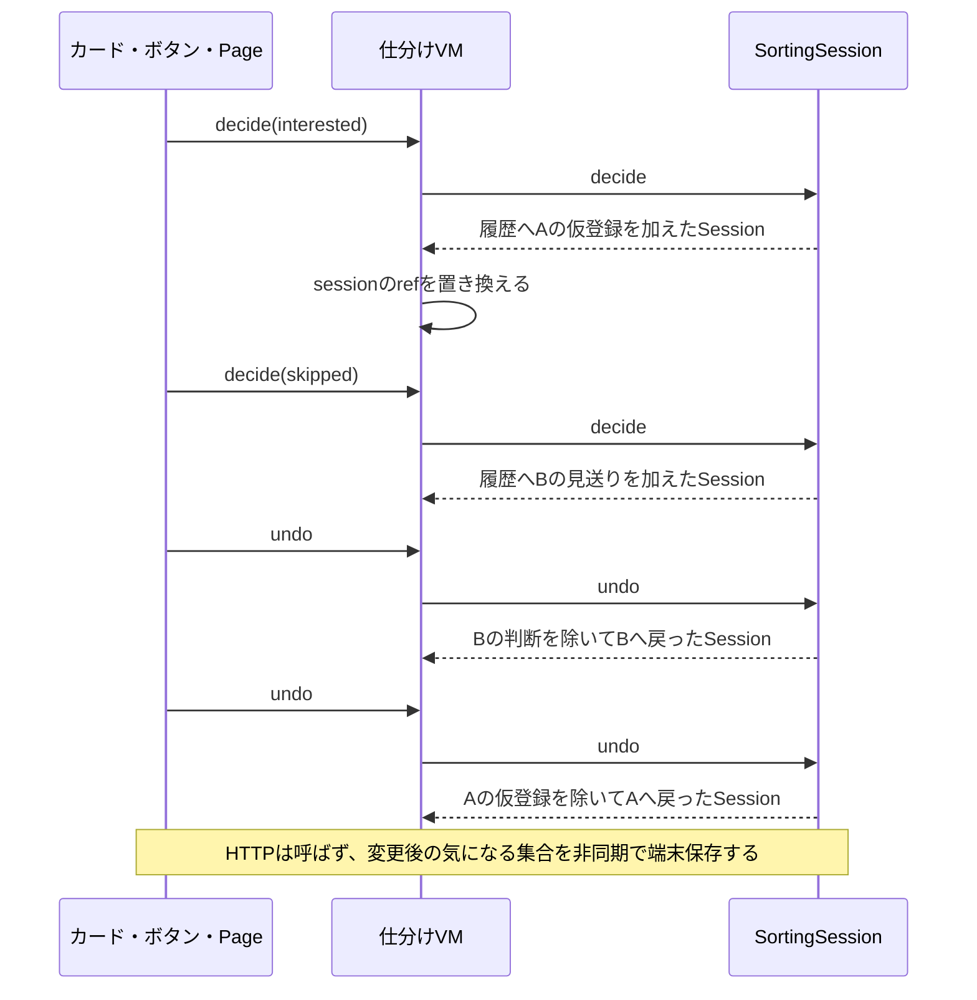

# 手動の仕分け・スワイプ・戻す（Issue #13）

[README](../README.md) · [対象取得API](sorting-api.md) · [操作ルール](rules.md) · [元記事を開く](article-opening.md)

一覧の「仕分けを始める」から最大10件を取得し、右スワイプで仮選択、左スワイプで見送りとして次へ進む。カードが主操作で、左右の方向案内を表示する。判断ボタンは支援技術向けに残し、キーボードでフォーカスした場合だけ表示する。「ひとつ戻す」は繰り返し使え、全件判断後の完了画面からも戻せる。

## 実装範囲と保存の制限

端末保存・終了時の一括登録・起動時復旧を[仕分けの保存処理](sorting-persistence.md)で接続した。判断は手元で即時に進み、最終ID集合を端末へ順序保存する。「仕分けを終了する」で最新の端末保存を待って一括登録し、成功確認した版だけを解消する。保存失敗では判断・戻すを止めて最新結果を残す。終了送信を開始した後は判断・戻すを再開しない。

仕分け中の一覧タブ・ピン操作・登録解除は設けない。通常の全件判断を登録成功として表示せず、「仮選択」として扱う。

## 責任と配置

| 役割 | ファイル（apps/web/src以下） | 担当 |
|---|---|---|
| 画面切り替え | app/AuthenticatedApplication.vue | 一覧と仕分けのPageを切り替える。データ取得や判断を行わない |
| Page | features/sorting/views/pages/SortingPage.vue | 表示開始・終了、イベントとVMの接続、beforeunload |
| Template | features/sorting/views/templates/SortingLayout.vue | header・intro・本文・footerの配置 |
| Organism | features/sorting/views/organisms/SortingCard.vue | Pointer操作を座標へ変換し、VMの判定結果でDOMを捕捉。ドラッグ後のクリックを抑止する |
| ViewModel | features/sorting/view-models/useSortingViewModel.ts | Sessionのref、取得・エラー・既読保存状態を管理。Modelへ依頼し、表示へ反映する |
| 取得Model | features/sorting/models/sorting.model.ts | 開始時に対象取得を依頼する |
| Session Model | features/sorting/models/sorting-session.ts | 固定カード・判断履歴と、仮登録・見送り・既読の次へ・戻すのルール |
| ジェスチャーModel | features/sorting/models/swipe-gesture.ts | 横方向の固定、距離、成立条件。DOMやVueには依存しない |
| 共通の記事処理 | features/articles/models/ | 一覧と同じ開く受付判定・既読の直接保存 |
| 通信 | infrastructure/api/ | 対象GETと実行時のJSON検証。見送り・履歴・位置は送信しない |

基本部品はPrimeVueのButton・Message・Skeleton・ProgressBarを直接使用する。共通のArticleCardとSourceBadgeを再利用し、仕分け専用の装飾ラッパーを増やさない。

## コードの依存関係

矢印はコード上で使う相手。ViewはAPI・Sessionの書き換えを直接行わず、VMもHTTPを直接呼ばない。組み立てはcreate-application-models.ts。AppはPageを作り替え、一覧へ戻ると一覧Pageが改めて初回取得を行う。URL別のルーティング・ブラウザ履歴管理は追加しない。

## 状態の持ち主

| 値 | 管理元 | 理由 |
|---|---|---|
| session | VMのshallowRef | 一回の固定カードと判断履歴。Modelの操作結果で値を置き換える |
| loading・error・openingError | VMのref | 初回取得・再試行、記事を開けなかった案内 |
| readStatus | VMのreactive Map | 記事ID別の既読保存中・失敗・結果不明と手動再試行日時 |
| currentArticle・total・processedCount | Sessionからのcomputed | 現在位置は履歴の長さから導く。独立した位置変数を増やさない |
| interestedIds・complete・canUndo | Sessionからのcomputed | 最終の仮登録集合、全件判断済み、戻せるか |
| canJudge・canNext・canExit | computed | 未読は左右判断、既読は次へ。端末保存エラーや送信中は終了操作を止める |
| departing | VMのref | 退出中は現在の記事を保持し、200ms後に一度だけ判断する。退出中の再入力・戻す・終了・元記事を開く操作を防ぐ |
| dragging | SortingCardのref | 指に追従中のCSS補間を外す。判断や保存の状態ではない |
| SwipeGesture | VM内のreactiveなModel | 指やマウスの開始位置・方向・移動量 |
| AbortController | VMの通常変数・Map | 終了後の通信中止と古い既読保存応答の無視 |
| pointerId・クリック抑止 | SortingCardの通常変数 | DOMのPointer捕捉と、記事リンクへの誤クリック防止 |

SessionはVueに依存しない値。開始時に記事・出典・状態をコピーし、その回の情報と順序を固定する。判断・戻す・既読の反映は新しいSessionを返し、VMのrefがその値一つを持つ。別Storeへ記事配列や希望値を二重保持しない。

## 判断と戻すの実行順序

開始時のGETは最大10件。0件ではSessionを作らず開始不可の表示、1〜9件でもその件数で開始する。初回の取得中はスケルトン、失敗は再試行を表示する。開始後に再取得してカードを差し替えない。見送った記事も次の回ではサーバーの抽出条件に従って再び対象になれる。

## スワイプと外部記事

横移動が縦より大きく12px以上になったら横操作に固定し、離す時に80px以上なら右＝仮選択、左＝見送り。短い移動は元へ戻る。縦に決まった操作は途中で横成分が増えても判断しない。縦スクロールはブラウザへ渡す。マウス・タッチ・ペンをPointerイベントで扱い、キャンセル・複数指では判断しない。

外枠がpointerdownの時点でcaptureを引き受ける。子リンクから外枠へcaptureが移った際のlostpointercaptureはbubblingするため、event.targetとevent.currentTargetが一致する場合だけキャンセルする。縦操作はtouch-action: pan-yでブラウザへ渡す。

ドラッグ中はCSSのtransitionを外し、移動量の160px制限も使わない。確定後は200msの退出表示を挟んで判断する。退出中は判断・戻す・終了・元記事を開く操作を止め、画面終了時は予約を解除する。reduced-motionでは移動アニメーションを省略する。

外側のSortingCardは記事交代後も残し、ドラッグ後に生じるclickを次の記事へ渡さない。内側の移動領域を記事IDで切り替え、文章展開をリセットする。ボタン操作はドラッグ開始の対象外。元記事のタップ・キーボード操作は共通のリンクを使う。

記事を開く受付が成功した時だけ同じカードを既読にし、保存を待たず元記事へ移動する。自動で次へは進めず、戻った既読カードは「次へ」で1件として数える。次へを戻すことはできるが、開いた事実・既読は戻さない。既読保存失敗でも次へ・戻すを妨げず、対象カードへ戻った時に手動保存できる。遅い既読保存応答は位置・仮選択・気になる・ピンを変更しない。

## 確認範囲

Session・VM・ジェスチャー・APIのテストで、A仮登録→B見送り→2回戻す、0/少数/10件、完了後の戻す、判断時にHTTP通信しないこと、固定カード、外部を開く・既読・失敗・終了を確認する。SSRで空表示・判断・完了・操作制限・既読表示を確認する。

Vueのクライアント用コンパイルとテスト用描画先で、実際のPointerハンドラ、次カード交代後のクリック抑止、縦スクロール・ボタン除外・キャンセルを確認する。実ブラウザや実機による画面・スワイプ・ポップアップ確認は未実施で、これらのテストをその代替保証とはしない。

## スワイプ不具合の回帰確認（#53）

子リンクからbubblingするlostpointercaptureをキャンセルしないことと、実際に描画されたtransformが動くことをクライアントVueのテストで確認する。VMでは退出中の再入力・開く・終了・戻すの制限、200ms後の一回だけの判断、dispose後に判断しないことを確認する。

`node scripts/check-swipe.mjs` はPlaywrightのChromiumへ実タッチ入力を送り、実際のApp→Page→VM→Model→描画で追従・右判断・左判断・短い操作・縦スクロール・戻すを確認する。APIだけ架空の3記事へ置き換え、本番には通信しない。CIのcheckではUbuntuランナーのChromeをCHROME_BINで指定して実行する。ローカルで環境変数を省略した場合はPlaywrightで導入したChromiumを使う。iPhoneのWebKit実機の確認は公開後に別途行う。
