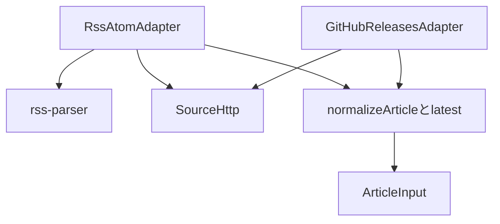
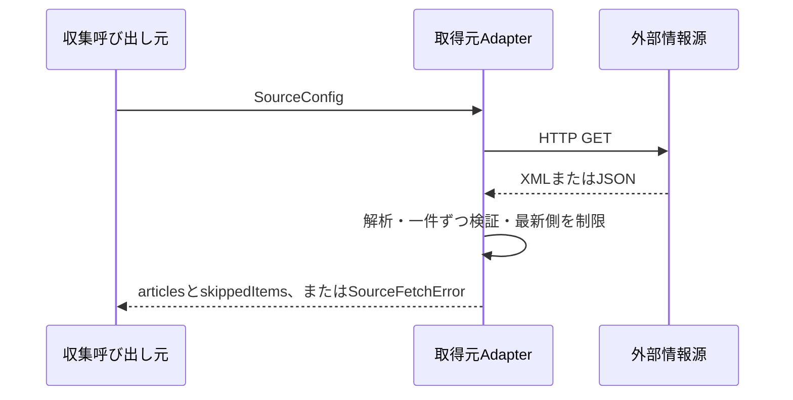

# 情報源の取得と変換

`collection/adapters` は外部のRSS・Atom・GitHub Releasesを読み、`ArticleInput`へ変換する。一覧・仕分けは取得元の形式を知らず、DBに保存済みの記事を読む。RSSのXML解析にはrss-parserを使い、アプリ固有の検証だけ共通のnormalizeArticleに置く。照合キーは既存のArticleServiceがsourceId＋外部ID（なければURL完全一致）で作り、タイトル一致やURLのクエリー除去を行わない。

タイトル・HTTP(S)のURLがない記事は一件だけスキップする。任意の説明・著者・日付がなければnullとし、壊れた日付でも記事は残す。日付ありは公開日時降順、同日時と日付なし同士は入力順を維持する。日付なしは日付ありの後ろに配置する。取得先全体の通信失敗・HTTPエラー・不正フォーマットは例外で返し、正常な0件と区別する。25秒でタイムアウトし、応答は20MiBまでとする。生データ・認証ヘッダーはエラーメッセージに含めない。

RSS・AtomはZenn、Cloudflare Changelog、YouTubeのGoogle Developersチャンネル、Syntax Podcastの既定取得先に対応する。YouTubeのmedia:descriptionも概要に使う。

GitHubは一覧APIの近傍を1ページ100件、`min(10, ceil(maxPerRun / 100) + 1)`ページまで調べる。APIの配列順やcreated_atを公開順と見なさず、取得範囲内でpublished_at降順に最大maxPerRun件を選ぶ。prereleaseを含みdraftを除く。過去全件を遡らないため、この範囲外にある古いコミットに付いたリリースを必ず発見する保証はしない。名前がなければtag_nameを表示し、識別には数値のrelease IDを使う。

`GITHUB_TOKEN`は任意。公開リポジトリなら未設定でも利用できるが、API制限の403/429は取得失敗として扱う。設定時はhttps://api.github.com/repos/{owner}/{repo}/releasesにだけ送り、リダイレクトを許さない。トークンは環境変数で設定し、ファイルへ保存しない。

## テスト用サンプル

`apps/api/src/collection/adapters/tests/fixtures/*-sample.xml` は2026-10-20に既定の4取得先から先頭3件のメタデータを抜き出して保存したもの。本文・概要・画像・音声は保存していない。元の名前空間と識別・日時・URLを維持し、テスト時には通信しない。`zenn.xml`等と`releases.json`は欠損・順序・同タイトル・下書きなどを検証する架空サンプル。実取得サンプルと架空の境界条件を区別している。

- [rss-parser](https://github.com/rbren/rss-parser)
- [GitHub Releases API](https://docs.github.com/en/rest/releases/releases)
