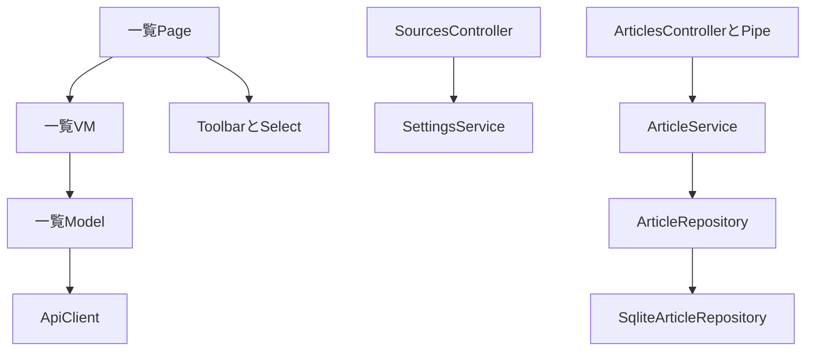
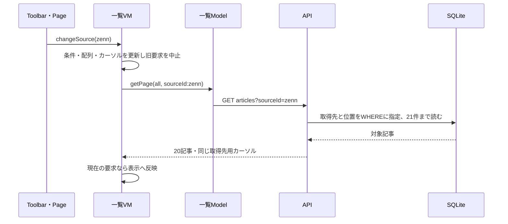

# 一覧の取得先フィルター（#55）

[README](../README.md) · [一覧API](article-list-api.md) · [フロント構成](frontend-architecture.md)

## 動作

取得先は「すべての取得先」または設定済みの1件を選ぶ。「すべて／気になる」と組み合わせる。Zenn・Cloudflare Changelogなど収集先そのものを指定し、記事・動画の種類分けではない。取得先を変更すると表示記事・続き位置を空にしてサーバーから先頭20件を取り直す。追加・更新・再試行も同じ条件を使う。仕分け対象にはこの条件を適用しない。

選択肢は最初の20記事から推測せず、`GET /api/sources`で全設定から取得する。収集停止中も過去記事を見られるよう含める。記事0件の取得先では空一覧になる。選択肢の取得失敗は一覧表示を妨げず、専用の再試行を表示する。選択条件は一覧VMの寿命内で保持し、別ページから一覧を作り直した場合は全取得先へ戻る。

## API

```text
GET /api/sources
→ [{ sourceId, siteName, iconUrl }, ...]

GET /api/articles?kind=interested&sourceId=zenn&limit=20
GET /api/articles?kind=interested&sourceId=zenn&cursor=...
```

`/sources`はmain.tsの既存グローバル認証の対象で、匿名公開の例外を追加しない。Cache-Controlはno-store。収集のendpoint・enabled・maxPerRunや秘密情報は返さない。表示情報への変換はSettings機能のSourcesControllerが担当し、SettingsServiceの公開メソッドを使う。

sourceIdを省略した既存要求は変更しない。空文字・複数指定・前後空白・制御文字・100文字超を400にする。形式が正しく存在しないIDは200と空一覧。パラメーターはDrizzleの比較条件に渡し、取得後の20件をクライアントで絞る方法は使わない。

カーソルには種類・日時・記事IDに加え、取得先を指定した場合だけsourceIdを含める。別取得先・全取得先・別種類への使い回しを拒否する。全取得先用の従来の3項目カーソルは継続利用できる。UTF-8の取得先名を含められるようカーソルの最大長は2048文字。新しいDB列・マイグレーションは不要。

## コードの依存関係



フロントの通信はModelを経由し、Toolbarはsourceイベントで親へ選択を通知する。選択状態はVMのselectedSourceId、選択肢はsources、取得状態はsourcesLoading・sourcesError。既存の要求番号で古い応答を捨て、保存中に別取得先へ切り替えた場合も対象外の記事を保存応答から挿入しない。

## 選択変更の実行順序



## 確認と更新

- 実HTTP＋SQLite：混在50記事から同日時でも20＋5件へ絞り込み、気になるとの組み合わせ・未指定・未知ID・入力拒否・カーソルの使い回し拒否。
- sourcesのHTTP応答：記事0件・停止中の取得先も含み、表示用の3項目だけを返す。
- VM：変更・追加・更新の条件、遅い応答の破棄、別取得先へ移った保存対象の混入防止、選択肢だけの再試行。
- CIの実ブラウザ：仕分け終了後に一覧のSelectからOther→Zennへ切り替え、表示記事が変わることを確認。

フロントはPagesのGit連携で更新する。APIにも変更があるため、mainのCI・GHCR公開成功後にVMの`.env`のAPI_IMAGEをそのmainコミットのイメージへ変更し、`sudo docker compose pull api`と`sudo docker compose up -d --no-build api`を実行する。VMでビルドしない。既存Google設定・SQLite・バックアップ設定は維持する。API更新前は選択肢の読み込み失敗を表示するが、通常の全取得先一覧は引き続き使える。
