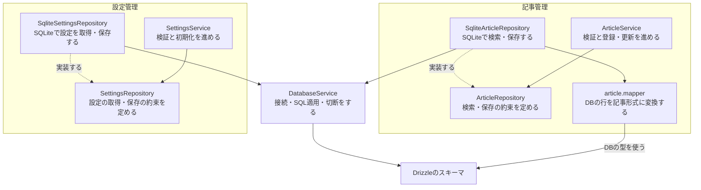
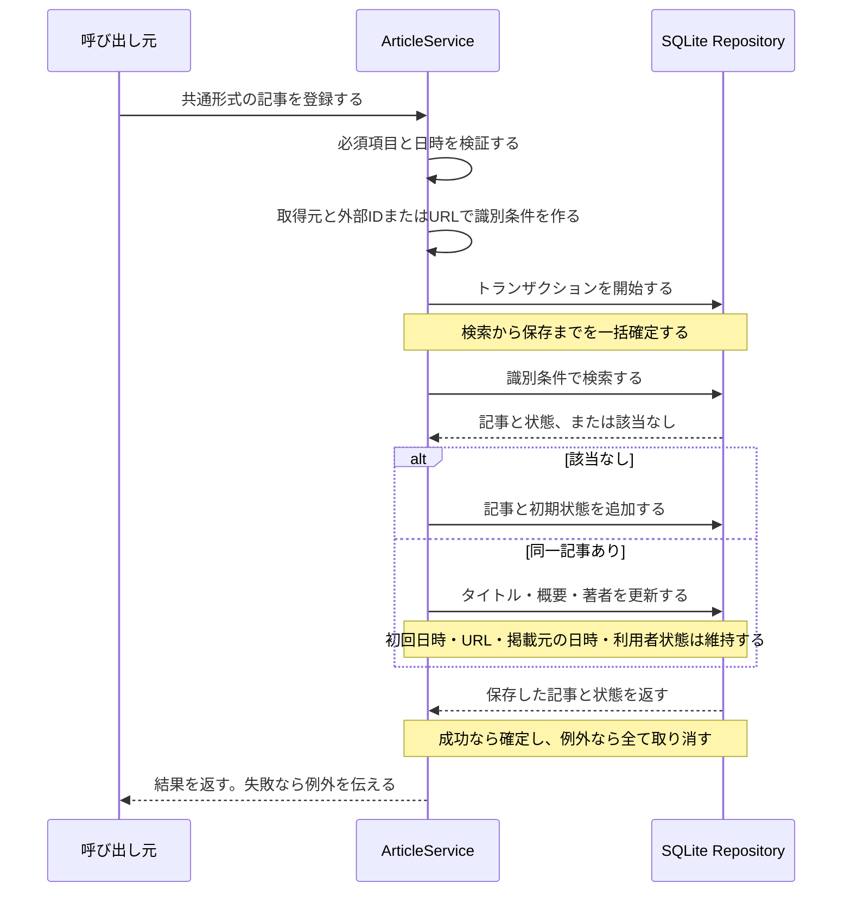

# PR #31：記事と設定の保存構成

[READMEに戻る](../README.md) · [全体の構成](architecture.md) · [DBの操作手順](database.md)

機能を最上位にまとめ、処理側が判断と手順を持つ。DB操作はRepositoryの抽象を通して頼む。レイヤードを土台に、ポートとアダプターの考え方を取り入れる。オニオンへの全面的な分割は行わない。

この記事は実装済みの保存基盤を説明する。記事API、収集、仕分け、保持期限による削除は後続Issueで扱う。

## 依存関係

矢印はコードが参照する向き。点線は抽象を実装する関係を示す。処理を実行する順番ではない。

ServiceはSQLite、Drizzle、テーブル定義を参照しない。記事の必須条件や設定の範囲はServiceが確認する。DBの一意制約・外部キー制約は保存側で守る。

DBとの形式変換はpersistence内に置く。記事ではmapperがDB専用の照合列を除く。設定ではSQLite RepositoryがDB内部の固定IDを除く。変換だけの小さな処理を必ず別クラスにするルールにはしない。

## 記事を登録・更新する順番

記事の登録・更新はArticleService.registerから利用する。タイトル・概要・著者を更新し、最初の取得日時・既読・気になる・ピン止めを維持する。概要・著者がなくなった場合はnullに更新する。本文の変更検出や独立した差分比較は行わない。

登録時にはURL・掲載元の日時も保存する。再取得時は今回合意した3項目だけを更新し、それ以外は維持する。識別キーやURLの正規化、ID有無の移行は行わない。

transactionは同期コールバックを一つの保存単位にする約束。SQLite実装が書き込み用のトランザクションを開始し、検索から保存までを守る。内部のinsertも記事と初期状態を一括保存する。入れ子は同じ接続のセーブポイントとして扱う。ServiceにSQLのトランザクション設定を渡さない。外部通信やPromiseを返す処理を入れない。

状態変更はArticleService.updateStateが入力を検証し、Repositoryが指定項目だけを保存する。既読判定、HTTP入力、再送順序は後続Issueで実装する。

## 設定を初期化する順番

SettingsModuleがSettingsService.initializeを呼ぶ。Serviceは保存済みの設定と取得先を確認し、足りない初期値だけを追加する。変更済みの値を上書きしない。同じ取得先URLが別IDで登録されている場合も追加しない。全体を一つのトランザクションにし、途中の失敗で初期化の一部だけが残ることを防ぐ。

DatabaseServiceは初期設定値を持たず、DB接続とSQLマイグレーションを担当する。

## Moduleの公開範囲

ArticlesModuleはArticleService、SettingsModuleはSettingsServiceだけを公開する。他の機能はServiceから操作を頼み、内部Repositoryを直接利用しない。

ModuleとDB操作コマンドは部品を組み立てる場所なので、具体的なSQLite実装を参照する。テストも実装を直接扱える。DatabaseModuleは必要なModuleが明示的にimportし、同じ接続を共有する。

## コードを読む順序

1. [記事の処理](../apps/api/src/articles/application/article.service.ts)：検証・識別・新規か更新かの判断をする。
2. [記事の約束](../apps/api/src/articles/application/article.repository.ts)：検索・保存・トランザクションを定める。
3. [SQLiteの記事操作](../apps/api/src/articles/persistence/sqlite-article.repository.ts)：約束をSQLiteで実現する。
4. [設定の処理](../apps/api/src/settings/application/settings.service.ts)：検証と初期値の追加判断をする。
5. [設定の約束](../apps/api/src/settings/application/settings.repository.ts)と[SQLite実装](../apps/api/src/settings/persistence/sqlite-settings.repository.ts)：設定の取得・保存をする。
6. [DBの共通基盤](../apps/api/src/infrastructure/database/database.service.ts)：接続・SQL適用・切断をする。

## テストの分担

- Serviceのテスト：DBを使わず、不正値の拒否・識別条件・新規／更新の判断・初期設定の維持を確認する。
- SQLiteのテスト：実ファイルを使い、保存・再接続・一意制約・外部キー・途中失敗のロールバックを確認する。

SQLiteのRepositoryへ同じ業務検証を重複して書かない。新しい入口でもServiceを通し、同じ条件を適用する。
